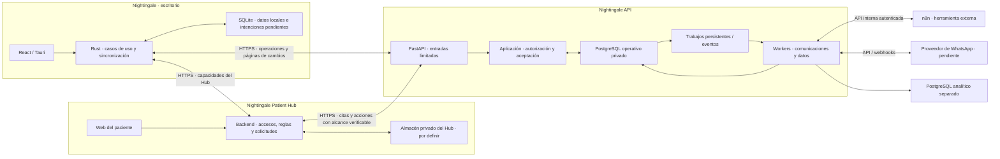

# Arquitectura propuesta

**Fecha:** 2026-10-21. **Estado:** propuesta; los límites confirmados proceden de [la especificación](nightingale-api.md). Los nombres de componentes no obligan a crear carpetas ahora.

## Tres proyectos



Solo API y sus procesos autorizados acceden al PostgreSQL operativo. La flecha de workers permite escribir datos de su módulo; cambiar una cita exige el mismo caso de aceptación. Los trabajos nacen con el commit, pero se ejecutan después. El diagrama no representa una transacción entre proyectos.

## Organización interna

```text
src/
├── application.py          # composición y recursos del proceso
├── api/
│   └── <componente>/
│       ├── domain/         # reglas, conceptos y errores propios
│       ├── application/    # casos de uso y límite de transacción
│       ├── infrastructure/ # HTTP, entradas de workers y proveedores
│       └── repository/     # modelos persistentes, consultas y adaptadores SQL
├── core/                   # soporte técnico con uso concreto
└── settings/               # configuración por entorno y validación
```

`api/` agrupa capacidades, incluidas las que no exponen HTTP. No es solo una colección de rutas. `application.py` conecta adaptadores, rutas y recursos; no acepta citas ni decide permisos. Los procesos de worker reutilizan esa composición con su configuración y permisos, sin arrancar un servidor por obligación.

El adaptador HTTP valida la forma y traduce errores; la aplicación coordina; el dominio decide reglas; el repositorio adapta persistencia. El dominio no importa frameworks, modelos SQL ni esquemas HTTP. Los esquemas de transporte se colocan junto al adaptador, sin convertirlos en entidades del dominio.

Una función o un tipo simple bastan cuando expresan el caso. Un puerto tiene sentido al separar una regla del almacenamiento, sustituir un proveedor o probar coordinación. Sus contratos viven junto a su consumidor en dominio o aplicación. No se exige una interfaz y una clase por consulta. La aplicación depende de esas capacidades; la composición suministra los adaptadores. No filtra sesiones SQL ni modelos ORM a los casos de uso.

`core/` puede administrar conexiones, correlación y soporte de transacciones. No contiene reglas de Citas, un repositorio universal ni un modelo global del producto. `settings/` valida configuración antes de aceptar tráfico, con precedencia documentada y secretos fuera del código. Crear los recursos al iniciar y cerrarlos al parar evita conexiones al importar módulos; [FastAPI documenta ese ciclo mediante lifespan](https://fastapi.tiangolo.com/advanced/events/).

## Componentes y propiedad propuesta

| Componente | Datos y comportamiento propios | Dependencias permitidas |
|---|---|---|
| `access` | Cuentas profesionales, pertenencias, roles, dispositivos y estado de acceso remoto; adaptación de identidad externa | Proveedor de identidad por decidir; expone contexto y comprobación de autorización |
| `patients` | Datos administrativos mínimos, contacto, actividad y versiones de pacientes | Autorización de `access` |
| `services` | Catálogo, actividad y reglas de duración por concretar | `access` |
| `schedule` | Horarios, excepciones, bloqueos, ausencias del profesional y zona aplicable | `access`; no mantiene otra reserva |
| `appointments` | Intervalos ocupados, transiciones, confirmación, asistencia e historial | Contratos de `access`, `patients`, `services`, `schedule`; usa registro de aceptación de `sync` y auditoría |
| `sync` | Registro de operaciones/resultados, Change Log, cursores y recuperación remota | Despacha a casos de aplicación registrados por composición; no importa sus repositorios |
| `waitlist` | Entradas, preferencias, ofertas, vencimientos y resultado de asignación | Consultas autorizadas de pacientes/servicios; pide asignación a `appointments` |
| `communications` | Planificación de recordatorios, trabajos, intentos, entregas y recepción de webhooks; adaptación de n8n | Hechos aceptados y lecturas limitadas de Citas; Hub para accesos, sin poseerlos |
| `analytics` | Consumo incremental, cursor ETL y proyecciones de indicadores básicos | Eventos/lecturas autorizadas; PostgreSQL analítico separado |
| `audit` | Evidencia de acciones y consulta autorizada; política de acceso y retención | Contexto validado y hechos del caso de uso; no usa logs como sustituto |

La agrupación de cuenta/dispositivo en Acceso y de comunicaciones en un componente reduce límites sin comportamiento independiente hoy. Se divide si un caso aprobado lo necesita; no anticipa servicios separados.

Cada componente escribe solo sus datos. Las referencias entre cuentas deben ser coherentes también en las restricciones SQL. Las consultas entre componentes usan una interfaz de lectura, una proyección o un caso compuesto; no importan modelos ni escriben tablas ajenas. Citas consulta Agenda; Agenda conserva sus reglas y no consulta Citas por una dependencia circular. Una consulta compuesta calcula disponibilidad usando reglas de Agenda y ocupación de Citas.

Cambiar agenda, actividad de paciente/servicio o permisos debe coordinarse con las reservas concurrentes. Una lectura previa no basta. T06 definirá el orden de bloqueos, las versiones y restricciones, y qué hacer con citas existentes. No se fijan ahora tablas ni aislamiento SQL.

## Aceptación y transacciones

1. La entrada autentica y obtiene el contexto permitido. Una operación completa identifica intención, objeto, versión y datos mínimos según [el contrato](contracts.md).
2. El caso de aplicación abre una transacción por operación. Coordina autorización vigente y sus carreras con revocaciones, clave idempotente y reglas del componente.
3. Los adaptadores de los propietarios usan esa misma transacción: efecto y versión, historial, auditoría, resultado, Change Log e intención duradera de trabajo derivado. Ningún repositorio hace un commit parcial. Una unidad de trabajo pequeña puede ofrecer esta coordinación sin un sistema genérico de comandos.
4. La API responde tras el commit. Un reintento vuelve a autorizar antes de devolver un resultado anterior. Si el commit tiene resultado desconocido para el proceso, consulta/reintenta la misma identidad de operación para averiguarlo.

El caso del componente delimita la transacción; `sync` aporta registros técnicos a ese límite, sin abrir otro commit. Un fallo revierte el conjunto. La política de persistencia de rechazos, sus claves y sus reintentos queda en T05: un fallo temporal no puede fijar para siempre un resultado que impida reintentar.

Las restricciones finales protegen versiones, referencias por cuenta y reservas incompatibles aunque lleguen dos conexiones a la vez. Una reprogramación cambia intervalo e invalida confirmación dentro de la misma aceptación. Si falla, conserva la reserva anterior. El lote transporta operaciones independientes; sus dependencias causales y fallos parciales no crean un commit global.

## Descarga y recuperación

`sync` devuelve páginas autorizadas, versiones y bajas lógicas. La elección del orden confirmado y del vínculo snapshot/cursor bloquea su implementación hasta T05. Una secuencia asignada antes de confirmar no prueba el orden de commit; [PostgreSQL documenta el comportamiento especial de las secuencias](https://www.postgresql.org/docs/18/transaction-iso.html).

Propuesta a comparar: contador transaccional por cuenta con coordinación de todos sus escritores, frente a publicación ordenada desde hechos ya confirmados con una frontera de lectura segura. La primera puede limitar concurrencia; la segunda introduce demora y recuperación de publicación. No se elige ninguna sin demostrar orden, continuidad y coste. Snapshot y descarga deben compartir una frontera coherente, incluidas eliminaciones y cambios de permisos. El escritorio aplica página y cursor en una transacción SQLite y conserva sus intenciones; ese código pertenece a su repositorio.

## Hub y trabajo posterior

El Hub valida sus enlaces y reglas. API exige una prueba de alcance por cita/acción que pueda verificar, además de autenticar al servicio. Usa el caso de Citas común y devuelve un resultado consultable. Hub conserva su solicitud de reprogramación; el personal define otro horario. No hay cambio ni reserva al pedirlo. La conciliación entre ambos almacenes usa la misma operación y estados conocidos; no una transacción distribuida. El ciclo de solicitud y `reschedule_requested` sigue abierto.

Los workers reclaman trabajo persistente, registran intento y recuperan trabajo interrumpido según una política aprobada. Revalidan cita, versión y permiso antes de un envío. Cancelar o reprogramar invalida trabajo obsoleto, sin prometer retirar un mensaje ya enviado. Las colas llevan referencias mínimas. No se deduce entrega única externa de una clave local: ante timeout se consulta al proveedor o se deriva a revisión antes de repetir.

n8n obtiene trabajo y registra resultados mediante acceso interno limitado; no ejecuta SQL operativo. ETL conserva su avance con los efectos en el almacén analítico y admite repetición. El panel consulta proyecciones, sin cargar el flujo operativo con informes costosos. Broker, proveedor, frecuencias y retenciones siguen [pendientes](decisions.md).
