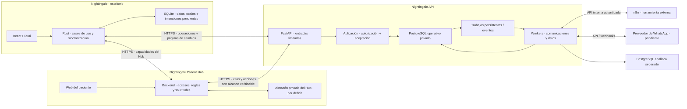

# Arquitectura de API

**Actualizada:** 2026-10-26. **Estado:** C01–C04 y C12–C15 aceptados. T13–T15 añaden el componente patients para revisión C05: fichas/documentos, contactos/vínculos y completitud, coordinados con la aceptación existente. Los límites funcionales proceden de [la especificación](nightingale-api.md). No crear carpetas sin uso concreto.

## Tres proyectos



Solo API y sus procesos autorizados acceden al PostgreSQL operativo. La flecha de workers permite escribir datos de su módulo; cambiar una cita exige el mismo caso de aceptación. Los trabajos nacen con el commit, pero se ejecutan después. El diagrama no representa una transacción entre proyectos.

## Organización interna

```text
src/
├── application.py          # composición y recursos del proceso
├── api/
│   └── <componente>/
│       ├── domain/         # esquemas, objetos de valor, tipos y errores
│       ├── application/    # casos de uso y límite de transacción
│       ├── infrastructure/ # solo endpoints y su configuración
│       └── repository/     # modelos SQLAlchemy y DAOs derivados de la base
├── core/                   # soporte técnico con uso concreto
└── settings/               # configuración por entorno y validación
```

`api/` agrupa capacidades, incluidas las que no exponen HTTP. No es solo una colección de rutas. `application.py` conecta adaptadores, rutas y recursos; no acepta citas ni decide permisos. Los procesos de worker reutilizan esa composición con su configuración y permisos, sin arrancar un servidor por obligación.

La referencia de estilo es `api/users`. El endpoint recibe esquemas de `domain`, llama al caso de uso y traduce `Ok`/`Err` a HTTP. `infrastructure` no contiene esquemas, helpers ni proveedores. Los esquemas de entrada y salida heredan del `BaseModel` de `core/schema`; Python usa snake_case y el JSON público usa sus alias camelCase. Los tipos y errores del dominio no dependen de FastAPI ni SQLAlchemy.

Los casos de uso aplican reglas y llaman a DAOs, sin construir consultas ni llamar execute, scalar, add o flush sobre sesiones. SQLAlchemy solo puede aparecer en anotaciones de tipos bajo TYPE_CHECKING, como en `users`. Los DAOs heredan de `core/db/dao.py` y extienden sus métodos cuando hace falta; no crear funciones de persistencia sueltas ni otra base. Una función o un tipo simple bastan para coordinar un caso; no se exige una clase o interfaz por acción.

`core/db` conserva el DAO base, el motor y la fábrica de sesiones del usuario. Una función pequeña permite delimitar la transacción sobre la sesión recibida; no crea otra sesión ni oculta commits parciales. Las rutas usan Depends(get_db), sin lifespan para la base de datos. La app sigue siendo un objeto de módulo y arranca con Uvicorn directo. `core/services` aloja soporte concreto para OIDC y credenciales, sin reglas de cuenta. `settings/` conserva configuración por tema y secretos fuera del código.

Los errores HTTP y la correlación se resuelven en soporte común; no añadir Request a cada endpoint solo para generar un error. Los workflows administrativos pequeños viven en `scripts/`; el servidor no depende de ellos. No crear un sistema de subcomandos ni seeders sin una necesidad actual.

## Componentes y propiedad propuesta

| Componente | Datos y comportamiento propios | Dependencias permitidas |
|---|---|---|
| `authorization` | Identidad autenticada, credenciales y dispositivos globales | Soporte OIDC y credenciales de core/services; expone casos de uso y tipos de identidad |
| `accounts` | Cuentas, pertenencias, perfil profesional y autorización de dispositivos por cuenta | Casos de uso y tipos de authorization y sync; expone contexto y permisos por cuenta |
| `patients` | Datos administrativos mínimos, contacto, actividad y versiones de pacientes | Casos de autorización de accounts |
| `services` | Catálogo propio del profesional, ofertas por cuenta y duración según el esquema vigente | Casos de autorización de accounts |
| `schedule` | Horarios, excepciones, bloqueos, ausencias del profesional y zona aplicable | accounts; no mantiene otra reserva |
| `appointments` | Intervalos ocupados, transiciones, confirmación, asistencia e historial | Casos de uso y tipos de accounts, patients, services y schedule; sync y auditoría en la misma transacción |
| `sync` | Registro de operaciones/resultados, Change Log, avance incremental y recuperación remota | Casos de uso por composición; sus modelos y DAOs poseen el acceso a sus datos |
| `waitlist` | Entradas, preferencias, ofertas, vencimientos y resultado de asignación | Consultas autorizadas de pacientes/servicios; pide asignación a `appointments` |
| `communications` | Planificación de recordatorios, trabajos, intentos, entregas y recepción de webhooks; adaptación de n8n | Hechos aceptados y lecturas limitadas de Citas; Hub para accesos, sin poseerlos |
| `analytics` | Consumo incremental, cursor ETL y proyecciones de indicadores básicos | Eventos/lecturas autorizadas; PostgreSQL analítico separado |
| `audit` | Evidencia de acciones y consulta autorizada; política de acceso y retención | Contexto validado y hechos del caso de uso; no usa logs como sustituto |

El usuario exige separar cuentas de autenticación/autorización global. `access` era la agrupación anterior y ya no tiene módulos fuente ni imports; no es un tercer propietario. Esta corrección conserva las tablas físicas y la evidencia histórica.

Cada componente escribe solo sus datos. Las referencias entre cuentas deben ser coherentes también en las restricciones SQL. Entre componentes se consumen casos de uso y tipos de dominio, nunca repositorios o modelos persistentes ajenos. Los casos coordinados reciben la misma sesión y no abren otra transacción. Citas consulta Agenda sin crear una dependencia circular.

Cambiar agenda, actividad de paciente/servicio o permisos debe coordinarse con las reservas concurrentes. Una lectura previa no basta. El esquema vigente propone la coordinación por profesional y el tratamiento de citas existentes. T06 concreta los acuerdos restantes antes de implementarlos, sin dar por probada la concurrencia.

El [esquema de base de datos](database-schema.md) es la única fuente vigente del modelo de datos y sus reglas físicas. Sustituye el borrador lógico anterior y las restricciones de D07 que contradiga. No es un modelo ORM global ni autoriza crear tablas; sus pendientes afectan solo al trabajo que los necesita.

## Aceptación y transacciones

1. La entrada autentica y obtiene el contexto permitido. Una operación completa identifica intención, objeto, versión y datos mínimos según [el contrato](contracts.md).
2. El caso de aplicación abre una transacción por operación. Coordina autorización vigente y sus carreras con revocaciones, clave idempotente y reglas del componente.
3. Los DAOs de los propietarios usan esa misma transacción con commit=False: efecto y versión, historial, auditoría, resultado, Change Log e intención duradera de trabajo derivado. El soporte de core/db confirma al salir sin error o revierte ante un fallo. No añadir una capa de clases de unidad de trabajo ni un sistema de comandos.
4. La API responde tras el commit. Un reintento vuelve a autorizar antes de devolver un resultado anterior. Si el commit tiene resultado desconocido para el proceso, consulta/reintenta la misma identidad de operación para averiguarlo.

El caso del componente delimita la transacción; `sync` aporta registros técnicos a ese límite, sin abrir otro commit. Un fallo revierte el conjunto. La política de persistencia de rechazos, sus claves y sus reintentos queda en T05: un fallo temporal no puede fijar para siempre un resultado que impida reintentar.

Las restricciones finales protegen versiones, referencias por cuenta y reservas incompatibles aunque lleguen dos conexiones a la vez. Una reprogramación cambia intervalo e invalida confirmación dentro de la misma aceptación. Si falla, conserva la reserva anterior. El lote transporta operaciones independientes; sus dependencias causales y fallos parciales no crean un commit global.

## Descarga y recuperación

Los listados y los elementos del snapshot usan page/shows y LIMIT/OFFSET en DAO; devuelven items/total, con orden estable y filtros de autorización antes de paginar y contar. No hay cursores de página, firmas ni configuración para ellos. Una lista normal puede cambiar entre peticiones; el snapshot materializado ofrece una descarga coherente.

El avance incremental de sync se conserva separado de esa paginación: D09 fija un contador transaccional por cuenta y grupos completos, con frontera compartida por snapshot y cambios. OFFSET no sustituye la posición del último cambio aplicado. Una secuencia asignada antes de confirmar no prueba el orden de commit; [PostgreSQL documenta ese comportamiento](https://www.postgresql.org/docs/18/transaction-iso.html). Sus pruebas siguen pendientes de T28–T30. El escritorio aplica datos y avance juntos en SQLite y conserva sus intenciones; ese código pertenece a su repositorio.

## Hub y trabajo posterior

El Hub valida sus enlaces y reglas. API exige una prueba de alcance por cita/acción que pueda verificar, además de autenticar al servicio. Usa el caso de Citas común y devuelve un resultado consultable. Hub conserva su solicitud de reprogramación separada del estado de cita, según P05; el personal define otro horario. Pedir cambio no altera estado, horario ni confirmación. La conciliación entre ambos almacenes usa la misma operación y estados conocidos; no una transacción distribuida. El ciclo detallado de solicitud sigue abierto en O04. P06 separa interés por una oferta de su reserva, que autoriza el personal. Ambos criterios son revisables por el usuario al implementar.

Los workers reclaman trabajo persistente, registran intento y recuperan trabajo interrumpido según una política aprobada. Revalidan cita, versión y permiso antes de un envío. Cancelar o reprogramar invalida trabajo obsoleto, sin prometer retirar un mensaje ya enviado. Las colas llevan referencias mínimas. No se deduce entrega única externa de una clave local: ante timeout se consulta al proveedor o se deriva a revisión antes de repetir.

n8n obtiene trabajo y registra resultados mediante acceso interno limitado; no ejecuta SQL operativo. ETL conserva su avance con los efectos en el almacén analítico y admite repetición. El panel consulta proyecciones, sin cargar el flujo operativo con informes costosos. Broker, proveedor, frecuencias y retenciones siguen [pendientes](decisions.md).
