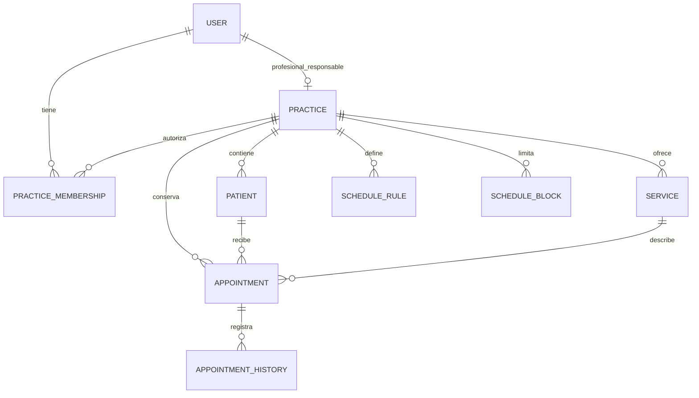

# Diseño lógico de datos · primer borrador

> **Retirado el 2026-10-24 por instrucción del usuario.** No se usa para diseño ni implementación. La única fuente vigente es [database-schema.md](database-schema.md). El texto siguiente se conserva como antecedente y no expresa reglas actuales.

**Versión:** 0.1. **Fecha:** 2026-10-23. **Estado:** Draft, para revisión del usuario. Solo D07 y los acuerdos previos están confirmados; las entidades, campos y relaciones siguientes son una propuesta. No hay DDL, migraciones ni cambios en los modelos Python.

## Alcance y fuentes

Primero se diseña el PostgreSQL operativo que posee Nightingale API. SQLite y el almacén privado del Hub conservan sus propios modelos; no se propone un esquema físico común a los tres proyectos. Analítica mantiene su almacén separado.

Fuentes leídas:

- [Especificación API 0.2](nightingale-api.md), [arquitectura](architecture.md), [contratos](contracts.md), [diseño de acceso](access-design.md) y [decisiones](decisions.md), incluidos P05/P06 y D07.
- En el repositorio original `C:/Users/Pedro/Documents/GitHub/nightingale`, `docs/master-plan.md` 0.3, §§9, 13–15; `docs/technical-architecture.md` 0.3, §§11–13; y `docs/srs.md` 0.5, §9, con la revisión documental del 2026-10-23. Lectura directa tras el traslado del usuario, sin copiar ni modificar esos archivos ni cambiar sus rutas.
- Estado actual: `src/api/users/repository/models.py`, modelos de entrada/salida de usuarios y soporte de persistencia. El código existente es una entrada de revisión, no una decisión de esquema final.

Este documento posee la propuesta de diseño de datos; el registro de decisiones posee los acuerdos del usuario. No define contratos HTTP ni reemplaza los acuerdos de T04–T06.

## Reglas confirmadas

Según [D07](decisions.md#d07--bases-del-modelo-de-datos):

1. La primera versión evita solapamientos del tiempo del profesional; no reserva consultorios o equipos como recursos adicionales.
2. El servicio aporta una duración por defecto y el personal puede ajustarla al crear la cita.
3. Para registrar una cita, el paciente debe tener nombre, teléfono y documento.
4. Un profesional tiene una sola cuenta profesional; el alcance inicial sigue siendo ese profesional y sus asistentes.

También se conservan aislamiento por cuenta, permisos vigentes al aceptar, operación local sin red y aceptación remota atómica. Pedir reprogramación no altera el estado de cita; responder a una oferta expresa interés y el personal autoriza la reserva.

## Relaciones propuestas del núcleo

Una cuenta representa el ámbito del profesional independiente y sus asistentes. Con una cuenta por profesional, la propuesta comprueba ocupación por `practice_id`: no necesita copiar otro identificador de recurso a cada cita. Se propone `practice.professional_user_id` para vincular el profesional a su usuario interno, con una sola cuenta como profesional por usuario. El diagrama muestra esa propuesta de vínculo, no una tabla de perfiles nueva ni un acuerdo físico ya aprobado.

La pertenencia define el acceso por cuenta; ser asistente no convierte a una persona en el profesional cuyo tiempo se reserva. El alta y la verificación del vínculo al profesional siguen en el diseño de acceso; una cuenta o un rol declarados por el cliente no los prueban.

## Entidades y campos propuestos

Los nombres expresan un diseño lógico; todavía no son clases ORM ni tablas creadas. Cada referencia operativa debe pertenecer a la misma cuenta. No se añaden todas las columnas técnicas por herencia sin revisar su uso.

| Entidad / propietario | Campos iniciales propuestos | Regla o decisión pendiente |
|---|---|---|
| `practice` / acceso | `id`, `professional_user_id`, nombre administrativo, zona horaria, estado | Una cuenta por profesional confirmada. Se propone vínculo único al usuario interno y pertenencia autorizada del profesional; comprobar el alta/vínculo antes del esquema físico |
| `user` / acceso | `id`, nombre, estado, emisor y sujeto OIDC | Propuesta mínima: un vínculo OIDC por usuario, sin contraseña local. Si hacen falta varias identidades por persona, revisar su separación antes del esquema físico |
| `practice_membership` / acceso | `id`, `practice_id`, `user_id`, estado de acceso, versión de permisos | Propuesta: una pertenencia actual por pareja cuenta/usuario. Roles y permisos concretos dependen de T04; no fijar un rol global como permiso para todas las cuentas |
| `device` / acceso | `id`, usuario que lo registra, estado de autorización, última actividad, versión reportada | El vínculo de sesión y el alcance por cuenta siguen pendientes; el ID declarado no autentica al dispositivo |
| `patient` / pacientes | `id`, `practice_id`, nombre, teléfono, documento, estado activo, versión | Los tres datos personales son obligatorios para registrar la cita. Formato del documento, validación y duplicados por decidir; no suponer teléfono o documento globalmente únicos |
| `service` / servicios | `id`, `practice_id`, nombre, duración por defecto, estado activo, versión | Duración positiva; cambiar el valor por defecto no cambia citas ya guardadas |
| `schedule_rule` / agenda | `id`, `practice_id`, día o patrón local, hora local de inicio/fin, periodo de vigencia, versión | Propuesta: reglas habituales en hora local de la cuenta; patrón de repetición y excepciones por cerrar |
| `schedule_block` / agenda | `id`, `practice_id`, inicio/fin UTC, motivo administrativo limitado, versión | Afecta al tiempo del profesional de la cuenta; no introduce recursos de consultorio. Definir qué ocurre con citas ya aceptadas al crear un bloqueo |
| `appointment` / citas | `id`, `practice_id`, `patient_id`, `service_id`, inicio/fin UTC, estado de negocio, versión | Se guarda el intervalo real aceptado, que puede diferir de la duración por defecto del servicio; la cuenta identifica el tiempo del profesional |
| `appointment_history` / citas | `id`, cuenta/cita, versión de cita, acción, cambio de intervalo/estado, actor comprobado, instante del servidor, operación de origen | Propuesta de historial por versión aceptada; no sustituye auditoría ni guarda cuerpos personales completos |

La ubicación puede ser un dato administrativo visible al paciente sin convertirse en otro recurso que bloquee la agenda. La necesidad de varias ubicaciones y su conservación histórica sigue pendiente; la elección de bloquear solo tiempo del profesional no la resuelve.

Para entidades que Rust crea sin red se conserva la regla del escritorio de generar UUID. El tipo de ID de usuarios u otras entidades solo remotas se revisará por separado; no se convierte automáticamente cada entero existente ni se impone un mismo tipo a todos los modelos.

## Cita y duración

Propuesta: inicio y fin del intervalo constituyen la duración efectiva de la cita. No se recalcula desde el servicio cada vez que se consulta. La política debe definir precisión, mínimos/máximos y permisos para el ajuste; estos valores no se eligen por defecto aquí.

Se propone conservar el nombre, duración por defecto y versión del servicio al reservar, o una referencia a una versión histórica recuperable. Antes del diseño físico se elegirá una sola forma de conservar esa información. No basta guardar una versión si el contenido de esa versión deja de existir.

Ejemplo ficticio: el servicio propone 30 minutos y el personal crea una cita de 45. Si después cambia el servicio a 20 minutos, la cita conserva su intervalo de 45 y su historial. Ajustar la duración durante una reprogramación requiere su regla propia; la autorización actual solo concreta el ajuste al crear.

Las reglas de integridad deben cubrir:

- Paciente y servicio válidos y de la cuenta autorizada; nombre, teléfono y documento presentes al registrar la cita.
- Inicio anterior al fin; intervalo dentro de las reglas permitidas y sin bloqueo incompatible.
- Ninguna reserva incompatible en el intervalo dentro de la cuenta, que representa el tiempo de su único profesional. Mantener la regla de una cuenta por profesional es parte de esta protección; cualquier ampliación futura exige revisar la restricción.
- Versión esperada vigente y transición permitida; no aceptar una asignación libre de `status`.
- Reprogramación: nuevo intervalo e invalidación de confirmación juntos; si falla, permanece la reserva anterior.
- Conservar historial al cancelar; separar estado de negocio de los estados de sincronización de cada dispositivo.

El mecanismo SQL de exclusión, coordinación con bloqueos y cambios de servicio/permiso, y el conjunto exacto de estados que ocupan tiempo se diseñarán antes de implementar. Un diagrama o una comprobación previa aislada no acreditan las carreras de dos conexiones PostgreSQL.

## Soporte que también necesita diseño

| Área | Datos previstos | Límite del borrador |
|---|---|---|
| Aceptación y sincronización | Identidad/contenido de operación, resultado recuperable, versión, cambios autorizados y recuperación | Cuenta y actor comprobados; clave repetida no repite efecto. Orden de cambios, cursor y retenciones siguen en T05; no se elige una secuencia como prueba de orden de commit |
| Auditoría | Actor, cuenta, objeto, acción, resultado y correlación | Sin secretos ni cuerpos personales innecesarios; acceso y retención por definir |
| Trabajos y comunicaciones | Trabajo persistente, cita/versión, intentos, estado de entrega, resultado desconocido | Intención duradera con la aceptación; llamadas externas después del commit; conciliación antes de repetir un envío de resultado desconocido |
| Lista de espera | Entrada, preferencias, oferta/vencimiento, interés y resultado de asignación | P06 exige asignación por personal. Tablas y ciclo exactos dependen del acuerdo de prioridad, canal y vencimiento |
| Autorización del Hub | Alcance verificable por cita/acción y su revocación | No escoger un formato o tabla de concesiones antes de cerrar T04 |

La operación aceptada debe conservar efecto, versión, historial, auditoría, resultado, Change Log e intención de trabajo derivado en el límite atómico acordado. El diseño físico no puede convertirlos en commits separados por comodidad de cada tabla.

Los enlaces/sesiones del paciente y `reschedule_request` pertenecen al almacén privado del Hub, no al esquema operativo de API. Los datos de espera y de recordatorios no justifican copiar enlaces secretos a auditoría o a todas las páginas de sync. Las proyecciones analíticas pertenecen al almacén analítico.

## Revisión del modelo actual de usuarios

El modelo actual contiene ID entero autogenerado, `external_id` sin emisor, `role_id` directamente en el usuario, correo único y `password`. No define todavía cuenta/pertenencia/dispositivo. Por eso no se toma como modelo final del producto.

La propuesta separa identidad de permiso por cuenta, conserva un vínculo OIDC verificable y no requiere una contraseña local con el proveedor externo aprobado. La unicidad de correo y el tipo del ID interno requieren revisión propia. Nada de ello se cambia en código por este borrador.

## Siguiente revisión antes del esquema físico

1. Cuenta y profesional: revisar la propuesta de vínculo único al usuario interno, su alta y su coherencia con las pertenencias; una cuenta por profesional ya está confirmada.
2. Paciente: concretar tipo/país/número del documento, formato de teléfono, tratamiento de duplicados y si un dato de contacto puede compartirse. No inferir una restricción única global de la obligación de registrar el dato.
3. Operación: cerrar reglas de intervalos y ajustes, estados, cambio de bloqueos/servicios frente a citas, pertenencias/dispositivos y conservación de datos históricos.

Después de esa revisión se podrá escribir el diccionario físico: columnas y tipos SQL, obligatoriedad, claves, referencias por cuenta, restricciones, índices derivados de consultas reales y límite de transacciones. El diseño técnico de sync requiere además T05. No se crearán tablas ni migraciones para validar solo esta propuesta.

## Comprobación de esta entrega

Se revisan texto, enlaces nuevos y trazabilidad a decisiones/casos ficticios; la evidencia se registra en la lista de control del plan después de comprobar. Sin pruebas de PostgreSQL, ejecución de consumidores o render de Mermaid. Este borrador no declara el diseño aceptado ni la base de datos definida por completo.
