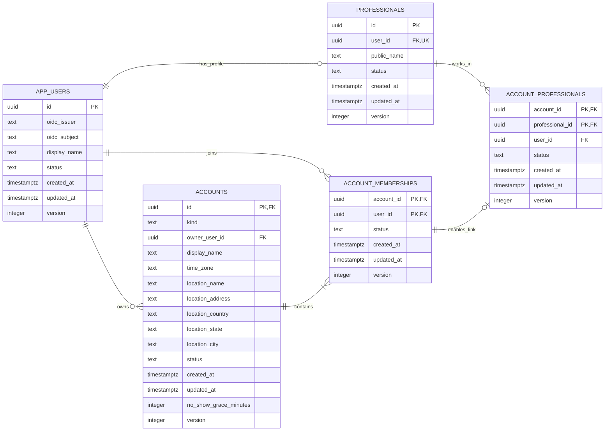
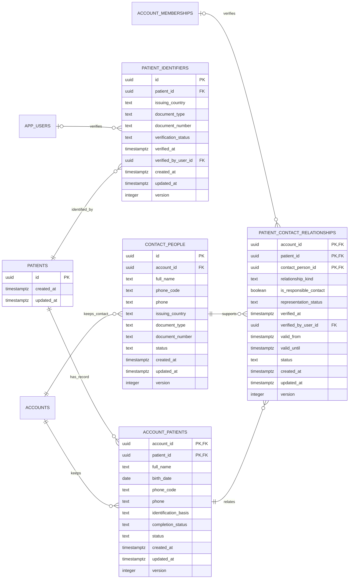
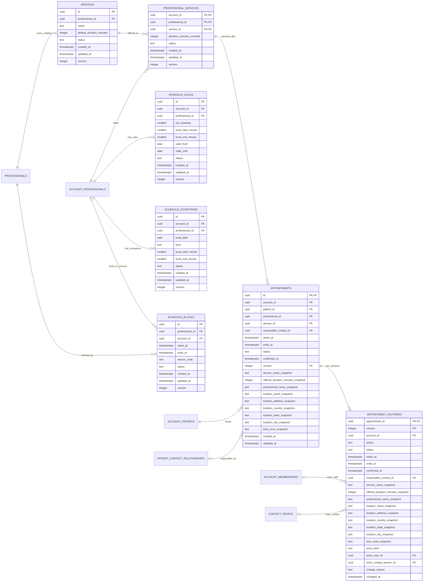
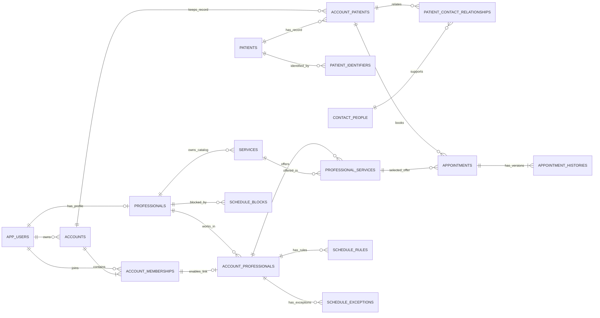
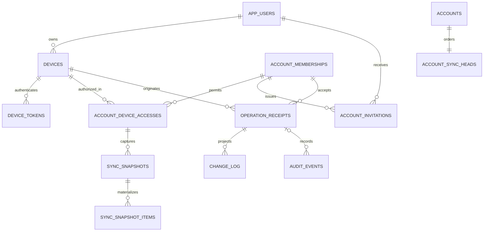

# Esquema de base de datos de Nightingale

**Versión:** 1.1; conserva la ampliación 1.0 aceptada en C01 y añade el soporte de T31.\
**Fecha:** 2026-10-28.\
**Estado:** base 0.3 y revisión 0.9 conservan sus aceptaciones históricas; ampliación 1.0 aceptada en T03/C01. C09/C10 aceptados. T31 añade soporte SSE: migración 20261028_01, 28 tablas y btree_gist, probada en bases ficticias aisladas. T31–T33 para revisión C11. C07/C08 conservaron autorización de paso sin aceptaciones separadas. Consumidores y producción siguen pendientes.\
**Motor del diseño:** PostgreSQL. Referencia técnica: documentación oficial de PostgreSQL 18; no fija la versión de un despliegue.  
**Propietario de los datos operativos:** Nightingale API.  
**Fuente del diseño:** este documento, por instrucción expresa del usuario.

Es la única fuente vigente para el modelo de datos y el esquema. `docs/data-model.md` queda retirado; sus reglas y las de D07 que este documento sustituye no se usan para diseñar o implementar. El usuario aceptó la revisión 0.8 y sus propuestas 2 y 3 al responder «Listo, todo bien». La revisión 0.9 las incorpora al diccionario y a los diagramas; §8.10 registra el alcance.

Lectura por grupos: [cuentas y profesionales](#3-cuentas-usuarios-y-profesionales), [pacientes y contactos](#4-pacientes-y-contactos), [servicios y agenda](#5-servicios-y-agenda), [citas e historial](#6-citas-e-historial), [diagrama general](#7-vista-general-del-esquema) y [revisión del conjunto](#8-revisión-del-conjunto).

## 1. Alcance y lectura

Este documento describe el esquema físico propuesto: tablas, columnas, tipos de PostgreSQL, nulabilidad, valores por defecto, claves, restricciones, índices, cardinalidades y conservación. No contiene SQL ni instrucciones para crear modelos o bases de datos.

La entrega cubre cuentas, usuarios, profesionales, pacientes, contactos responsables, servicios, agenda, citas e historial funcional de citas. Los nombres y detalles físicos son propuestas revisables; no acreditan tablas existentes ni funciones implementadas.

El núcleo original no cubre SQLite, sincronización, auditoría técnica, comunicaciones, lista de espera, APIs, migraciones o código de aplicación. La ampliación documental de §9 añade solo soporte físico de acceso, sincronización y auditoría de esta etapa; el transporte sigue en api-v1.md. No define datos clínicos, inventario, facturación o archivos médicos ni campos genéricos anticipados.

### 1.1 Estado de las decisiones

| Marca | Significado |
|---|---|
| Acuerdo | El usuario lo definió o aprobó en esta conversación. |
| Propuesta física | Una elección de tablas, columnas o restricciones para revisar. |
| Pendiente | Aún no hay una decisión suficiente; no permite deducir una regla automática. |

La aprobación del plan autoriza redactar esta propuesta. Cada revisión de etapa acepta o cambia sus decisiones físicas por separado.

### 1.2 Acuerdos del 2026-10-23

- El primer uso se centra en consultorios independientes. Las relaciones admitirán clínicas y personas en varias cuentas, sin desarrollar ahora gestión clínica avanzada.
- Un profesional siempre tiene usuario. Puede poseer su consulta independiente y trabajar en varias clínicas. Un asistente tiene una sola identidad aunque pertenezca a varias cuentas.
- Cada cuenta tiene un lugar de atención. El tiempo del profesional no puede reservarse simultáneamente en cuentas distintas.
- Una identidad interna identifica al paciente; sus fichas y contactos por cuenta no dan acceso entre consultas.
- Se admiten cédula y pasaporte venezolanos. Un paciente puede tener varios documentos propios.
- Una ficha puede guardarse como borrador y completarse después; completitud y actividad son estados distintos.
- Un menor sin documento propio puede tener cita con nombre, fecha de nacimiento y contacto responsable. Su documento queda pendiente; el del adulto no identifica al menor.
- El contacto responsable no necesita ser paciente ni usuario. Parentesco, representación declarada, representación verificada y permiso son conceptos distintos.
- Coincidencias de nombre, teléfono o representante no unen pacientes automáticamente. Añadir un documento conserva la identidad e historial del menor.
- Las citas pasadas siguen siendo citas; su historial describe modificaciones. La duración real no se recalcula por cambiar el servicio.

Estos acuerdos sustituyen, para este diseño, la lectura anterior que limitaba todas las cuentas a un profesional o exigía documento propio a todo paciente antes de citar. Concretan también la identidad común del profesional entre cuentas. Conservan el aislamiento y la separación de responsabilidades del producto.

### 1.3 Cambios solicitados el 2026-10-24

Estos acuerdos actualizan la propuesta aceptada el día anterior:

- Para agendar basta registrar los datos del documento propio; no se exige verlo físicamente ni verificarlo antes. La comprobación es independiente de la reserva y de la completitud de la ficha. La excepción del menor sin documento se conserva.
- Cada profesional mantiene su catálogo de servicios y elige en qué cuentas los ofrece. Cada oferta por cuenta puede ajustar la duración base del servicio.
- Los identificadores propios usan UUIDv7; las referencias conservan el mismo valor y el tipo PostgreSQL `uuid`.
- Todas las tablas usan nombres en plural, incluidas las tablas de relación y `appointment_histories`. Las columnas de referencia mantienen el singular.
- Cada `phone` tiene un `phone_code` para su prefijo internacional, como `+58`. La pareja puede quedar vacía cuando el teléfono es opcional.
- Los documentos propios del paciente admiten país emisor extranjero y los tipos `national_id` o `passport`. La misma estructura identifica el documento opcional de un contacto.
- El único lugar de atención de la cuenta incorpora país, estado o división equivalente, y ciudad. El país toma `VE` como valor por defecto. Las citas y sus versiones conservan también esos datos del lugar comunicado.

### 1.4 Límites de autoridad

El [plan maestro](master-plan.md), la [arquitectura](technical-architecture.md) y la [SRS](srs.md) conservan sus responsabilidades generales. Las instrucciones expresas de esta conversación concretan el alcance de este documento; no se modifican esas fuentes como efecto de esta entrega.

La ubicación de esta documentación no concede al escritorio acceso SQL. El [reparto de tres proyectos](decisions/transactional-sync-three-projects.md) conserva a Nightingale API como propietario de PostgreSQL operativo. Aquí solo se especifican datos y relaciones.

## 2. Convenciones físicas propuestas

### 2.1 Nombres e identificadores

- Tablas en plural y `snake_case`; columnas en `snake_case`. Las referencias conservan el nombre singular de la entidad, como `account_id`, `patient_id` o `appointment_id`. Los nombres técnicos son ingleses; las explicaciones son españolas.
- `accounts` representa la cuenta, sea independiente o clínica. `account_id` expresa ese ámbito en las tablas de este diseño.
- `app_users` representa a la persona que accede al sistema. Evita usar `user` como nombre físico: PostgreSQL reserva esa palabra. Véase [palabras reservadas](https://www.postgresql.org/docs/18/sql-keywords-appendix.html).
- Las entidades con identidad propia usan una PK `id` UUIDv7 conforme a RFC 9562, de tipo PostgreSQL `uuid`, no nula y estable. Cada `id` propio exige un CHECK de versión 7 y variante RFC 9562; el tipo `uuid` por sí solo admite otras versiones. Las FK conservan el valor de su destino, sin generar otro UUID. Las tablas de relación mantienen sus PK compuestas, sin añadirles un `id`.
- UUIDv7 contiene un componente temporal; no codifica nombre ni documento de la persona ni demuestra autorización. No sustituye `created_at`, `updated_at`, los instantes de citas o el contador de versión; tampoco garantiza el orden real de cambios entre equipos. Esta decisión permite el componente temporal al concretar §11.4 del plan maestro para este diseño. El documento no fija biblioteca, función ni lugar de generación. Fuentes: [RFC 9562, §5.7](https://www.rfc-editor.org/rfc/rfc9562.html#section-5.7) y [PostgreSQL: tipo UUID](https://www.postgresql.org/docs/18/datatype-uuid.html).
- PK significa clave primaria; FK, clave foránea; UQ, unicidad; NN, columna no nula. Los índices se describen aparte de las claves que ya crean su propio índice.

### 2.2 Tipos y valores

| Tipo | Uso previsto | Regla del diseño |
|---|---|---|
| `uuid` | Identificadores UUIDv7 y sus referencias | Mismo tipo en ambos extremos; versión y variante según §2.1; sin valor por defecto salvo indicación expresa. |
| `text` | Nombres, documentos, códigos y zona horaria | Números de documento y teléfono no son cantidades; no pierden prefijos ni ceros por conversión numérica. |
| `date` | Fecha civil, por ejemplo nacimiento | No contiene hora ni sustituye un instante. |
| `timestamptz` | Instantes de creación, cambio y cita | Representa un instante; la zona IANA de la cuenta se conserva por separado. |
| `boolean` | Una condición binaria real | No sustituye un ciclo con varios estados. |
| `smallint` | Valores discretos pequeños y minutos desde medianoche en Agenda | Cada campo documenta su intervalo; 1440 solo representa el fin del día local. |
| `integer` | Duración o cantidades administrativas | Unidad y límites explícitos en cada campo; no se inventan límites de citas en T01. |

Se usa `text` sin longitudes arbitrarias mientras no haya una regla de producto que justifique un límite. Los campos requeridos de texto no admiten una cadena vacía o compuesta solo por espacios. Los códigos enumerados propuestos son `text` con conjunto cerrado documentado, no un ENUM global reutilizado por tablas con significados distintos. Fuentes: [tipos de texto](https://www.postgresql.org/docs/18/datatype-character.html) y [tipos numéricos](https://www.postgresql.org/docs/18/datatype-numeric.html).

`timestamptz` no conserva el nombre de la zona original. Por eso `America/Caracas`, como ejemplo de zona IANA, vive en su propia columna. No se guarda una edad que cambie con el tiempo. Fuente: [fecha, hora y zona](https://www.postgresql.org/docs/18/datatype-datetime.html).

Cada diccionario declara obligatoriedad y valor por defecto por separado. **Sin valor por defecto** significa que el campo requiere un valor explícito cuando es obligatorio; **nulo** solo se permite si la columna lo indica. Un guion en la explicación nunca implica una cadena literal guardada.

Todos los campos `date` y `timestamptz` de este diccionario exigen valores finitos cuando no son nulos, incluidos nacimiento, creación, actualización, verificación, confirmación, cambios y extremos de vigencia. Cada campo lleva un CHECK de finitud: no se admite `infinity` ni `-infinity` como fecha o instante. Los finales abiertos usan exclusivamente el nulo que ya permita la columna; no se añade otra forma de indicar ausencia de fin. Fuente: [PostgreSQL: isfinite](https://www.postgresql.org/docs/18/functions-datetime.html).

Las marcas `created_at` y `updated_at`, cuando figuren, son obligatorias y no tienen valor por defecto en este diseño. La segunda no puede ser anterior a la primera. No se afirma que PostgreSQL actualice esas marcas automáticamente ni se prescribe código para hacerlo.

### 2.3 Claves, restricciones e índices

Las PK y UQ tienen su índice de unicidad; no se añade otro índice con las mismas columnas y orden. Una FK no crea por sí sola un índice en su origen. Los índices adicionales se justifican por búsqueda, relación o control de integridad concretos; no son resultados de una medición.

Una FK compuesta comprobará también el ámbito cuando una relación deba permanecer en la misma cuenta. Sus columnas obligatorias serán NN para evitar que un nulo eluda parte de la referencia. No se presentará un CHECK de fila como garantía sobre datos de otra tabla.

Las reglas entre tablas que no cubran PK/FK/UQ se identificarán por separado, junto con el mecanismo propuesto y la necesidad de comprobar concurrencia. Las restricciones diferidas, cuando se indiquen, deben cumplirse al final de la transacción; no permiten un estado inválido persistido. Fuentes: [restricciones](https://www.postgresql.org/docs/18/ddl-constraints.html), [índices parciales](https://www.postgresql.org/docs/18/indexes-partial.html) y [restricciones disparadas diferidas](https://www.postgresql.org/docs/18/sql-createtrigger.html).

La propuesta conserva identificadores: no actualiza PK ni usa borrado en cascada para eliminar identidad o historia funcional. Cada FK declara el tratamiento de eliminación. Desactivar no borra filas ni rompe referencias; no equivale a resolver una solicitud de supresión de datos, cuya política queda fuera de esta entrega.

### 2.4 Ámbito de los datos

| Ámbito | Significado | Límite |
|---|---|---|
| Global interno | Una identidad de usuario, profesional o paciente, reutilizable en varias relaciones | No es un directorio público ni da acceso entre cuentas. |
| Por cuenta | Pertenencia, ficha administrativa, contacto, oferta de servicio o dato operativo de esa cuenta | Conocer un identificador global no permite consultar estos datos. |
| Por profesional | Catálogo propio y actividad de la misma persona en distintas cuentas | La futura restricción de ocupación debe comprobar toda su actividad, sin revelar detalles de otras cuentas. |

Ejemplo de lectura: Ana es una persona con un usuario y un perfil profesional. Su consulta y una clínica son cuentas distintas; cada una requiere sus propias relaciones. La pertenencia de otra persona a la consulta de Ana no la incorpora automáticamente a la clínica.

### 2.5 Extensión y conservación

Una capacidad nueva añadirá relaciones específicas cuando exista una necesidad definida. No se añaden a las tablas actuales campos JSON de contenido libre, columnas clínicas anticipadas ni un catálogo genérico de atributos.

Los nombres, tipos y restricciones de esta versión son una propuesta objetivo, no una transformación de datos existentes. No se documentan migraciones ni métodos de generación de modelos. Las políticas legales de acceso y retención no se deducen de una edad, un parentesco o un estado de actividad.

### 2.6 Países y teléfonos

`issuing_country` y `location_country` usan `text` con un código ISO 3166-1 alfa-2 en mayúsculas, como `VE`. El CHECK de forma exige dos letras de A a Z; validar que el código esté asignado requiere contrastarlo con el catálogo ISO admitido. No se fija una lista limitada a Venezuela ni se añade una tabla de países en esta revisión. El país emisor, la nacionalidad, la ubicación de la consulta y el prefijo telefónico son datos distintos. Fuente: [ISO 3166](https://www.iso.org/iso-3166-country-codes.html).

`phone_code` y `phone` son `text` y forman una pareja: ambos nulos o ambos presentes, incluso en borradores. No tienen valor por defecto; asignar `+58` sin teléfono dejaría una pareja incompleta. `phone_code` guarda el signo `+` seguido del indicativo internacional asignado, sin espacios; `phone` guarda la parte nacional en dígitos, sin repetir el indicativo ni el prefijo de marcación nacional. Ejemplo ficticio: `+58` y `4120000000`. Los CHECK de forma y pareja no prueban que el número exista o pertenezca a la persona. No se impone unicidad: familiares pueden usar el mismo teléfono.

El prefijo telefónico no sustituye el código ISO de país ni acredita residencia o nacionalidad; distintos países pueden compartir un indicativo. Cuando §4 exige teléfono, exige la pareja completa. Los planes nacionales determinan la longitud y los prefijos de marcación; sus reglas de normalización y validación quedan pendientes antes de aceptar datos reales. Fuente de la estructura internacional: [UIT-T E.164](https://www.itu.int/rec/T-REC-E.164/en).

## 3. Cuentas, usuarios y profesionales

**Estado del grupo:** revisado y aceptado en C01. Las reglas de identidad, pertenencia múltiple y usuario obligatorio del profesional son acuerdos; las propuestas físicas de este grupo se aceptaron para esta primera versión, que admite revisiones posteriores.

| Tabla | Propietario funcional | Ámbito | Propósito |
|---|---|---|---|
| `app_users` | Identidad y acceso | Global interno | Identificar a una persona que accede al sistema. |
| `accounts` | Cuenta | Por cuenta | Identificar consulta independiente o clínica y su único lugar de atención. |
| `account_memberships` | Cuenta y acceso | Por cuenta | Representar la pertenencia de una persona a una cuenta. |
| `professionals` | Profesionales | Global interno | Identificar al profesional cuyo tiempo se reserva, ligado a un usuario. |
| `account_professionals` | Profesionales | Por cuenta | Vincular al profesional con cada cuenta donde atiende. |

Una identidad global no es una ficha de paciente, una sesión ni un permiso global. La propiedad de una cuenta y la condición profesional son relaciones separadas de la pertenencia. La gestión detallada de roles y permisos queda fuera de esta versión del esquema: estas cinco tablas no constituyen por sí solas un sistema completo de autorización.

### 3.1 `app_users`

Una fila por persona que accede al sistema. No se crea una fila por clínica. Médico, asistente, administrador y otros integrantes del equipo pueden tener esta identidad; su condición no se fija mediante un tipo global de usuario.

| Columna | Tipo | Obligatoria | Por defecto | Clave | Significado |
|---|---|---|---|---|---|
| `id` | `uuid` | Sí | Sin valor por defecto | PK; CHECK UUIDv7 | Identidad interna de la persona. |
| `oidc_issuer` | `text` | Sí | Sin valor por defecto | UQ con `oidc_subject` | Emisor de su identidad externa. |
| `oidc_subject` | `text` | Sí | Sin valor por defecto | UQ con `oidc_issuer` | Sujeto dentro de ese emisor. |
| `display_name` | `text` | Sí | Sin valor por defecto | Ninguna | Nombre para identificar a la persona dentro del equipo. |
| `status` | `text` | Sí | `active` | CHECK | `active` o `inactive`; estado de esta identidad. |
| `created_at` | `timestamptz` | Sí | Sin valor por defecto | CHECK finito | Instante de creación de la identidad. |
| `updated_at` | `timestamptz` | Sí | Sin valor por defecto | CHECK temporal; CHECK finito | Instante del último cambio. |
| `version` | `integer` | Sí | 1 | CHECK positivo | Versión autoritativa de esta fila para aceptación optimista; no se deriva de updated_at. |

**Claves y restricciones:** PK en `id`; UQ en `(oidc_issuer, oidc_subject)`. Los dos valores OIDC se comparan exactamente y con distinción de mayúsculas, sin cambiar su contenido para deduplicar. Se propone intercalación determinista `C` para esas columnas. Un correo o nombre coincidente no une identidades. No hay contraseña ni correo obligatorio en esta propuesta. Un vínculo OIDC por usuario es una propuesta de esta versión, no una prohibición de admitir varios mediante una relación futura.

**Índices:** los de PK y UQ cubren consulta por identidad interna y por emisor/sujeto; no se propone índice de nombre ni búsqueda global de personas sin un caso aprobado.

**Cambios y conservación:** `id` permanece estable. Cambiar nombre no crea otro usuario. Desactivar no borra perfil profesional, propiedad o pertenencias; tampoco declara que las cuentas o citas desaparecen. No se eliminan identidades referenciadas. Estas columnas no describen tokens ni su validación.

### 3.2 `accounts`

Una fila por espacio administrativo. La consulta independiente y la clínica usan la misma tabla. En esta propuesta ambas tienen un propietario responsable y un único lugar de atención, sin una tabla anticipada de sedes.

| Columna | Tipo | Obligatoria | Por defecto | Clave | Significado |
|---|---|---|---|---|---|
| `id` | `uuid` | Sí | Sin valor por defecto | PK; parte de FK de propietario; CHECK UUIDv7 | Identidad de la cuenta. |
| `kind` | `text` | Sí | Sin valor por defecto | CHECK | `independent` o `clinic`. |
| `owner_user_id` | `uuid` | Sí | Sin valor por defecto | FK; UQ parcial | Persona propietaria responsable, no un rol global. |
| `display_name` | `text` | Sí | Sin valor por defecto | Ninguna | Nombre administrativo de la cuenta. |
| `time_zone` | `text` | Sí | Sin valor por defecto | Regla de zona | Zona IANA válida, por ejemplo `America/Caracas`. |
| `location_name` | `text` | Sí | Sin valor por defecto | Ninguna | Nombre del lugar de atención de esta cuenta. |
| `location_address` | `text` | Sí | Sin valor por defecto | Ninguna | Calle, edificio y demás datos de dirección del lugar; país, estado y ciudad se guardan aparte. |
| `location_country` | `text` | Sí | `VE` | CHECK de país | País del lugar de atención, según §2.6; no determina la zona horaria. |
| `location_state` | `text` | Sí | Sin valor por defecto | CHECK de texto | Estado o división equivalente; por ejemplo, Lara. |
| `location_city` | `text` | Sí | Sin valor por defecto | CHECK de texto | Ciudad; por ejemplo, Barquisimeto. |
| `status` | `text` | Sí | `active` | CHECK | `active` o `inactive`; actividad de la cuenta. |
| `created_at` | `timestamptz` | Sí | Sin valor por defecto | CHECK finito | Instante de creación. |
| `updated_at` | `timestamptz` | Sí | Sin valor por defecto | CHECK temporal; CHECK finito | Instante del último cambio. |
| `no_show_grace_minutes` | `integer` | Sí | 15 | CHECK 0–1440 | Margen administrativo desde inicio para registrar ausencia manual; no recalcula citas. |
| `version` | `integer` | Sí | 1 | CHECK positivo | Versión autoritativa de esta fila para aceptación optimista; no se deriva de updated_at. |

**Claves y restricciones:** PK en `id`; FK de `owner_user_id` a `app_users.id`; FK compuesta de `(id, owner_user_id)` a `account_memberships.(account_id, user_id)`, diferida al cierre de la transacción. La segunda exige que el propietario pertenezca a su cuenta; no prueba permisos por sí sola. Las referencias y su tratamiento de eliminación aparecen en §3.6.

Se propone un índice único parcial sobre `owner_user_id` para las filas `independent`, incluidas las inactivas: una persona conserva una consulta independiente, aunque además pertenezca a clínicas o sea propietaria de estas. `display_name`, dirección y zona no son únicos. Dos cuentas pueden atender en la misma dirección sin compartir pacientes o permisos.

**Índices:** PK; UQ parcial de consulta independiente; índice B-tree no único en `owner_user_id` para listar todas las cuentas propias, incluidas clínicas. No duplica el parcial, cuyo alcance excluye clínicas.

`location_state` y `location_city` requieren texto no vacío; no son catálogos ni claves foráneas en esta versión. No se presume que un nombre de ciudad sea único o que el texto compruebe su pertenencia al estado y país. Tampoco se añaden índices geográficos sin una consulta definida. El país por defecto es Venezuela; estado y ciudad deben indicarse, sin deducirlos de la zona horaria.

**Reglas adicionales:** una cuenta `independent` tiene exactamente un profesional, cuyo usuario es el propietario. Una clínica admite varios profesionales. Estas reglas no caben en un CHECK de esta fila; §3.7 describe el control propuesto. Un propietario de clínica no tiene que ser profesional. Admitir copropietarios o cambiar el profesional responsable de una consulta independiente requerirá revisar esta propuesta; no se deducen esas capacidades de una pertenencia.

`time_zone` requiere pertenencia al catálogo de zonas IANA admitidas; `text` y no vacío no bastan para probarlo. Se propone validación de integridad al escribir la cuenta contra las zonas reconocidas por PostgreSQL, sin tratar ese catálogo como tabla de pacientes o zona copiada a cada usuario. No se fija una zona por defecto para evitar asignar Caracas a una cuenta distinta sin decisión.

**Cambios y conservación:** la cuenta conserva su identificador al cambiar nombre, dirección o estado. En esta primera propuesta `kind` y el propietario de una consulta independiente son estables; convertirla a clínica o transferirla a otra persona queda pendiente de un caso específico. La dirección comunicada de cada cita se conserva según §6, sin sustituirla por una edición posterior de esta cuenta. No se borra una cuenta con relaciones existentes.

### 3.3 `account_memberships`

Una fila por pareja cuenta/persona. La pertenencia expresa vínculo administrativo; no concede acceso a otras cuentas de la misma persona ni define por sí sola sus acciones permitidas.

| Columna | Tipo | Obligatoria | Por defecto | Clave | Significado |
|---|---|---|---|---|---|
| `account_id` | `uuid` | Sí | Sin valor por defecto | PK compuesta; FK | Cuenta a la que pertenece la persona. |
| `user_id` | `uuid` | Sí | Sin valor por defecto | PK compuesta; FK | Persona que pertenece a la cuenta. |
| `status` | `text` | Sí | `active` | CHECK | `active` o `inactive`; estado del vínculo. |
| `created_at` | `timestamptz` | Sí | Sin valor por defecto | CHECK finito | Instante en que se registra el vínculo. |
| `updated_at` | `timestamptz` | Sí | Sin valor por defecto | CHECK temporal; CHECK finito | Instante del último cambio. |
| `version` | `integer` | Sí | 1 | CHECK positivo | Versión autoritativa de esta fila para aceptación optimista; no se deriva de updated_at. |

**Claves y restricciones:** PK `(account_id, user_id)`; FK de cada extremo a su entidad. Se conserva una sola fila por pareja, aunque se desactive y reactive. No se añade un `id` que permita duplicar la misma pertenencia.

**Índices:** el de PK sirve para equipo por cuenta y la FK hacia cuenta. Índice B-tree no único `(user_id, account_id)` para cuentas de la persona y referencias al usuario. No se añade UQ sobre `user_id`: impediría que el mismo asistente acompañe al profesional en varias cuentas.

**Cambios y conservación:** desactivar conserva el vínculo y sus referencias. La FK de propietario conserva la identidad del propietario aunque su pertenencia esté inactiva; no debe interpretarse como autorización para operar. Una revocación no exige cambiar al propietario ni borrar datos históricos. No se conserva aquí un historial de permisos ni se presume que pertenencia activa equivalga a administración.

### 3.4 `professionals`

Una fila por profesional. Su identidad permanece al atender en otra clínica o abrir su consulta independiente. El perfil no es una identidad de paciente ni exige que toda persona con usuario sea profesional.

| Columna | Tipo | Obligatoria | Por defecto | Clave | Significado |
|---|---|---|---|---|---|
| `id` | `uuid` | Sí | Sin valor por defecto | PK; parte de UQ de referencia; CHECK UUIDv7 | Identidad estable del profesional. |
| `user_id` | `uuid` | Sí | Sin valor por defecto | FK; UQ; parte de UQ de referencia | Usuario propio y obligatorio del profesional. |
| `public_name` | `text` | Sí | Sin valor por defecto | Ninguna | Nombre profesional que se usa al presentar sus citas. |
| `status` | `text` | Sí | `active` | CHECK | `active` o `inactive`; actividad del perfil. |
| `created_at` | `timestamptz` | Sí | Sin valor por defecto | CHECK finito | Instante de creación del perfil. |
| `updated_at` | `timestamptz` | Sí | Sin valor por defecto | CHECK temporal; CHECK finito | Instante del último cambio. |
| `version` | `integer` | Sí | 1 | CHECK positivo | Versión autoritativa de esta fila para aceptación optimista; no se deriva de updated_at. |

**Claves y restricciones:** PK `id`; FK `user_id` a `app_users.id`; UQ `user_id`, que permite como máximo un perfil por persona; UQ `(id, user_id)` para que §3.5 pueda comprobar los dos valores en una FK compuesta. Esta última unicidad ya se deduce de la PK, pero su declaración explícita sirve como destino de esa FK.

**Índices:** los de las tres claves anteriores. No se añade otro índice a `user_id` ni a `id`. No se proponen índices de especialidades, datos clínicos o licencias que aún no tienen columnas definidas.

`public_name` tiene un propósito distinto de `app_users.display_name`: presentación profesional frente a identificación del integrante del equipo. Ambos pueden coincidir; no se propone sincronizarlos ni usarlos como identificadores únicos.

**Cambios y conservación:** la relación con el usuario es estable en esta versión. Desactivar no elimina citas ni vinculaciones con cuentas. Asociar el perfil de una persona a otra no es una edición de nombre. El nombre presentado en cada cita se conserva según §6.

### 3.5 `account_professionals`

Una fila por profesional y cuenta donde atiende. Se distingue de la pertenencia para no convertir en profesional a todo asistente o administrador de la cuenta.

| Columna | Tipo | Obligatoria | Por defecto | Clave | Significado |
|---|---|---|---|---|---|
| `account_id` | `uuid` | Sí | Sin valor por defecto | PK compuesta; parte de UQ/FK | Cuenta donde atiende. |
| `professional_id` | `uuid` | Sí | Sin valor por defecto | PK compuesta; parte de FK | Identidad común del profesional. |
| `user_id` | `uuid` | Sí | Sin valor por defecto | Parte de UQ/FK | Usuario del perfil, necesario para comprobar pertenencia. |
| `status` | `text` | Sí | `active` | CHECK | `active` o `inactive`; actividad de esta vinculación profesional. |
| `created_at` | `timestamptz` | Sí | Sin valor por defecto | CHECK finito | Instante de creación del vínculo. |
| `updated_at` | `timestamptz` | Sí | Sin valor por defecto | CHECK temporal; CHECK finito | Instante del último cambio. |
| `version` | `integer` | Sí | 1 | CHECK positivo | Versión autoritativa de esta fila para aceptación optimista; no se deriva de updated_at. |

**Claves y restricciones:** PK `(account_id, professional_id)`; UQ `(account_id, user_id)`; FK `(professional_id, user_id)` a `professionals.(id, user_id)`; FK `(account_id, user_id)` a `account_memberships.(account_id, user_id)`.

La repetición deliberada de `user_id` permite que esas dos FK impidan asignar el perfil de una persona utilizando la pertenencia de otra. No es otra identidad editable; debe coincidir con el usuario del perfil. La UQ identifica como máximo una vinculación profesional por pertenencia y documenta esa cardinalidad de forma explícita.

**Índices:** los de PK y UQ; índice B-tree no único `(professional_id, account_id)` para obtener las cuentas del profesional y cubrir el origen de la FK hacia su perfil. El índice de UQ cubre la FK hacia la pertenencia. No hay unicidad global sobre `professional_id`, porque impediría trabajar en varias cuentas.

**Cambios y conservación:** una baja en una clínica desactiva esta vinculación, no el perfil común ni las vinculaciones en otras cuentas. No se reasigna una fila a otro profesional. La actividad efectiva requiere revisar cuenta, usuario, pertenencia, perfil y vinculación; las FK prueban correspondencia y existencia, no que todos sus estados sean activos. La definición de permisos y sus comprobaciones queda fuera de estas tablas.

### 3.6 Referencias y cardinalidades

Todas las columnas referenciadas son del mismo tipo que su destino. Las siete FK siguientes son propuestas. Ninguna autoriza a leer otra cuenta.

| Referencia | Origen → destino | Comprobación | Eliminación / cambio de clave |
|---|---|---|---|
| F01 | `accounts.owner_user_id` → `app_users.id` | El propietario existe. | RESTRICT; identidades estables. |
| F02 | `accounts.(id, owner_user_id)` → `account_memberships.(account_id, user_id)` | El propietario pertenece a esa misma cuenta. | NO ACTION diferida al cierre; evita perder la pertenencia del propietario. |
| F03 | `account_memberships.account_id` → `accounts.id` | La cuenta de la pertenencia existe. | RESTRICT. |
| F04 | `account_memberships.user_id` → `app_users.id` | La persona de la pertenencia existe. | RESTRICT. |
| F05 | `professionals.user_id` → `app_users.id` | El profesional tiene usuario propio. | RESTRICT. |
| F06 | `account_professionals.(professional_id, user_id)` → `professionals.(id, user_id)` | Perfil y usuario corresponden a la misma persona. | RESTRICT. |
| F07 | `account_professionals.(account_id, user_id)` → `account_memberships.(account_id, user_id)` | Esa persona pertenece a la cuenta donde atiende. | RESTRICT. |

F02 forma un ciclo de referencias con F03: al cierre de una transacción deben existir cuenta y pertenencia de su propietario. Se propone diferir F02, no hacer opcional al propietario ni dejar una cuenta huérfana. RESTRICT y NO ACTION diferida no se presentan como equivalentes; véase [claves foráneas y acciones](https://www.postgresql.org/docs/18/ddl-constraints.html#DDL-CONSTRAINTS-FK).

| Relación | Cardinalidad persistida | Condición |
|---|---|---|
| Usuario → cuentas propias | Cero o muchas | Como máximo una `independent`, por el índice parcial propuesto. |
| Cuenta → propietario | Exactamente uno | FK F01 y pertenencia F02. |
| Usuario → pertenencias | Cero o muchas | Una por cuenta; incluye profesionales y personal de apoyo. |
| Cuenta → pertenencias | Una o muchas | Al menos la del propietario al cierre. |
| Usuario → perfil profesional | Cero o uno | Perfil: usuario obligatorio; usuario: puede no ser profesional. |
| Perfil profesional → vinculaciones con cuentas | Cero o muchas | La misma identidad puede atender en varias. |
| Pertenencia → vinculación profesional | Cero o una | Un asistente puede pertenecer sin tener esa vinculación. |
| Cuenta → profesionales | Uno si es independiente; cero o muchos si es clínica | Regla adicional §3.7. Una clínica sin profesionales aún no ofrece agenda profesional. |

### 3.7 Integridad entre tablas y límites

Las siguientes son propuestas físicas para revisión; no se afirma que estén implementadas:

| Regla | Garantía exigida | Mecanismo propuesto |
|---|---|---|
| I01 | Una consulta `independent` tiene exactamente una fila en `account_professionals`, y el usuario de esa fila es su propietario. | Restricción de integridad diferida entre las tablas afectadas; un trigger de restricción con cambios de la misma cuenta coordinados sobre esa cuenta. Las dos partes —cardinalidad y propietario— deben comprobarse juntas antes del cierre. |
| I02 | Una cuenta `clinic` puede vincular varios profesionales sin exigir que su propietario lo sea. | F01–F07; I01 solo aplica a cuentas independientes. |
| I03 | El tipo de cuenta, su propietario independiente y la relación perfil/usuario no cambian de significado por una edición administrativa. | Restricción de cambio sobre esos atributos mientras no exista un caso de conversión o transferencia revisado. No se bloquea cambiar nombre, dirección o actividad. |
| I04 | `time_zone` identifica una zona IANA admitida, no una cadena cualquiera. | Validación de integridad al escribir la fila contra el catálogo de zonas PostgreSQL. |

Un CHECK que consulte otra tabla no cubre I01. Tampoco basta con contar profesionales antes de una escritura sin coordinar cambios concurrentes. La propuesta exige control diferido y coordinación por cuenta; su prueba con dos conexiones pertenece a una implementación posterior, fuera de este documento. Fuente del mecanismo diferido: [constraint triggers](https://www.postgresql.org/docs/18/sql-createtrigger.html).

No se crean en estas cinco tablas reservas o calendarios duplicados. La identidad `professionals.id` será la referencia común para impedir solapamientos incluso entre cuentas; el mecanismo temporal y las tablas de cita se describen en §6. Ningún índice de este grupo demuestra todavía esa protección.

### 3.8 Diagrama de cuentas, usuarios y profesionales

Los atributos muestran todas las columnas del grupo. PK y FK corresponden al diccionario; las UQ simples se marcan en los atributos y las compuestas se detallan en el texto. Las líneas representan cardinalidad; no convierten todas las relaciones semánticas en una FK simple.

En el diagrama se usan mayúsculas para las entidades Mermaid; sus nombres físicos son los mismos en minúsculas. F02 es una referencia adicional del propietario a su pertenencia, incluida en §3.6; se omite como segunda línea entre las mismas cajas para evitar superposición. La cardinalidad condicional de profesionales por tipo de cuenta aparece en §3.6/I01; la ruta a través de pertenencia no la sustituye.

### 3.9 Ejemplos ficticios de lectura

| Caso | Filas y relaciones esperadas | Lo que no se deduce |
|---|---|---|
| Ana abre su consulta | Una fila en `app_users`, una en `professionals`, una cuenta `independent`, su pertenencia y su vinculación profesional. | Una cuenta sin pertenencia del propietario no es un estado persistido válido. |
| Ana atiende en dos clínicas | Se reutilizan usuario y perfil; se añaden pertenencias y vinculaciones para las dos cuentas `clinic`. | No se crean otros dos usuarios ni otros dos perfiles. |
| Luis asiste a Ana en las tres cuentas | Un usuario de Luis y tres pertenencias autorizadas por separado. No necesita perfil profesional. | Ser asistente en una cuenta no lo incorpora automáticamente a las otras. |
| Una administradora no médica posee una clínica | Usuario propietario, cuenta y pertenencia; los perfiles de quienes atienden se vinculan por separado. | Propietaria no equivale a profesional de la salud. |
| Otra persona intenta vincular el perfil de Ana con su propia pertenencia | F06 exige el usuario de Ana y F07 exige la pertenencia de ese mismo usuario. | Conocer `professional_id` no permite usar el vínculo de otra persona. |
| Se intenta añadir otro profesional a la cuenta independiente | I01 debe rechazar el resultado persistido; para una clínica se admiten varios. | La FK por sí sola no comprueba el máximo de profesionales de una consulta independiente. |
| Ana deja una clínica | Se desactiva esa vinculación y, si corresponde, su pertenencia; se conservan perfil, consulta y demás relaciones. | Una baja en una cuenta no es una baja global ni borra citas previas. |

### 3.10 Revisión C01

Revisar los nombres físicos y, en especial, estas propuestas: un propietario responsable por cuenta; máximo de una consulta independiente por propietario incluso inactiva; lugar y dirección obligatorios; una identidad OIDC por usuario; `public_name` separado del nombre del usuario; pertenencia distinta de la vinculación profesional; controles de integridad diferidos para la consulta independiente. Son decisiones físicas propuestas, no nuevas aprobaciones atribuidas al usuario.

El usuario aceptó C01 el 2026-10-23 al responder «Puedes continuar, por favor». La lista anterior conserva los puntos presentados para esa revisión; no se extiende esa aceptación a las tablas de etapas posteriores.

El esquema de este grupo no contiene un historial de cambios de propietario, ni un sistema de roles y permisos, ni una prueba ejecutada de aislamiento o concurrencia. Pacientes y contactos se definen en la siguiente etapa.

## 4. Pacientes y contactos

**Estado del grupo:** revisado y aceptado en C02 el 2026-10-23. Identidad interna, fichas por cuenta, borrador, excepción del menor y ausencia de acceso automático son acuerdos; los campos y controles se aceptaron como primera propuesta física revisable.

### 4.1 `patients`

**Propietario:** Pacientes. **Ámbito:** global interno. Es la identidad estable de la persona atendida, no un usuario ni una ficha compartida. Mantiene deliberadamente pocos datos.

| Columna | Tipo | Obligatoria | Por defecto | Clave | Significado |
|---|---|---|---|---|---|
| `id` | `uuid` | Sí | Sin valor por defecto | PK; CHECK UUIDv7 | Identidad interna, también para menores sin documento. |
| `created_at` | `timestamptz` | Sí | Sin valor por defecto | CHECK finito | Creación de la identidad. |
| `updated_at` | `timestamptz` | Sí | Sin valor por defecto | CHECK temporal; CHECK finito | Último cambio de esta fila. |

**Claves y restricciones:** PK `id`; regla temporal de §2.2. No hay unicidad por nombre, nacimiento, teléfono o representante. La fila no contiene esos datos ni un estado global de actividad: cada consulta administra la actividad de su propia ficha.

**Índices:** solo PK. No se propone un buscador público de pacientes globales.

**Cambios y conservación:** obtener un documento, cambiar de contacto o acudir a otra consulta no cambia `id`. No se elimina una identidad referenciada. Una unión de identidades erróneamente duplicadas requiere revisión expresa y conservación de referencias; no se diseña aquí una reasignación masiva ni se borra una de las historias para resolver la coincidencia.

### 4.2 `patient_identifiers`

**Propietario:** Identificación de pacientes. **Ámbito:** global interno restringido. Conserva identificadores propios y su estado de comprobación. Su existencia no permite consultar la ficha o conocer otras cuentas del paciente. Un registro `declared` permite satisfacer la base `own_document` de §4.7; no se exige pasar a `verified` para agendar.

| Columna | Tipo | Obligatoria | Por defecto | Clave | Significado |
|---|---|---|---|---|---|
| `id` | `uuid` | Sí | Sin valor por defecto | PK; CHECK UUIDv7 | Identidad del registro de documento. |
| `patient_id` | `uuid` | Sí | Sin valor por defecto | FK | Paciente al que se atribuye el documento. |
| `issuing_country` | `text` | Sí | `VE` | CHECK de país; parte de UQ parcial | País emisor según §2.6; admite Venezuela y otros países. No expresa nacionalidad. |
| `document_type` | `text` | Sí | Sin valor por defecto | CHECK; parte de UQ parcial | `national_id` para cédula o ID nacional del país emisor; `passport` para pasaporte. |
| `document_number` | `text` | Sí | Sin valor por defecto | UQ parcial | Número canónico, con prefijos significativos y ceros conservados. |
| `verification_status` | `text` | Sí | `declared` | CHECK | `declared`, `verified` o `invalidated`; comprobación independiente de la posibilidad de agendar. |
| `verified_at` | `timestamptz` | No | Nulo | CHECK de pareja; CHECK finito | Instante de la comprobación, si la hubo. |
| `verified_by_user_id` | `uuid` | No | Nulo | FK; CHECK de pareja | Persona que dejó constancia de la comprobación. |
| `created_at` | `timestamptz` | Sí | Sin valor por defecto | CHECK finito | Creación del registro. |
| `updated_at` | `timestamptz` | Sí | Sin valor por defecto | CHECK temporal; CHECK finito | Último cambio. |
| `version` | `integer` | Sí | 1 | CHECK positivo | Versión autoritativa de esta fila para aceptación optimista; no se deriva de updated_at. |

**Claves y restricciones:** PK `id`; FK `patient_id` a `patients.id`; FK opcional `verified_by_user_id` a `app_users.id`. UQ parcial `(issuing_country, document_type, document_number)` solo para `verified`. Una fila declarada no se convierte en una asociación fiable solo porque otro registro tenga el mismo número. La colisión entre dos identidades al verificar exige revisión, no una unión automática.

Las marcas de comprobación son ambas nulas o ambas no nulas. `verified` exige ambas y `declared` exige ambas nulas; `invalidated` conserva la comprobación anterior si existió; no permite borrarla. Cuando hay `verified_at`, no precede a `created_at` ni supera `updated_at`. El tipo y número se comparan con intercalación determinista `C`. La normalización del ID nacional o pasaporte según su país emisor debe aprobarse antes de aceptar valores reales; un texto no vacío no demuestra validez ni titularidad. No se eliminan ceros o prefijos por convertir a número.

La clave verificada incluye país emisor, tipo y número. Dos documentos con el mismo número y tipo, emitidos por países distintos, no colisionan por ello. Una persona extranjera puede presentar un ID emitido por su país, un pasaporte o un documento emitido por Venezuela: no se añade un tipo `foreign` ni se deduce nacionalidad del emisor.

**Índices:** PK; UQ parcial verificada; B-tree `(patient_id, verification_status)` para documentos de esa identidad; B-tree en `verified_by_user_id` para su referencia. Las coincidencias declaradas no justifican un índice global de búsqueda disponible al personal de cualquier cuenta.

**Cambios y conservación:** `patient_id` no cambia. Mientras una fila siga en `declared`, se pueden corregir país emisor, tipo o número sin atribuirles una verificación. Desde que se verifica o invalida la fila, la terna `(issuing_country, document_type, document_number)` queda inmutable. Las marcas `verified_at` y `verified_by_user_id` se asignan únicamente al pasar de `declared` a `verified` y, una vez presentes, se conservan. Invalidar una declaración sin comprobar mantiene ambas nulas; no se añaden marcas a una fila ya invalidada.

Las transiciones permitidas son `declared` a `verified` o `invalidated`, y `verified` a `invalidated`. `invalidated` es terminal: no se reactiva ni vuelve a declarada para editar la terna y reutilizar una comprobación anterior. Corregir un documento verificado exige conservar e invalidar el registro previo y añadir otro registro `declared` que reciba su propia comprobación antes de pasar a `verified`. Un documento nuevo de la misma persona conserva `patient_id`; un documento mal atribuido exige revisión y no reasignación directa.

Se propone un trigger de control de cambios por fila que compare valores anteriores y nuevos y rechace modificaciones de identidad, terna protegida, marcas o transiciones no permitidas. Los CHECK de estado y pareja solo comprueban la fila resultante; no prueban esa inmutabilidad. Fuente: [comportamiento de triggers de PostgreSQL](https://www.postgresql.org/docs/18/trigger-definition.html).

La invalidación y la incorporación del documento corregido respetan juntas la unicidad verificada y la completitud diferida de §4.7: al cierre, las fichas afectadas deben conservar una base válida o pasar a borrador según la revisión autorizada. No se traslada una comprobación al nuevo registro. Un documento invalidado no participa en la unicidad verificada; esa baja no autoriza a vincular otra persona sin comprobación.

**Límite:** verificación es una constancia administrativa, no una comprobación automática con un registro estatal. La comprobación es opcional para la gestión de citas; puede permanecer en `declared` sin impedir agendar la cita. Este esquema no define el procedimiento o permiso para verificar ni hace público el dato global. Pueden persistir coincidencias declaradas sin resolver; por eso no se promete ausencia absoluta de duplicados antes de identificar a la persona.

### 4.3 `account_patients`

**Propietario:** Pacientes de la cuenta. **Ámbito:** por cuenta. Es la ficha administrativa que esa consulta mantiene y puede completar. Una cuenta no recibe los nombres o contactos de otra por reutilizar `patient_id`.

| Columna | Tipo | Obligatoria | Por defecto | Clave | Significado |
|---|---|---|---|---|---|
| `account_id` | `uuid` | Sí | Sin valor por defecto | PK compuesta; FK | Cuenta de la ficha. |
| `patient_id` | `uuid` | Sí | Sin valor por defecto | PK compuesta; FK | Identidad interna común. |
| `full_name` | `text` | No | Nulo | CHECK condicional | Nombre que la cuenta registró. |
| `birth_date` | `date` | No | Nulo | Regla de fecha; CHECK finito | Fecha registrada por esta cuenta; necesaria para la excepción de menor. |
| `phone_code` | `text` | No | Nulo | CHECK de forma y pareja | Prefijo internacional del teléfono propio, según §2.6; por ejemplo `+58`. |
| `phone` | `text` | No | Nulo | CHECK de forma y pareja | Parte nacional del teléfono propio, según §2.6; no es única. |
| `identification_basis` | `text` | No | Nulo | CHECK condicional | `own_document` para documento propio registrado o `minor_without_document`; permite nulo en borrador. |
| `completion_status` | `text` | Sí | `draft` | CHECK | `draft` o `complete`. |
| `status` | `text` | Sí | `active` | CHECK | `active` o `inactive`, separado de completitud. |
| `created_at` | `timestamptz` | Sí | Sin valor por defecto | CHECK finito | Creación de la ficha en esta cuenta. |
| `updated_at` | `timestamptz` | Sí | Sin valor por defecto | CHECK temporal; CHECK finito | Último cambio de la ficha. |
| `version` | `integer` | Sí | 1 | CHECK positivo | Versión autoritativa de esta fila para aceptación optimista; no se deriva de updated_at. |

**Claves y restricciones:** PK `(account_id, patient_id)`; FK a `accounts.id` y a `patients.id`. No hay otro `id` ni otra ficha de esa identidad en la misma cuenta. Los textos presentes no son vacíos. La pareja `phone_code`/`phone` cumple §2.6 aunque la ficha sea borrador. Para `complete`, `full_name` e `identification_basis` son obligatorios; `minor_without_document` exige además `birth_date`. Borrador admite esos campos nulos y conserva el identificador para volver a completarlos.

Las condiciones dependientes de documento, contacto y fecha no se dan por cubiertas por un CHECK de esta fila: se detallan en §4.7. No se fija una edad legal automática ni se persiste una edad. La fecha de nacimiento exige un valor finito cuando existe; que no sea futura se valida al registrarla; no se usa una condición dependiente del paso del tiempo como prueba permanente de minoría de edad.

**Índices:** PK para ficha/listado por cuenta; B-tree `(patient_id, account_id)` para referencias internas de identidad; B-tree `(account_id, completion_status, status)` para listas de borradores o fichas operativas. No se añade unicidad a nombre, teléfono o nacimiento. Una búsqueda por nombre puede requerir otro índice cuando se defina su forma; no se presume búsqueda parcial eficiente por estos índices.

**Cambios y conservación:** cambios de nombre, nacimiento o teléfono no alteran otra cuenta. Cambiar completitud no activa/desactiva la ficha. Una corrección que deje sin requisitos una ficha completa debe conservarse como borrador o rechazarse según el resultado revisado; no debe continuar marcada completa. Desactivar no borra citas. Completar después el documento del menor conserva la misma PK.

### 4.4 `contact_people`

**Propietario:** Contactos de pacientes de la cuenta. **Ámbito:** por cuenta. Una persona de contacto puede relacionarse con varios pacientes de esa cuenta, sin convertirse en paciente o usuario por ello.

| Columna | Tipo | Obligatoria | Por defecto | Clave | Significado |
|---|---|---|---|---|---|
| `id` | `uuid` | Sí | Sin valor por defecto | PK; parte de UQ de referencia; CHECK UUIDv7 | Identidad del contacto en esta cuenta. |
| `account_id` | `uuid` | Sí | Sin valor por defecto | FK; parte de UQ de referencia | Cuenta que conserva sus datos. |
| `full_name` | `text` | Sí | Sin valor por defecto | Ninguna | Nombre del contacto. |
| `phone_code` | `text` | No | Nulo | CHECK de forma y pareja | Prefijo internacional del teléfono, según §2.6. |
| `phone` | `text` | No | Nulo | CHECK de forma y pareja | Parte nacional; la pareja será necesaria si sustenta el contacto responsable para citar. |
| `issuing_country` | `text` | No | Nulo | CHECK de país y conjunto | País emisor del documento opcional, según §2.6; admite Venezuela y otros países. |
| `document_type` | `text` | No | Nulo | CHECK de conjunto | `national_id` o `passport` propios del adulto, según el país emisor. |
| `document_number` | `text` | No | Nulo | CHECK de conjunto | Número propio, no el identificador del menor. |
| `status` | `text` | Sí | `active` | CHECK | `active` o `inactive`. |
| `created_at` | `timestamptz` | Sí | Sin valor por defecto | CHECK finito | Creación del contacto. |
| `updated_at` | `timestamptz` | Sí | Sin valor por defecto | CHECK temporal; CHECK finito | Último cambio. |
| `version` | `integer` | Sí | 1 | CHECK positivo | Versión autoritativa de esta fila para aceptación optimista; no se deriva de updated_at. |

**Claves y restricciones:** PK `id`; UQ `(account_id, id)` como destino de FK que impide cruzar cuentas; FK `account_id` a `accounts.id`. `issuing_country`, `document_type` y `document_number` son todos nulos o todos presentes; tipo y número usan la comparación exacta de §4.2. La pareja telefónica cumple §2.6. El país del documento no se toma del teléfono ni de la cuenta. No se impone unicidad global a los documentos, nombres o teléfonos del contacto: no se usa esta tabla como registro global de identidad.

**Índices:** PK; UQ compuesta; B-tree `(account_id, status)` para contactos de la cuenta. La reutilización consciente de un contacto evita copiarlo por cada hijo; una coincidencia de teléfono no une adultos automáticamente.

**Cambios y conservación:** el contacto pertenece a una sola cuenta y no se traslada cambiando `account_id`. Su edición afecta a sus vínculos dentro de esa cuenta. No se sincronizan sus datos con otra consulta ni con una ficha propia que esa persona pueda tener como paciente. Desactivar conserva relaciones y sus comprobaciones; no los elimina en cascada.

### 4.5 `patient_contact_relationships`

**Propietario:** Vínculos de pacientes de la cuenta. **Ámbito:** por cuenta. Separa relación declarada, función de contacto y comprobación de representación. No concede permisos al Hub ni acceso a información clínica.

| Columna | Tipo | Obligatoria | Por defecto | Clave | Significado |
|---|---|---|---|---|---|
| `account_id` | `uuid` | Sí | Sin valor por defecto | PK compuesta; parte de FK | Cuenta del vínculo. |
| `patient_id` | `uuid` | Sí | Sin valor por defecto | PK compuesta; parte de FK | Paciente de esa cuenta. |
| `contact_person_id` | `uuid` | Sí | Sin valor por defecto | PK compuesta; parte de FK | Contacto de la misma cuenta. |
| `relationship_kind` | `text` | Sí | Sin valor por defecto | CHECK | `mother`, `father`, `guardian` u `other`; vínculo declarado, no tutela probada. |
| `is_responsible_contact` | `boolean` | Sí | Falso | Ninguna | Función administrativa de contacto responsable para citas. |
| `representation_status` | `text` | Sí | `unverified` | CHECK | `unverified` o `verified`; no equivale a permiso de acceso. |
| `verified_at` | `timestamptz` | No | Nulo | CHECK de pareja; CHECK finito | Constancia de comprobación de representación, si la hubo. |
| `verified_by_user_id` | `uuid` | No | Nulo | FK compuesta; CHECK de pareja | Persona perteneciente a esta cuenta que dejó constancia. |
| `valid_from` | `timestamptz` | Sí | Sin valor por defecto | CHECK temporal; CHECK finito | Inicio de vigencia declarado para el vínculo. |
| `valid_until` | `timestamptz` | No | Nulo | CHECK temporal; CHECK finito | Fin exclusivo; nulo significa sin fin definido. |
| `status` | `text` | Sí | `active` | CHECK | `active` o `inactive`; conserva la fila al terminar el vínculo. |
| `created_at` | `timestamptz` | Sí | Sin valor por defecto | CHECK finito | Creación del registro. |
| `updated_at` | `timestamptz` | Sí | Sin valor por defecto | CHECK temporal; CHECK finito | Último cambio. |
| `version` | `integer` | Sí | 1 | CHECK positivo | Versión autoritativa de esta fila para aceptación optimista; no se deriva de updated_at. |

**Claves y restricciones:** PK `(account_id, patient_id, contact_person_id)`; FK `(account_id, patient_id)` a `account_patients`; FK `(account_id, contact_person_id)` a `contact_people.(account_id, id)`; FK opcional `(account_id, verified_by_user_id)` a `account_memberships`. La última usa la nulabilidad deliberada del verificador: sin comprobación no exige verificador; con valor debe pertenecer a la cuenta correcta.

`verified` exige las dos marcas de comprobación y `unverified` exige ambas nulas. Una relación que termina se desactiva o cierra su vigencia, conservando una comprobación anterior; no se borra esa evidencia cambiando a no verificada. Si `valid_until` existe, supera `valid_from`; su intervalo es cerrado al inicio y abierto al final. Cuando existe, `verified_at` queda entre creación y última actualización. Las validaciones no prueban por sí solas la validez legal de la representación.

**Conservación aceptada en la revisión 0.9:** las marcas `verified_at` y `verified_by_user_id` se asignan únicamente al pasar de `unverified` a `verified`; desde entonces ambas quedan inmutables y no se vuelve a `unverified`. El control propuesto compara los valores anteriores y nuevos, además de comprobar su pareja y finitud. Desactivar o cerrar la vigencia conserva las marcas. Reactivar no cambia fecha ni autor y no equivale a una nueva comprobación: requiere revisar vigencia y alcance actuales. Una comprobación que sustituya la anterior necesita un diseño que conserve ambas; no se habilita sobrescribir la constancia ni se añade ahora un historial jurídico. Esta regla no concede acceso ni convierte la comprobación en prueba legal permanente.

**Índices:** PK para contactos por paciente/cuenta; B-tree `(account_id, contact_person_id, patient_id)` para pacientes de un contacto y su FK; B-tree `(account_id, verified_by_user_id)` para la referencia del verificador. No se exige un único responsable: varios contactos pueden cumplir esa función. No se crea un índice cuya pertenencia dependa de la hora actual.

**Cambios y conservación:** los extremos no cambian de persona ni cuenta. Estado y vigencia conservan la relación al terminarla. La propuesta mantiene una fila por vínculo, no un historial jurídico completo de cada cambio. Tutela, prueba documental, concesiones del Hub y cambios de acceso por edad necesitan su propio diseño; no se simulan mediante `relationship_kind`.

### 4.6 Referencias y cardinalidades

Las FK F08–F15 tienen tipos compatibles y eliminación/cambio de identidad RESTRICT. No se borra una identidad, ficha, contacto o pertenencia referenciada para ocultar un error de identificación.

| Referencia | Origen → destino | Comprobación |
|---|---|---|
| F08 | `patient_identifiers.patient_id` → `patients.id` | El documento se atribuye a una identidad existente. |
| F09 | `patient_identifiers.verified_by_user_id` → `app_users.id` | Existe el autor de la constancia, si se registró. |
| F10 | `account_patients.account_id` → `accounts.id` | La ficha pertenece a una cuenta existente. |
| F11 | `account_patients.patient_id` → `patients.id` | La ficha conserva una identidad existente. |
| F12 | `contact_people.account_id` → `accounts.id` | El contacto pertenece a una cuenta existente. |
| F13 | `patient_contact_relationships.(account_id, patient_id)` → `account_patients.(account_id, patient_id)` | Existe esa ficha en esa cuenta. |
| F14 | `patient_contact_relationships.(account_id, contact_person_id)` → `contact_people.(account_id, id)` | Contacto y ficha pertenecen a la misma cuenta. |
| F15 | `patient_contact_relationships.(account_id, verified_by_user_id)` → `account_memberships.(account_id, user_id)` | El autor pertenece a esa cuenta; columna de verificador opcional. |

| Relación | Cardinalidad | Condición |
|---|---|---|
| Paciente → documentos | Cero o muchos | El menor puede no tener documento propio; cada documento apunta a un paciente. |
| Paciente → fichas por cuenta | Cero o muchas | Una ficha por pareja cuenta/paciente. Una identidad en revisión puede aún no tener ficha. |
| Cuenta → fichas / contactos | Cero o muchas | No se copian por pertenecer a otra cuenta. |
| Ficha → vínculos de contacto | Cero o muchos | Para completar la excepción de menor se necesita al menos un responsable vigente con teléfono. |
| Contacto → vínculos de pacientes | Cero o muchos | Permite hermanos con el mismo contacto. |
| Usuario / pertenencia → constancias | Cero o muchas | El verificador es opcional hasta que se deja constancia; su existencia no acredita permisos. |

### 4.7 Completitud e identificación

Se propone el siguiente resultado de integridad, con control diferido de existencia y estado de documentos y contactos para las fichas que deban seguir completas. Ese control de integridad no exige ver físicamente un documento. Completitud, actividad y comprobación documental son conceptos separados. La fecha de nacimiento, vigencia y condición de menor se revalidan al citar; no se consideran ciertas para siempre por el estado `complete`.

| Situación | Requisitos / resultado propuesto |
|---|---|
| Ficha `draft` | Permite datos incompletos; mantiene cuenta, identidad y valores ya registrados. No habilita una cita nueva por estar activa. |
| Ficha `complete`, base `own_document` | Nombre y al menos un documento propio registrado con país, tipo y número, en `declared` o `verified`; teléfono propio o contacto responsable activo con teléfono. `invalidated` no sirve como base. Admitir contacto en vez de teléfono propio evita exigir móvil personal a un menor que sí tenga cédula. |
| Ficha `complete`, base `minor_without_document` | Nombre, nacimiento y vínculo responsable vigente, activo y con contacto activo que tenga teléfono. No exige documento del menor ni exige convertir al adulto en paciente. |
| Se añade documento propio al menor | Se conserva `patients.id`; la ficha puede pasar a `own_document` con los datos registrados, aunque sigan en `declared`. No cambian por sí solas las fichas de otras cuentas. |
| Se invalida el único documento o se retira el único contacto requerido | Antes de persistir el cambio, las fichas afectadas deben dejar de estar completas o satisfacer otra base válida. No se mantienen completas por una FK que solo prueba existencia. |
| Documento declarado sin inspección física | Permite completar `own_document` y agendar si se cumplen nombre, teléfono o contacto y demás reglas operativas. No se exige una comprobación posterior por el hecho de reservar. |
| Se verifica después un documento ya registrado | No cambia por sí solo la completitud, el estado ni el intervalo de sus citas; conserva la identidad y la reserva existente. |
| Dos pacientes declaran el mismo documento | Se mantiene la coincidencia por revisar; solo una identidad puede tener la clave verificada. No se fusionan por una declaración ni se revela información ajena. |

El control entre tablas se propone como integridad diferida coordinada por identidad y ficha, incluyendo las escrituras que retiran documentos o contactos. No se da por cumplido con una consulta previa aislada. Que `verified_by_user_id` exista no concede derecho a comprobar representación o identidad: esa autorización no forma parte de este esquema documental.

La búsqueda de coincidencias se limita a identificación administrativa. No devuelve por este hecho nombre, teléfono, nacimiento, consultas visitadas ni vínculos de otra cuenta. Se necesita un recorrido autorizado de comprobación antes de atribuir una ficha a una identidad ya existente. La unicidad técnica no prueba que el documento pertenezca a quien lo declara.

### 4.8 Diagrama de pacientes y contactos

Incluye las cinco tablas nuevas y los extremos ya definidos que necesitan. Las marcas de UQ parcial/compuesta se explican en el diccionario; las columnas `text` con varios estados no son nuevos tipos de PostgreSQL.

Las cajas de `ACCOUNTS`, `APP_USERS` y `ACCOUNT_MEMBERSHIPS` solo indican extremos existentes; sus columnas están en §3 y no se duplican aquí. Las relaciones de verificación permiten cero o un verificador por fila. No representan acceso a la ficha.

### 4.9 Casos ficticios y revisión C02

| Caso | Resultado que debe representar el esquema |
|---|---|
| Misma persona en consulta de Ana y otra clínica | Una identidad en `patients`, dos fichas en `account_patients`; nombres/contactos por cuenta sin acceso cruzado. |
| Hermanos sin documento con su madre Marta | Dos identidades de paciente, dos fichas, un contacto de Marta en esa cuenta y dos vínculos; el documento de Marta no aparece como identificador de los hijos. |
| Uno de los hermanos obtiene cédula | Se añade su documento y se revisa su ficha; mantiene identidad y citas, sin tocar a su hermano. |
| Ficha sin nombre o sin datos suficientes para una base de identificación | Persiste como `draft`; se completa después sin crear otra identidad por cada edición. Un documento declarado no obliga a dejarla en borrador. |
| Dos personas comparten teléfono y apellido | No se unen por esa coincidencia. |
| Paciente con pasaporte extranjero | `issuing_country` registra el país emisor y `document_type` vale `passport`; no se exige que el emisor sea `VE`. |
| Dos ID nacionales con el mismo número, emitidos por países distintos | Pueden coexistir verificados; la clave incluye país, tipo y número. Una coincidencia de esos tres datos exige revisión antes de atribuir otra identidad. |
| Contacto extranjero de un menor | Su propio país emisor, tipo y número permanecen en `contact_people`; no identifican al menor. |
| Ficha o contacto sin teléfono | `phone_code` y `phone` quedan nulos; solo uno presente es inválido. Para citar mediante ese responsable se exige la pareja. |
| Cambiar país, tipo o número de un documento ya verificado | Se rechaza la edición; la comprobación no puede atribuirse a otra terna. |
| Corregir el número tras verificar | Conserva e invalida el registro previo; crea otro declarado, suficiente para `own_document` si conserva los demás requisitos. Solo una nueva comprobación permite marcar el nuevo registro como verificado. |
| Reactivar un documento invalidado o borrar sus marcas de verificación | Se rechaza; no se reutiliza la fila para evitar una nueva comprobación. |
| Nacimiento o marca de verificación con `-infinity` | Se rechaza por finitud; un fin de vigencia abierto usa nulo, no infinito. |
| Paciente dicta su documento por teléfono | Registra país, tipo y número como `declared` y permite agendar con ficha completa; no exige inspección física ni cambia a verificado por reservar. |
| Se declara por error un documento que ya está verificado para otra identidad | Conflicto de identificación por revisar; no copia ficha ni confirma una unión. |
| Se desactiva un contacto con representación verificada | Se conserva la constancia; deja de servir como vínculo operativo. No se revoca o concede por ello un acceso del Hub diseñado aparte. |

En C02 se revisaron y aceptaron para esta primera versión las propuestas de separar documento declarado/verificado; guardar datos administrativos por cuenta; completar una ficha con contacto responsable en lugar de teléfono propio; constancias de representación sin almacenar archivos; controles diferidos de completitud. Los procedimientos de verificación y el tratamiento legal por edad siguen pendientes. La revisión 0.7 permite agendar con documento declarado. La revisión del 2026-10-24 define la separación de indicativo/número y el país emisor extranjero; la normalización y validación por país aún requieren reglas específicas.

## 5. Servicios y agenda

**Estado del grupo:** revisado y aceptado en C02 el 2026-10-23. El intervalo real de cita y su historial se definen en §6; este grupo no demuestra por sí solo la prevención de reservas simultáneas.

### 5.1 `services`

**Propietario:** Servicios del profesional. **Ámbito:** por profesional. Describe su catálogo propio de servicios que se pueden reservar, sin campos de tratamiento o datos clínicos. El profesional elige mediante §5.2 en qué cuentas ofrece cada servicio; no necesita copiarlo por clínica.

| Columna | Tipo | Obligatoria | Por defecto | Clave | Significado |
|---|---|---|---|---|---|
| `id` | `uuid` | Sí | Sin valor por defecto | PK; parte de UQ de referencia; CHECK UUIDv7 | Identidad estable del servicio. |
| `professional_id` | `uuid` | Sí | Sin valor por defecto | FK; parte de UQ de referencia | Profesional propietario del catálogo. |
| `name` | `text` | Sí | Sin valor por defecto | Ninguna | Nombre administrativo del servicio del profesional. |
| `default_duration_minutes` | `integer` | Sí | Sin valor por defecto | CHECK 1–1440 | Duración base en minutos enteros según D09, usada cuando la oferta no fija otra. |
| `status` | `text` | Sí | `active` | CHECK | `active` o `inactive` para el servicio del profesional. |
| `created_at` | `timestamptz` | Sí | Sin valor por defecto | CHECK finito | Creación del servicio. |
| `updated_at` | `timestamptz` | Sí | Sin valor por defecto | CHECK temporal; CHECK finito | Último cambio del catálogo. |
| `version` | `integer` | Sí | 1 | CHECK positivo | Versión autoritativa de esta fila para aceptación optimista; no se deriva de updated_at. |

**Claves y restricciones:** PK `id`; UQ `(professional_id, id)` para comprobar propiedad en las ofertas; FK `professional_id` a `professionals.id`. La UQ también se deduce de la PK, pero se declara como destino compuesto de F18. Duración entera mayor que cero. D09 y §9.1 fijan para esta etapa 1–1440 minutos enteros; no es un límite clínico ni una regla de tratamiento. El nombre no es un identificador único: dos profesionales pueden llamar igual a sus servicios sin compartir su propiedad.

**Índices:** PK; UQ compuesta; B-tree `(professional_id, status)` para el catálogo activo o inactivo del profesional. No se indexan precios, especialidades o campos futuros inexistentes.

**Cambios y conservación:** `professional_id` es estable: no se transfiere un servicio a otro profesional. Cambiar nombre o duración base modifica el catálogo propio, sin recalcular citas existentes. Las ofertas sin ajuste usan la nueva base en reservas futuras; las que tienen ajuste mantienen el suyo. Desactivar impide nuevas reservas del servicio en todas sus ofertas, sin cancelar las existentes. Una cuenta consulta los servicios ofrecidos allí mediante §5.2; una pertenencia no concede acceso al catálogo completo ni permite editarlo por sí sola.

### 5.2 `professional_services`

**Propietario:** Ofertas de servicios en la cuenta. **Ámbito:** por cuenta y profesional. Indica dónde ofrece el profesional un servicio de su catálogo y permite ajustar allí su duración habitual.

| Columna | Tipo | Obligatoria | Por defecto | Clave | Significado |
|---|---|---|---|---|---|
| `account_id` | `uuid` | Sí | Sin valor por defecto | PK compuesta; parte de FK | Cuenta donde se ofrece el servicio. |
| `professional_id` | `uuid` | Sí | Sin valor por defecto | PK compuesta; parte de FK | Profesional que pertenece a esa cuenta y posee el servicio. |
| `service_id` | `uuid` | Sí | Sin valor por defecto | PK compuesta; parte de FK | Servicio del catálogo de ese mismo profesional. |
| `duration_minutes_override` | `integer` | No | Nulo | CHECK 1–1440 si presente | Duración habitual de esta oferta; nulo usa la duración base del servicio. |
| `status` | `text` | Sí | `active` | CHECK | `active` o `inactive` solo para esta oferta. |
| `created_at` | `timestamptz` | Sí | Sin valor por defecto | CHECK finito | Creación de la oferta. |
| `updated_at` | `timestamptz` | Sí | Sin valor por defecto | CHECK temporal; CHECK finito | Último cambio de la oferta. |
| `version` | `integer` | Sí | 1 | CHECK positivo | Versión autoritativa de esta fila para aceptación optimista; no se deriva de updated_at. |

**Claves y restricciones:** PK `(account_id, professional_id, service_id)`; FK `(account_id, professional_id)` a `account_professionals`; FK `(professional_id, service_id)` a `services.(professional_id, id)`. Juntas exigen que quien ofrece el servicio pertenezca a la cuenta y sea su propietario. No basta con que existan por separado profesional y servicio. Las columnas obligatorias no dejan una referencia compuesta parcialmente nula. Si existe `duration_minutes_override`, es un entero entre 1 y 1440 según D09; cero no significa usar la base.

**Índices:** PK para ofertas por cuenta/profesional; B-tree `(professional_id, service_id, account_id)` para las cuentas donde se ofrece el servicio y su FK de propiedad. No hay unicidad sobre servicio o profesional por separado: un profesional puede ofrecer varios servicios y el mismo servicio puede ofrecerse en varias cuentas.

**Duración de referencia:** se usa `duration_minutes_override` cuando existe y, en caso contrario, `services.default_duration_minutes`. Esa duración se resuelve al crear la cita y se conserva como `offered_duration_minutes_snapshot`; no se guarda otra columna editable con el valor calculado en la oferta. El intervalo real de la cita puede diferir de esa referencia.

**Cambios y conservación:** los extremos de la oferta son estables. Inactivarla impide nuevas reservas en esa cuenta, sin retirar el servicio de otras ni borrar citas. La actividad efectiva requiere cuenta, usuario, pertenencia, perfil, vinculación, servicio y oferta activos. Cambiar o retirar el ajuste no recalcula citas existentes; solo cambia la referencia para reservas futuras. La cuenta puede ajustar la oferta dentro de sus permisos, sin cambiar por ello el catálogo propio del profesional.

### 5.3 `schedule_rules`

**Propietario:** Agenda. **Ámbito:** profesional dentro de una cuenta. Representa un intervalo habitual de un día de la semana, en la zona de la cuenta. Una jornada partida usa varias filas.

| Columna | Tipo | Obligatoria | Por defecto | Clave | Significado |
|---|---|---|---|---|---|
| `id` | `uuid` | Sí | Sin valor por defecto | PK; CHECK UUIDv7 | Identidad de la regla. |
| `account_id` | `uuid` | Sí | Sin valor por defecto | Parte de FK/UQ | Cuenta de la regla. |
| `professional_id` | `uuid` | Sí | Sin valor por defecto | Parte de FK/UQ | Profesional cuyo horario describe. |
| `iso_weekday` | `smallint` | Sí | Sin valor por defecto | CHECK; parte de UQ | Día ISO: 1 lunes, hasta 7 domingo. |
| `local_start_minute` | `smallint` | Sí | Sin valor por defecto | CHECK; parte de UQ | Inicio local en minutos desde medianoche, entre 0 y 1439. |
| `local_end_minute` | `smallint` | Sí | Sin valor por defecto | CHECK; parte de UQ | Fin local exclusivo entre 1 y 1440, mayor que inicio; 1440 es medianoche del día siguiente. |
| `valid_from` | `date` | Sí | Sin valor por defecto | CHECK; parte de UQ; CHECK finito | Primer día incluido de vigencia. |
| `valid_until` | `date` | No | Nulo | CHECK; parte de UQ; CHECK finito | Último día incluido; nulo si no se define fin. |
| `status` | `text` | Sí | `active` | CHECK | `active` o `inactive`. |
| `created_at` | `timestamptz` | Sí | Sin valor por defecto | CHECK finito | Creación de la regla. |
| `updated_at` | `timestamptz` | Sí | Sin valor por defecto | CHECK temporal; CHECK finito | Último cambio. |
| `version` | `integer` | Sí | 1 | CHECK positivo | Versión autoritativa de esta fila para aceptación optimista; no se deriva de updated_at. |

**Claves y restricciones:** PK `id`; FK `(account_id, professional_id)` a `account_professionals`. Día entre 1 y 7; inicio entre 0 y 1439, fin entre 1 y 1440 e inicio menor que fin; si hay `valid_until`, no precede a `valid_from`. Las fechas de vigencia son finitas; no se usa un valor infinito como segundo modo de expresar fin abierto.

Se propone UQ `(account_id, professional_id, iso_weekday, local_start_minute, local_end_minute, valid_from, valid_until)` tratando dos nulos de `valid_until` como iguales. Esto evita duplicar exactamente una regla abierta. No prohíbe que distintos intervalos de disponibilidad se solapen; su unión se calcula sin producir dos reservas. Unicidad con nulos no distintos es una propiedad explícita de esta propuesta, no el comportamiento ordinario de UQ. Fuente: [unicidad y nulos en PostgreSQL](https://www.postgresql.org/docs/18/ddl-constraints.html#DDL-CONSTRAINTS-UNIQUE-CONSTRAINTS).

**Índices:** PK; UQ compuesta, que también sirve al origen de FK y búsqueda por cuenta/profesional/día. B-tree `(professional_id, account_id, iso_weekday)` para vista conjunta del profesional en sus cuentas. La conveniencia de índices temporales adicionales necesita consultas y mediciones posteriores.

**Cambios y conservación:** desactivar conserva la regla. Cambiar fechas u horas no mueve citas ni reserva intervalos. Una regla que cruza medianoche se expresa en dos días; usa 1440 como fin del primer día y 0 como inicio del siguiente, sin intervalos de duración cero. La precisión de estas reglas es de minutos. No se guarda una lista ilimitada de eventos futuros por cada repetición.

### 5.4 `schedule_exceptions`

**Propietario:** Agenda. **Ámbito:** profesional dentro de una cuenta, en una fecha local. Sustituye el horario habitual de ese día; no añade un segundo horario a la regla habitual.

| Columna | Tipo | Obligatoria | Por defecto | Clave | Significado |
|---|---|---|---|---|---|
| `id` | `uuid` | Sí | Sin valor por defecto | PK; CHECK UUIDv7 | Identidad de la excepción. |
| `account_id` | `uuid` | Sí | Sin valor por defecto | Parte de FK/UQ | Cuenta afectada. |
| `professional_id` | `uuid` | Sí | Sin valor por defecto | Parte de FK/UQ | Profesional afectado. |
| `local_date` | `date` | Sí | Sin valor por defecto | UQ compuesta; CHECK finito | Fecha finita en la zona de la cuenta. |
| `kind` | `text` | Sí | Sin valor por defecto | CHECK | `closed` o `replacement`. |
| `local_start_minute` | `smallint` | No | Nulo | CHECK condicional | Inicio local del reemplazo en minutos desde medianoche, entre 0 y 1439. |
| `local_end_minute` | `smallint` | No | Nulo | CHECK condicional | Fin local exclusivo entre 1 y 1440; 1440 es medianoche del día siguiente. |
| `status` | `text` | Sí | `active` | CHECK | `active` o `inactive`. |
| `created_at` | `timestamptz` | Sí | Sin valor por defecto | CHECK finito | Creación de la excepción. |
| `updated_at` | `timestamptz` | Sí | Sin valor por defecto | CHECK temporal; CHECK finito | Último cambio. |
| `version` | `integer` | Sí | 1 | CHECK positivo | Versión autoritativa de esta fila para aceptación optimista; no se deriva de updated_at. |

**Claves y restricciones:** PK `id`; UQ `(account_id, professional_id, local_date)`; FK `(account_id, professional_id)` a `account_professionals`. `closed` exige ambos extremos nulos; `replacement` exige ambos no nulos, inicio entre 0 y 1439, fin entre 1 y 1440 e inicio menor que fin. Su precisión es de minutos. Una fila inactiva no reemplaza el horario y se reutiliza si se revisa esa misma fecha.

La primera propuesta admite un solo intervalo de reemplazo por día. Una pausa dentro de ese intervalo se representa mediante un bloqueo de esa cuenta, sin crear dos excepciones incompatibles. Ampliar el modelo a varios intervalos de reemplazo independientes requeriría una relación de detalle; no se añade sin necesidad validada.

**Índices:** PK; UQ compuesta para excepción de cuenta/profesional/fecha y su FK. B-tree `(professional_id, local_date, account_id)` para la vista del profesional entre cuentas.

**Cambios y conservación:** inactivar permite volver al horario habitual para ese día, sujeto a la integridad de reservas existentes. Cambiar una excepción no cambia el estado ni el intervalo de las citas. No se usa esta fila como registro de vacaciones globales; esos intervalos corresponden a `schedule_blocks`.

### 5.5 `schedule_blocks`

**Propietario:** Agenda del profesional. **Ámbito:** global del profesional o limitado a una cuenta. Representa una indisponibilidad concreta, incluidas vacaciones; sus instantes son absolutos.

| Columna | Tipo | Obligatoria | Por defecto | Clave | Significado |
|---|---|---|---|---|---|
| `id` | `uuid` | Sí | Sin valor por defecto | PK; CHECK UUIDv7 | Identidad del bloqueo. |
| `professional_id` | `uuid` | Sí | Sin valor por defecto | FK; parte de FK compuesta | Profesional cuya disponibilidad limita. |
| `account_id` | `uuid` | No | Nulo | Parte de FK compuesta | Nulo: todas sus cuentas. Valor: solo esa cuenta. |
| `starts_at` | `timestamptz` | Sí | Sin valor por defecto | CHECK temporal; CHECK finito | Inicio absoluto incluido y finito. |
| `ends_at` | `timestamptz` | Sí | Sin valor por defecto | CHECK temporal; CHECK finito | Fin absoluto exclusivo y finito, posterior al inicio. |
| `reason_code` | `text` | Sí | Sin valor por defecto | CHECK | `vacation`, `administrative` u `unavailable`; sin notas clínicas. |
| `status` | `text` | Sí | `active` | CHECK | `active` o `inactive`. |
| `created_at` | `timestamptz` | Sí | Sin valor por defecto | CHECK finito | Creación del bloqueo. |
| `updated_at` | `timestamptz` | Sí | Sin valor por defecto | CHECK temporal; CHECK finito | Último cambio. |
| `version` | `integer` | Sí | 1 | CHECK positivo | Versión autoritativa de esta fila para aceptación optimista; no se deriva de updated_at. |

**Claves y restricciones:** PK `id`; FK obligatoria `professional_id` a `professionals.id`; FK opcional `(account_id, professional_id)` a `account_professionals`. La nulabilidad de cuenta es intencional: con cuenta nula no se comprueba esa FK compuesta, pero la FK al profesional sigue siendo obligatoria. Con cuenta presente se exige su vinculación a ese mismo profesional. Inicio anterior al fin; no se permiten intervalos vacíos.

**Índices:** PK; B-tree `(professional_id, starts_at)` para bloqueos de la persona y la FK global; B-tree `(account_id, professional_id, starts_at)` para bloqueos de una cuenta y su FK compuesta. No se impide que dos bloqueos se solapen: restan disponibilidad, no crean dos reservas incompatibles. No se confunde el índice de búsqueda con una exclusión de citas.

**Cambios y conservación:** inactivar conserva el registro. Las vacaciones de toda la actividad se expresan con cuenta nula; un cierre limitado a una cuenta no impide por sí solo atender en otra. Ni crear ni retirar un bloqueo cancela o reprograma citas automáticamente. El motivo de un bloqueo global no se convierte en información visible a todas las cuentas por tener una identidad profesional común.

### 5.6 Referencias y cardinalidades

F16–F22 continúan la numeración de §4.6. Eliminación/cambio de identidades: RESTRICT en todos los casos. No se eliminan servicios o vinculaciones que conserven referencias.

| Referencia | Origen → destino | Comprobación |
|---|---|---|
| F16 | `services.professional_id` → `professionals.id` | El catálogo pertenece a ese profesional. |
| F17 | `professional_services.(account_id, professional_id)` → `account_professionals.(account_id, professional_id)` | El profesional pertenece a esa cuenta. |
| F18 | `professional_services.(professional_id, service_id)` → `services.(professional_id, id)` | El servicio pertenece al mismo profesional de la oferta. |
| F19 | `schedule_rules.(account_id, professional_id)` → `account_professionals.(account_id, professional_id)` | La regla habitual corresponde a esa vinculación. |
| F20 | `schedule_exceptions.(account_id, professional_id)` → `account_professionals.(account_id, professional_id)` | La excepción corresponde a esa vinculación. |
| F21 | `schedule_blocks.professional_id` → `professionals.id` | Todo bloqueo identifica a un profesional, incluso sin cuenta. |
| F22 | `schedule_blocks.(account_id, professional_id)` → `account_professionals.(account_id, professional_id)` | Si se limita a una cuenta, debe existir esa vinculación. |

| Relación | Cardinalidad | Condición |
|---|---|---|
| Profesional → servicios propios | Cero o muchos | Cada servicio tiene exactamente un profesional propietario. |
| Vinculación profesional → ofertas de servicio | Cero o muchas | Una por servicio propio en esa cuenta; la vinculación no incorpora todo el catálogo automáticamente. |
| Servicio → ofertas en cuentas | Cero o muchas | Siempre del mismo profesional; cada oferta tiene su cuenta y puede ajustar la duración base. |
| Vinculación profesional → reglas / excepciones | Cero o muchas | Una excepción por fecha; varias reglas semanales. |
| Profesional → bloqueos | Cero o muchos | Profesional obligatorio en cada bloqueo. |
| Vinculación profesional → bloqueos limitados | Cero o muchos | Cada bloqueo tiene cero o una cuenta; sin cuenta afecta toda su actividad. |

### 5.7 Lectura de disponibilidad e integridad pendiente con Citas

La propuesta calcula disponibilidad por profesional, cuenta y fecha, sin otra tabla de huecos que compita con las reservas:

1. Toma los intervalos habituales activos aplicables al día y a su vigencia; une los solapados.
2. Si hay una excepción activa de esa fecha, usa el cierre o el reemplazo en lugar de los intervalos habituales.
3. Combina los minutos desde medianoche con la fecha local: 1440 designa medianoche del día siguiente, no sumar 24 horas fijas a un instante UTC. Convierte los extremos locales usando la fecha y zona de esa cuenta. Una hora ambigua o inexistente requiere una resolución explícita antes de aceptar un instante; no se presupone un desplazamiento UTC fijo.
4. Resta bloqueos activos del profesional con alcance global o de esa cuenta.
5. Resta las citas incompatibles del mismo profesional en cualquiera de sus cuentas, según los estados y reservas de §6.3.

Los intervalos horarios y de bloqueo incluyen inicio y excluyen fin: terminar a las 10:00 no invade por sí solo un intervalo que empieza a las 10:00. Las fechas de vigencia semanal incluyen ambos días extremos, como indica su diccionario. No son dos convenciones temporales intercambiables.

**Regla aceptada en C02:** un cambio de horario, zona, excepción o bloqueo que vuelva incompatible una cita aceptada debe rechazarse hasta una resolución explícita de esa cita. No mueve ni cancela reservas por su cuenta. La garantía debe cubrir también la carrera entre esa modificación y una nueva reserva; Su protección conjunta con Citas se describe en §6.4. Las FK de este grupo no la prueban.

Tampoco basta con que una vinculación o servicio existan para reservar: deben encontrarse operativos junto a la cuenta y sus relaciones. Desactivar un catálogo o profesional no borra citas ya aceptadas. Las decisiones de cancelación o reprogramación continúan como operaciones propias de Citas.

El calendario de una cuenta reúne sus profesionales, reglas, excepciones, bloqueos pertinentes y citas autorizadas. El calendario del profesional reúne su actividad entre cuentas. Son vistas de los mismos datos; no se duplican eventos ni se concede acceso a nombres de pacientes o motivos ajenos por comprobar que está ocupado.

### 5.8 Diagrama de servicios, agenda y citas

Diagrama del tercer grupo, ampliado con Citas e historial de §6. Las cajas sin atributos remiten a sus diccionarios en §§3–4. Los atributos de los siete modelos de este grupo coinciden con sus tablas físicas.

Los extremos locales del diagrama usan `smallint` en minutos desde medianoche, con los límites del diccionario. La cuenta opcional del bloqueo expresa su alcance, no un profesional opcional. Su FK global conserva siempre la identidad de la persona. La referencia de la cita a su entrada actual se describe como F26; no se dibuja otra línea paralela a la historia. La referencia histórica al contacto conservado F28 se detalla en §6.6; la línea de contacto del diagrama muestra solo el actor de tipo contacto, F30.

### 5.9 Casos ficticios y revisión C02

| Caso | Resultado que debe representar el esquema |
|---|---|
| Servicio de 30 minutos, cita acordada de 45, catálogo cambia a 20 | Solo cambia el valor por defecto; la cita de §6 conserva los 45 minutos aceptados. |
| Ana ofrece el mismo servicio en su consulta y en una clínica | Un servicio de Ana y dos ofertas, cada una con su cuenta; no duplica el catálogo. |
| Servicio base de 30, oferta sin ajuste y oferta de 45 | La primera usa 30 y la segunda 45; una cita conserva la referencia de su oferta y su intervalo real. |
| Se cambia la base a 20 o se retira el ajuste | Solo afecta referencias de reservas futuras; las citas e historias previas conservan lo acordado. |
| Otro profesional intenta ofrecer el servicio de Ana | F18 rechaza la pareja de propietario y servicio, aunque ambos pertenezcan a la clínica. |
| Horario de lunes en dos tramos | Dos reglas del mismo profesional/cuenta/día; no dos calendarios con citas copiadas. |
| Un lunes de atención especial | Una excepción `replacement` sustituye todos los tramos habituales de esa fecha; una pausa se resta mediante bloqueo. |
| Cierre de una clínica | Excepción `closed` de esa cuenta; no modifica horarios de la consulta independiente. |
| Vacaciones de Ana | Un bloqueo global con `account_id` nulo afecta todas sus cuentas; el motivo no se publica a todas ellas. |
| Bloqueo limitado a la clínica | No permite reservar allí ese intervalo, pero no cierra por sí solo la consulta independiente. |
| Horarios disponibles en dos cuentas al mismo tiempo | Son posibilidades de atención; aceptar dos citas solapadas para Ana seguirá prohibido. La exclusión y su alcance se definen en §6.3. |
| Cambio de horario o vacaciones sobre una cita aceptada | Propuesta: rechazar el cambio incompatible hasta resolver la cita expresamente; no cancelarla en silencio. |

En C02 se revisaron y aceptaron para esta primera versión la separación entre reglas, excepción diaria y bloqueo; un solo intervalo de reemplazo por día; bloqueo global o por cuenta; duración positiva en minutos sin máximo todavía fijado; y rechazo de cambios de agenda incompatibles con reservas existentes. Los estados ocupantes y la protección conjunta se definen en §6. La duración al reprogramar sigue la propuesta de §6.5; las garantías no se presentan como comprobadas por ejecución.

## 6. Citas e historial

**Estado del grupo:** base aceptada en C03; la revisión 0.6 actualiza la referencia de duración de la oferta y los controles de fechas. Mantiene los estados de negocio de la arquitectura vigente y separa el historial funcional de cualquier auditoría técnica o estado de sincronización, que no se diseñan aquí.

### 6.1 `appointments`

**Propietario:** Citas. **Ámbito:** por cuenta, con ocupación global del profesional. Una fila conserva el estado actual de una cita; una reprogramación mantiene su identidad.

| Columna | Tipo | Obligatoria | Por defecto | Clave | Significado |
|---|---|---|---|---|---|
| `id` | `uuid` | Sí | Sin valor por defecto | PK; parte de UQ/FK; CHECK UUIDv7 | Identidad estable de la cita. |
| `account_id` | `uuid` | Sí | Sin valor por defecto | Parte de FK/UQ | Cuenta responsable. |
| `patient_id` | `uuid` | Sí | Sin valor por defecto | Parte de FK | Paciente con ficha en esa cuenta. |
| `professional_id` | `uuid` | Sí | Sin valor por defecto | Parte de FK/exclusión | Profesional cuyo tiempo se reserva en todas sus cuentas. |
| `service_id` | `uuid` | Sí | Sin valor por defecto | Parte de FK | Servicio ofrecido allí por ese profesional. |
| `responsible_contact_id` | `uuid` | No | Nulo | Parte de FK | Contacto elegido para esa cita, si corresponde. |
| `starts_at` | `timestamptz` | Sí | Sin valor por defecto | CHECK; exclusión; CHECK finito | Inicio absoluto incluido y finito. |
| `ends_at` | `timestamptz` | Sí | Sin valor por defecto | CHECK; exclusión; CHECK finito | Fin absoluto exclusivo y finito, posterior al inicio. |
| `status` | `text` | Sí | `scheduled` | CHECK; exclusión | `scheduled`, `confirmed`, `cancelled`, `completed` o `no_show`. |
| `confirmed_at` | `timestamptz` | No | Nulo | CHECK condicional; CHECK finito | Confirmación del horario vigente, si existió. |
| `version` | `integer` | Sí | 1 | FK; CHECK positivo | Versión funcional actual; no es una fecha ni se incrementa automáticamente por el tipo. |
| `service_name_snapshot` | `text` | Sí | Sin valor por defecto | Ninguna | Nombre del servicio acordado, conservado para esta cita. |
| `offered_duration_minutes_snapshot` | `integer` | Sí | Sin valor por defecto | CHECK 1–1440 | Duración de referencia de la oferta al acordar la cita, tras resolver ajuste o base; no es su duración efectiva. |
| `professional_name_snapshot` | `text` | Sí | Sin valor por defecto | Ninguna | Nombre profesional presentado al acordarla. |
| `location_name_snapshot` | `text` | Sí | Sin valor por defecto | Ninguna | Lugar de atención comunicado para esa versión. |
| `location_address_snapshot` | `text` | Sí | Sin valor por defecto | Ninguna | Dirección comunicada para esa versión. |
| `location_country_snapshot` | `text` | Sí | Sin valor por defecto | CHECK de país | Código de país del lugar comunicado, según §2.6; no se completa con un país por defecto. |
| `location_state_snapshot` | `text` | Sí | Sin valor por defecto | CHECK de texto | Estado o división equivalente del lugar comunicado. |
| `location_city_snapshot` | `text` | Sí | Sin valor por defecto | CHECK de texto | Ciudad del lugar comunicado. |
| `time_zone_snapshot` | `text` | Sí | Sin valor por defecto | Regla de zona | Zona de presentación de la cita, conservada como dato administrativo. |
| `created_at` | `timestamptz` | Sí | Sin valor por defecto | CHECK finito | Creación de la cita; coincide con la primera entrada de historial. |
| `updated_at` | `timestamptz` | Sí | Sin valor por defecto | CHECK temporal; CHECK finito | Último cambio; coincide con la entrada de su versión actual. |

**Claves y restricciones:** PK `id`; UQ `(account_id, id)` para referencias históricas con cuenta; FK `(account_id, patient_id)` a `account_patients`; FK `(account_id, professional_id, service_id)` a `professional_services`; FK opcional `(account_id, patient_id, responsible_contact_id)` a `patient_contact_relationships`. Una cita no combina una ficha y una oferta de cuentas distintas ni usa el servicio de otro profesional. Las referencias obligatorias son NN; la del responsable admite nulo de forma deliberada.

FK diferida `(account_id, id, version)` a `appointment_histories.(account_id, appointment_id, version)`: la cita y su entrada actual deben existir al cierre. La referencia no prueba por sí sola que estado, intervalo y valores conservados coincidan; §6.4 exige esa igualdad. Inicio menor que fin; versión positiva; duración de referencia conservada positiva; textos requeridos no vacíos; país conservado con forma de §2.6; zona conservada reconocida. Si existe `confirmed_at`, queda entre creación y última actualización. `confirmed` exige confirmación no nula y `scheduled` exige nulo; los estados terminales pueden conservar la confirmación del horario que terminó.

**Índices:** PK; UQ compuesta; exclusión GiST de §6.3; B-tree `(account_id, starts_at, id)` para calendario de cuenta; B-tree `(professional_id, starts_at, id)` para agenda del profesional; B-tree `(account_id, patient_id, starts_at, id)` para citas actuales y pasadas de esa ficha; B-tree `(account_id, professional_id, service_id)` para la oferta referenciada; B-tree `(account_id, patient_id, responsible_contact_id)` para el vínculo responsable. Son índices propuestos según consultas y referencias, no resultados de rendimiento medidos. La PK por `id` permite encontrar la fila para su FK a la versión actual; no se añade un índice idéntico por cada clave citada.

**Cambios y conservación:** cuenta, paciente, profesional y servicio identifican esta reserva y se mantienen estables en la primera versión. Trasladarla a otra cuenta o cambiar paciente/profesional/servicio requiere un caso específico, no una edición libre de sus FK. Reprogramar mantiene `id`, cambia el intervalo autorizado, pasa a `scheduled` e invalida la confirmación en ese mismo cambio. Cancelar conserva la fila y libera su ocupación; atender o registrar ausencia conserva la reserva histórica. No se elimina una cita para quitar un conflicto ni se borran sus entradas de historial.

Los nueve campos `snapshot` conservan datos administrativos necesarios para entender la cita. Cambiar el catálogo, nombre profesional, dirección, país, estado o ciudad de cuenta no los reemplaza silenciosamente. La duración efectiva se calcula con inicio y fin: no se vuelve a obtener desde el servicio ni desde el ajuste de la oferta. La conservación de nombres y dirección está acotada a la cita y su historial; no incluye datos clínicos ni una copia completa de la ficha del paciente.

### 6.2 `appointment_histories`

**Propietario:** Citas. **Ámbito:** la misma cuenta de su cita. Una fila describe el resultado de un cambio funcional aceptado. La versión anterior se obtiene de la entrada precedente: no se repiten columnas anteriores y nuevas para cada atributo.

| Columna | Tipo | Obligatoria | Por defecto | Clave | Significado |
|---|---|---|---|---|---|
| `appointment_id` | `uuid` | Sí | Sin valor por defecto | PK compuesta; parte de FK/UQ | Cita cuyo cambio se conserva. |
| `version` | `integer` | Sí | Sin valor por defecto | PK compuesta; parte de UQ | Versión resultante, mayor que cero. |
| `account_id` | `uuid` | Sí | Sin valor por defecto | Parte de FK/UQ | Cuenta de la cita, conservada y comprobada. |
| `action` | `text` | Sí | Sin valor por defecto | CHECK | `created`, `confirmed`, `rescheduled`, `cancelled`, `completed` o `no_show`. |
| `status` | `text` | Sí | Sin valor por defecto | CHECK | Estado de la cita después de este cambio, con el mismo conjunto de §6.1. |
| `starts_at` | `timestamptz` | Sí | Sin valor por defecto | CHECK temporal; CHECK finito | Inicio de la reserva después del cambio. |
| `ends_at` | `timestamptz` | Sí | Sin valor por defecto | CHECK temporal; CHECK finito | Fin exclusivo posterior al inicio. |
| `confirmed_at` | `timestamptz` | No | Nulo | CHECK condicional; CHECK finito | Confirmación que conserva la versión resultante. |
| `responsible_contact_id` | `uuid` | No | Nulo | Parte de FK | Contacto asociado a la versión, si existe. |
| `service_name_snapshot` | `text` | Sí | Sin valor por defecto | Ninguna | Nombre de servicio conservado en esa versión. |
| `offered_duration_minutes_snapshot` | `integer` | Sí | Sin valor por defecto | CHECK 1–1440 | Duración de referencia de la oferta conservada en esa versión, sin volver a calcular ajuste o base. |
| `professional_name_snapshot` | `text` | Sí | Sin valor por defecto | Ninguna | Nombre profesional conservado en esa versión. |
| `location_name_snapshot` | `text` | Sí | Sin valor por defecto | Ninguna | Lugar comunicado en esa versión. |
| `location_address_snapshot` | `text` | Sí | Sin valor por defecto | Ninguna | Dirección comunicada en esa versión. |
| `location_country_snapshot` | `text` | Sí | Sin valor por defecto | CHECK de país | Código de país del lugar comunicado, según §2.6; no se completa con un país por defecto. |
| `location_state_snapshot` | `text` | Sí | Sin valor por defecto | CHECK de texto | Estado o división equivalente del lugar comunicado. |
| `location_city_snapshot` | `text` | Sí | Sin valor por defecto | CHECK de texto | Ciudad del lugar comunicado. |
| `time_zone_snapshot` | `text` | Sí | Sin valor por defecto | Regla de zona | Zona de presentación conservada en esa versión. |
| `actor_kind` | `text` | Sí | Sin valor por defecto | CHECK | `staff`, `patient` o `contact`; diferencia responsabilidad sin convertir al paciente en usuario. |
| `actor_user_id` | `uuid` | No | Nulo | Parte de FK; CHECK de actor | Integrante de la cuenta que realizó el cambio, si es `staff`. |
| `actor_contact_person_id` | `uuid` | No | Nulo | Parte de FK; CHECK de actor | Contacto que realizó la acción, si es `contact`. No es un permiso. |
| `change_reason` | `text` | No | Nulo | CHECK de texto | Motivo administrativo, cuando se registra; sin notas clínicas ni secretos. |
| `changed_at` | `timestamptz` | Sí | Sin valor por defecto | CHECK temporal; CHECK finito | Instante del cambio funcional aceptado. |

**Claves y restricciones:** PK `(appointment_id, version)`; UQ `(account_id, appointment_id, version)` para la referencia desde la cita actual; FK `(account_id, appointment_id)` a `appointments.(account_id, id)`; FK opcional `(account_id, responsible_contact_id)` a `contact_people.(account_id, id)`; FK opcional `(account_id, actor_user_id)` a `account_memberships`; FK opcional `(account_id, actor_contact_person_id)` a `contact_people.(account_id, id)`.

Para `staff`, solo `actor_user_id` es no nulo; para `contact`, solo `actor_contact_person_id` es no nulo; para `patient`, ambos son nulos y el actor es el paciente inmutable de la cita. El conjunto de actores no concede acciones automáticas: origen y alcance deben ser válidos. Un contacto existente en la cuenta no prueba vínculo con ese paciente ni representación legal; §6.4 exige la correspondencia y la autorización necesaria al realizar el cambio. No se habilita un portal ni un contrato HTTP por registrar este dato.

Versión positiva; inicio/fin finitos e intervalo no vacío; duración de referencia positiva; textos requeridos no vacíos; motivo opcional no vacío si existe; país conservado con forma de §2.6. Las condiciones de `status`/`confirmed_at` son las de §6.1 y una confirmación no puede ser posterior a `changed_at`. Acciones y estados deben corresponder a §6.5. La referencia del contacto histórico prueba cuenta y existencia; su relación con el paciente debe comprobarse contra la cita, sin añadir un segundo `patient_id` mutable a esta tabla.

**Índices:** los de PK y UQ cubren secuencia por cita y referencia a la cita por cuenta. B-tree `(account_id, actor_user_id)` y `(account_id, actor_contact_person_id)` para sus FK; B-tree `(account_id, responsible_contact_id)` para su referencia. No se añade un índice de texto al motivo ni una segunda restricción de exclusión: los intervalos de versiones antiguas pueden coincidir entre sí y no son reservas adicionales.

**Cambios y conservación:** solo se añaden entradas; no se actualizan ni eliminan para corregir la cita. Las claves y los valores históricos permanecen. Una corrección futura requiere un hecho nuevo con regla explícita, no reescribir la acción anterior. Las referencias no se eliminan en cascada. Esta es historia funcional de citas, no una bitácora técnica de intentos, sesiones, entregas o sincronización.

### 6.3 Integridad temporal entre cuentas

Se propone una **restricción de exclusión GiST** en `appointments`, combinando igualdad de `professional_id` y solapamiento del rango `tstzrange` formado por inicio y fin, con inicio incluido y fin excluido. No se incluye `account_id` como límite de la exclusión: dos cuentas distintas no pueden reservar al mismo profesional en el mismo intervalo.

Participan `scheduled`, `confirmed`, `completed` y `no_show`. `cancelled` queda fuera y libera el intervalo. Conservar los estados atendida/ausencia en la exclusión impide introducir después reservas históricas incompatibles para ese mismo profesional. Los estados terminales no se reabren mediante una asignación de texto.

La combinación de UUID y rango en GiST requiere las clases de operadores correspondientes de `btree_gist`. Es un requisito de ese mecanismo de base de datos, no una dependencia de aplicación añadida aquí. Fuentes: [rangos y exclusión](https://www.postgresql.org/docs/18/rangetypes.html#RANGETYPES-CONSTRAINT) y [btree_gist](https://www.postgresql.org/docs/18/btree-gist.html).

La exclusión protege frente a dos escrituras incompatibles, incluso si ambas consultas previas vieron el intervalo disponible. No demuestra que el horario esté habilitado ni comprueba otra tabla de bloqueos. Esas condiciones necesitan el control adicional de §6.4. Tampoco equivale a reservar un hueco por consultar el calendario.

No se guarda un rango independiente editable junto a inicio y fin. El rango usado por el índice deriva de esos extremos. Se propone comprobación inmediata de la exclusión; la reprogramación modifica una misma fila, no crea una segunda reserva temporal para luego borrar la primera. No se prescribe SQL para construirla.

### 6.4 Integridad funcional y conservación conjunta

| Regla | Garantía exigida | Mecanismo propuesto de integridad |
|---|---|---|
| CI01 | Paciente y oferta profesional pertenecen a la misma cuenta que la cita. | FK compuestas F23–F24. No basta con UUID existentes en tablas distintas. |
| CI02 | Un responsable elegido corresponde al paciente de esa cuenta. | FK compuesta F25; para la excepción de menor se exige valor no nulo y contacto/vínculo operativo al citar. |
| CI03 | Una nueva cita o reprogramación respeta completitud, disponibilidad, bloqueos y estados operativos de sus referencias. | Comprobación coordinada con las filas implicadas y la ocupación del profesional; una FK solo prueba existencia/correspondencia. |
| CI04 | Reserva y cambios de horario/bloqueos no pueden confirmarse en un orden que deje una cita vigente incompatible. | Coordinación de escrituras sobre la identidad estable del profesional, común a todas sus cuentas; la exclusión temporal añade la protección entre citas. |
| CI05 | Estado actual e historial se conservan juntos. | FK de versión actual diferida y control diferido de correspondencia, secuencia y último estado. No permite persistir una cita sin su historia ni una historia futura sin estado actual. |
| CI06 | Un cambio conserva su actor y respeta su transición. | CHECK de forma del actor más integridad con la cita y su predecesora; comprobación de vínculo y alcance al realizar la acción. No concede acceso por declarar el actor. |

Para CI04 se propone que las escrituras que cambian ocupación o disponibilidad de una persona se coordinen sobre su fila `professionals`, incluso si proceden de cuentas diferentes. Los cambios que afectan a varios profesionales deben coordinarse en un orden estable por identificador. El control debe cubrir también modificación de horarios, excepciones y bloques, no solo inserción de citas. La lectura de validación debe usar el estado vigente tras esa coordinación; no una copia previa a la espera. Fuentes: [bloqueos de fila](https://www.postgresql.org/docs/18/explicit-locking.html#LOCKING-ROWS) y [restricciones entre filas/tablas](https://www.postgresql.org/docs/18/ddl-constraints.html).

El rechazo de cambios de agenda aceptado en C02 se aplica a las citas vigentes `scheduled`/`confirmed` que el cambio afecte. Los hechos terminales conservan lo sucedido; no se recalifican como inválidos porque cambie después el horario habitual. Un cambio de zona no recalcula los instantes ni los datos comunicados de citas existentes. Reprogramar es una decisión expresa con un intervalo nuevo.

Para CI05, la versión empieza en 1 con `created`; cada cambio añade exactamente la siguiente versión, sin huecos. El máximo histórico coincide con `appointments.version`. La fila actual y su última entrada comparten estado, intervalo, confirmación, responsable y los nueve valores `snapshot`. `created_at` coincide con el instante de la versión 1; `updated_at` coincide con `changed_at` de la última. Los instantes históricos no retroceden. Los identificadores de cuenta/paciente/profesional/servicio del padre son estables, por lo que no necesitan repetirse en cada entrada.

La FK diferida y un control de integridad diferido con coordinación de la misma cita son mecanismos propuestos para esa correspondencia. El control debe considerar inserciones históricas, cambios de versión y modificaciones del estado actual; comprobar solo la existencia de la última versión no prueba igualdad ni continuidad. La protección de historia inmutable necesita además impedir su actualización/eliminación por las identidades de escritura ordinarias. No se presenta la PK como protección contra una reescritura autorizada de sus columnas. Fuente: [restricciones disparadas diferidas](https://www.postgresql.org/docs/18/sql-createtrigger.html).

Los bloqueos de profesional y cita no sustituyen la autorización ni prueban consentimiento del paciente. Las carreras de permisos, protocolos remotos y reintentos quedan fuera de este esquema acotado. Esta documentación describe las garantías exigidas a los datos, sin afirmar que su implementación exista o haya superado pruebas concurrentes.

### 6.5 Estados, acciones y datos conservados

| Acción | Estado anterior → resultante | Condiciones de la primera propuesta |
|---|---|---|
| `created` | Sin cita → `scheduled` | Versión 1; actor del personal; confirmación nula; ficha completa y referencias operativas. En `own_document` basta documento declarado o verificado; no exige inspección física. |
| `confirmed` | `scheduled` → `confirmed` | Mismo intervalo; confirmación registrada; personal, paciente o contacto con alcance autorizado. Una solicitud de cambio no es esta acción. |
| `rescheduled` | `scheduled`/`confirmed` → `scheduled` | Personal autorizado; nuevo intervalo válido; confirmación nula en cita e historia resultante. |
| `cancelled` | `scheduled`/`confirmed` → `cancelled` | Actor autorizado; conserva intervalo e historia y libera ocupación. Puede conservar la confirmación que tenía ese horario. |
| `completed` | `scheduled`/`confirmed` → `completed` | Personal registra atención; conserva intervalo y confirmación existente. No crea una historia clínica. |
| `no_show` | `scheduled`/`confirmed` → `no_show` | Personal confirma ausencia después de la hora y margen aplicables; falta de respuesta no basta. |

`cancelled`, `completed` y `no_show` son terminales en esta primera versión. No se incluye `reschedule_requested` como estado ni se registra una petición del Hub como si ya hubiera cambiado el horario. Confirmar una cita ya confirmada sin otro cambio no crea una nueva transición funcional.

**Duración:** al crear se conserva la referencia de la oferta resuelta según §5.2; puede elegirse un intervalo real distinto. Al reprogramar se conserva la duración efectiva anterior mientras no se apruebe una regla específica para ajustarla durante ese acto. Los límites de esta etapa se fijan después en D09 y §9.1: 1–1440 minutos, precisión de minuto y margen de ausencia de cuenta inicialmente 15. No se deducen de los tipos de PostgreSQL.

Los valores conservados no se refrescan por editar sus fuentes. Para la reprogramación de esta versión se conservan servicio, nombre profesional y lugar acordados; no se cambia ubicación o cuenta en silencio. La zona conservada permite interpretar lo comunicado, mientras la aceptación del intervalo usa la zona y disponibilidad vigentes. Cambiar los datos acordados, el responsable elegido o reabrir un estado terminal requerirá una acción administrativa explícita revisada; no se habilita una edición general de columnas por disponer de ellas.

### 6.6 Referencias y cardinalidades

F23–F30 continúan la numeración de §5.6. Todas las referencias mantienen tipos compatibles. No se eliminan citas, fichas o personas referenciadas; ninguna FK borra historia en cascada.

| Referencia | Origen → destino | Comprobación | Eliminación / cambio de clave |
|---|---|---|---|
| F23 | `appointments.(account_id, patient_id)` → `account_patients.(account_id, patient_id)` | Existe la ficha de esa cuenta. | RESTRICT. |
| F24 | `appointments.(account_id, professional_id, service_id)` → `professional_services.(account_id, professional_id, service_id)` | La oferta corresponde a cuenta, profesional y servicio. | RESTRICT. |
| F25 | `appointments.(account_id, patient_id, responsible_contact_id)` → `patient_contact_relationships.(account_id, patient_id, contact_person_id)` | El responsable elegido tiene vínculo con ese paciente y cuenta, si se elige. | RESTRICT. |
| F26 | `appointments.(account_id, id, version)` → `appointment_histories.(account_id, appointment_id, version)` | La versión actual tiene historia de la misma cita/cuenta. | NO ACTION diferida al cierre. |
| F27 | `appointment_histories.(account_id, appointment_id)` → `appointments.(account_id, id)` | La entrada corresponde a esa cita/cuenta. | RESTRICT. |
| F28 | `appointment_histories.(account_id, responsible_contact_id)` → `contact_people.(account_id, id)` | El contacto conservado existe en esa cuenta. | RESTRICT. |
| F29 | `appointment_histories.(account_id, actor_user_id)` → `account_memberships.(account_id, user_id)` | El actor de personal pertenece a esa cuenta, si es de ese tipo. | RESTRICT. |
| F30 | `appointment_histories.(account_id, actor_contact_person_id)` → `contact_people.(account_id, id)` | El actor de contacto existe en esa cuenta, si es de ese tipo. | RESTRICT. |

La PK histórica por cita/versión no incluye datos personales. F26 y F27 forman un ciclo deliberado: los datos de una nueva cita y de su primera versión deben existir juntos al cierre. F26 no comprueba que sea la última entrada ni que sus valores coincidan; CI05 completa esa garantía. Las FK opcionales permiten nulo solo en el identificador opcional; cuenta, paciente y oferta siguen siendo obligatorios.

| Relación | Cardinalidad | Condición |
|---|---|---|
| Ficha de paciente → citas | Cero o muchas | Cada cita pertenece a exactamente una ficha de cuenta. |
| Oferta profesional de servicio → citas | Cero o muchas | Una oferta por cita; no un catálogo global mezclado. |
| Vínculo responsable → citas | Cero o muchas | Cada cita tiene cero o un contacto elegido; obligatorio para la base de menor sin documento. |
| Cita → entradas históricas | Una o muchas | La versión 1 existe; exactamente una entrada por versión. |
| Cita → entrada actual | Exactamente una | Referencia diferida a su versión; coincide con el máximo histórico. |
| Pertenencia / contacto → acciones históricas | Cero o muchas | El tipo de actor determina la referencia; paciente no necesita usuario. |

### 6.7 Casos ficticios y revisión C03

| Caso | Estado e historia que se deben poder representar |
|---|---|
| Crear cita de 45 minutos con servicio de 30 y oferta sin ajuste | Intervalo real de 45; referencia conservada de 30; versión 1 `created`/`scheduled`. |
| Crear cita de 50 minutos para una oferta de 45 con base de 30 | `offered_duration_minutes_snapshot` conserva 45; inicio/fin expresan los 50 reales. La base de 30 no sustituye la referencia acordada. |
| Cambiar el servicio a 20 minutos | La cita y su primera historia mantienen 45 reales y 30 de referencia; no se recalculan. |
| Confirmar y reprogramar esa cita | Versiones 2 `confirmed` y 3 `rescheduled`/`scheduled`; nuevo intervalo, confirmación nula y antecedentes conservados. |
| Fallar el cambio antes de conservar su historia | No puede quedar solo el intervalo nuevo persistido; se conserva la versión anterior completa. |
| Dos cuentas reservan a Ana en intervalos solapados | La exclusión por `professional_id` impide dos reservas incompatibles sin limitarse a una cuenta. |
| Una reserva termina a las 10:00 y otra empieza a las 10:00 | Pueden ser contiguas; la exclusión no las trata como solapadas. Horario y bloqueos siguen requiriendo validación. |
| Cancelar una cita confirmada | Nueva versión terminal que conserva el intervalo y la confirmación previa; libera ocupación sin eliminar historia. |
| Madre gestiona una cita de su hijo sin usuario propio | Actor `contact` con referencia de cuenta y comprobación del vínculo/alcance; no se crea un usuario ficticio para el menor o la madre. |
| Registrar atención o ausencia | Conserva la cita pasada y añade el hecho; ausencia no se deduce del silencio del paciente. |
| Vacaciones concurrentes con reserva | La protección debe cubrir ambos cambios sobre el mismo profesional; una FK o consulta previa aislada no basta. |
| Dos cambios sobre la misma versión | No pueden producir dos predecesoras válidas de la misma siguiente versión ni reescribir una entrada; se conserva una secuencia coherente. |
| Un paciente pide reprogramar | La petición no cambia `appointments.status`, intervalo o confirmación; su ciclo no está en estas tablas. |

Para C03 se presentan las dos tablas, conservación por versión, actores funcionales, exclusión global por profesional, control conjunto con Agenda y conservación de duración al reprogramar. Los límites de negocio aún no fijados quedan enumerados al cierre de la revisión completa; la documentación no equivale a una base de producción probada.

Ejemplo de la misma cita, con instantes UTC, servicio de base inicial de 30 minutos y oferta sin ajuste:

| Versión | Acción / estado resultante | Intervalo conservado | Confirmación | Instante del cambio |
|---|---|---|---|---|
| 1 | `created` / `scheduled` | 2026-10-26 13:00 a 13:45 | Nula | 2026-10-23 12:00 |
| 2 | `confirmed` / `confirmed` | 2026-10-26 13:00 a 13:45 | 2026-10-23 12:05 | 2026-10-23 12:05 |
| 3 | `rescheduled` / `scheduled` | 2026-10-27 14:00 a 14:45 | Nula | 2026-10-23 12:10 |

Si el catálogo cambia a 20 minutos o se añade un ajuste a la oferta a las 12:08, las tres versiones conservan 30 como valor de referencia y 45 como duración efectiva. La fila `appointments` apunta a versión 3 y coincide con ella; las entradas 1 y 2 conservan lo anterior. Una petición del paciente sin reprogramación aceptada no añade una versión 3 con horario inventado.

## 7. Vista general del esquema

**Base histórica:** esta vista resume las 17 tablas del núcleo; §9 añade diez tablas técnicas. Los diagramas de detalle incorporan las nuevas columnas y conservan las relaciones del núcleo. Las cifras de la revisión 0.9 no son el inventario de toda la ampliación.

El conjunto contiene 17 tablas. Este diagrama muestra las relaciones funcionales principales, sin repetir las 174 columnas de los tres diagramas de detalle. Las FK F01–F30 y sus condiciones opcionales o diferidas se describen en §§3.6, 4.6, 5.6 y 6.6. Las relaciones de verificador, actor, versión actual y los vínculos opcionales de responsable/alcance se omiten en esta vista para no superponer líneas; la cuenta del contacto se detalla en §4; no desaparecen del esquema.

La cuenta identifica el ámbito administrativo, mientras `professionals` conserva la identidad de quien atiende entre cuentas. `patients` y `patient_identifiers` son identidad interna; `account_patients` y los contactos conservan datos propios de cada cuenta. Los servicios pertenecen al profesional y sus ofertas indican las cuentas donde los presta. Las citas reúnen ficha y oferta de la misma cuenta y mantienen su historia. Reglas, excepciones y bloqueos describen disponibilidad; no son reservas ni calendarios duplicados.

## 8. Revisión del conjunto

### 8.1 Inventario y límites físicos

**Inventario histórico de la base 0.9:** la ampliación 1.0 y su inventario vigente se describen en §9.7.

| Grupo | Tablas | Columnas | FK declaradas | Diagramas de detalle |
|---|---:|---:|---|---|
| Cuentas y profesionales | 5 | 37 | F01–F07 | §3.8 |
| Pacientes y contactos | 5 | 48 | F08–F15 | §4.8 |
| Servicios y agenda | 5 | 44 | F16–F22 | §5.8 |
| Citas e historial | 2 | 45 | F23–F30 | §5.8, junto a servicios y agenda |
| Total | 17 | 174 | 30 | Tres de detalle y uno general |

Todas las tablas tienen propietario, ámbito, campos/tipos, obligatoriedad, valores por defecto, claves, restricciones, índices y conservación. Las tablas de relación usan sus extremos como PK cuando no necesitan otro identificador. `patients` conserva solo identidad y tiempos; `appointment_histories` conserva tiempo del hecho y secuencia, sin inventar un estado de actividad editable para la historia.

Las restricciones de fila comprueban forma y coherencia local. Las FK compuestas mantienen cuenta y correspondencia; no sustituyen autorización o validación de estados activos. La exclusión evita solapamientos de reservas del mismo profesional; no reemplaza el control conjunto con Agenda. Las reglas diferidas completan cardinalidad o correspondencia donde una FK no basta. Son mecanismos de diseño propuestos, sin SQL ejecutado en esta entrega.

Los índices de PK/UQ no se duplican sin propósito. Los adicionales declaran su consulta o referencia. La exclusión usa su índice GiST, no se añade otro GiST idéntico como supuesto índice de lectura. No se promete rendimiento sin consultas y mediciones reales.

### 8.2 Recorridos documentales

| Caso de revisión | Resultado esperado | Sección |
|---|---|---|
| Profesional independiente que también atiende en clínicas | Un usuario y un perfil, con pertenencias y vinculaciones por cuenta. | §3.9 |
| Asistente acompaña al profesional en varias cuentas | Un usuario; cada pertenencia se concede por separado. | §3.9 |
| Consulta en Barquisimeto, Lara | `location_country` toma `VE` si no se indica; estado `Lara` y ciudad `Barquisimeto` se guardan aparte de la dirección. No deducen zona horaria. | §3.2 |
| Teléfono registrado con prefijo internacional | Guarda `phone_code` y `phone` juntos; el prefijo no determina país de residencia ni emisor del documento. | §§2.6 y 4.3–4.4 |
| Paciente o contacto con ID o pasaporte extranjero | País emisor explícito; mismo tipo/número en países distintos no implica identidad común. | §§4.2, 4.4 y 4.9 |
| Cuenta cambia después su estado o ciudad | Las citas y sus versiones conservan los datos del lugar comunicado; una edición de cuenta no los reemplaza. | §§6.1–6.5 |
| Paciente identificado en dos consultas | Identidad común con fichas y datos administrativos separados. | §4.9 |
| Hermanos con un contacto responsable | Dos pacientes, un contacto en la cuenta y vínculos distintos. | §4.9 |
| Menor obtiene después su cédula | Añade documento sin perder identidad o citas. | §4.9 |
| Ficha incompleta guardada | Borrador recuperable, independiente de su actividad. | §4.7 |
| Documento coincidente sin comprobación | Revisión; no unión automática ni consulta de ficha ajena. | §4.7 |
| Cédula del adulto asociada a varios hijos como contacto | El documento sigue siendo del adulto; no identifica a ninguno de los hijos. | §4.9 |
| Servicio propio ofrecido en dos cuentas | Un catálogo del profesional; una oferta por cuenta, con ajuste opcional de duración. | §§5.1–5.2 |
| Profesional intenta ofrecer un servicio ajeno | La FK de propiedad F18 lo impide, aunque exista pertenencia a la cuenta. | §5.6 |
| Servicio u oferta cambia su duración | No recalcula la duración efectiva ni la referencia conservada de citas previas. | §§5.9 y 6.7 |
| Documento verificado corregido | Conserva la fila previa y registra otra declarada; no reutiliza la comprobación. La nueva declaración permite agendar sin esperar a verificarla. | §§4.2 y 4.9 |
| Documento dictado por teléfono | Permite ficha completa y cita sin ver el documento; mantiene separadas la declaración y su comprobación. | §§4.7, 4.9 y 6.5 |
| Fecha o instante infinito | Se rechaza cuando el campo tiene valor; los finales abiertos permitidos usan nulo. | §2.2 |
| Horario habitual, excepción, cierre y vacaciones | Sustitución diaria y bloqueos con alcance claro, sin citas copiadas a otra tabla. | §§5.7–5.9 |
| Reserva simultánea entre cuentas | No pueden coexistir dos intervalos ocupantes solapados para el mismo profesional. | §6.3 |
| Dos intervalos contiguos | Fin exclusivo permite que uno termine donde empieza el otro. | §6.7 |
| Confirmación seguida de reprogramación | Misma cita, siguiente versión, confirmación invalidada e historia previa intacta. | §6.7 |
| Cancelación y citas pasadas | La cancelación libera ocupación; todas conservan su fila e historia. | §§6.1–6.5 |
| Cambio con respuesta o escritura incompleta | Los datos no pueden quedar persistidos sin la entrada correspondiente; no se diseña aquí el transporte. | §6.4 |
| Vacaciones concurrentes con una reserva | Coordinación por profesional debe proteger ambos lados de la integridad. | §6.4 |
| Petición del paciente de cambiar horario | No se convierte en estado de cita ni reserva otro intervalo. | §6.5 |

Esta matriz sirve para revisar el texto y sus relaciones. No es una lista de pruebas SQL ejecutadas, no verifica permisos reales ni demuestra que una restricción concurrente ya funcione en producción.

### 8.3 Pendientes de producto y de verificación

**Actualización 1.0:** D09 y §9.1 concretan duración, precisión, margen de ausencia y criterio administrativo de menor para esta etapa. El contrato v1 concreta documentos declarados, países y teléfonos; no resuelve política legal, verificación o corrección global, que siguen excluidas. Los pendientes históricos siguientes conservan su ámbito restante.

El primer esquema físico es revisable. Antes de aplicar sus reglas a datos reales deben concretarse, según el trabajo afectado:

- Normalización y validación de ID nacionales y pasaportes según país emisor; planes nacionales de teléfono y comprobación de indicativos asignados; procedimiento autorizado de identificación y tratamiento de coincidencias o atribuciones erróneas. Ninguna coincidencia débil fusiona personas.
- Prueba y alcance de representación, política legal por edad y permisos de cada actor. No se deducen acceso o tutela de parentesco, documento o usuario existente.
- Límites y precisión de duración, margen para ausencia y reglas temporales de cancelación. La propuesta inicial conserva duración al reprogramar; ajustar esa duración requiere una decisión expresa.
- Acciones de corrección administrativa que cambien datos acordados, responsable, profesional, servicio o un estado terminal. El usuario confirma que sus cambios deben quedar en el historial de la cita (§8.9); falta definir las acciones y sus reglas antes de implementarlas. No se implementan mediante actualización general de columnas o reescritura de historia.
- Tratamiento autorizado de conversión o transferencia de una consulta independiente, copropiedad y evolución posterior del modelo. Las relaciones actuales no constituyen gestión clínica avanzada.
- Pruebas futuras de FK, nulos, restricciones diferidas, historia inmutable, aislamiento, interbloqueos y carreras entre reservas y disponibilidad sobre PostgreSQL real. El diccionario y Mermaid no acreditan esos resultados.

Estos pendientes no se rellenan con proveedores, tiempos legales, campos clínicos o parámetros arbitrarios. La entrega no define APIs, migraciones, modelos de aplicación, sincronización, almacenamiento local, auditoría técnica ni módulos futuros excluidos.

### 8.4 Revisión C03

La revisión final cubre Citas e historial, los datos administrativos conservados, actores sin usuario de paciente, exclusión global por profesional, integridad de disponibilidad y correspondencia entre cita actual e historia. El usuario aceptó C03 el 2026-10-23 al responder «Confirmado» a la solicitud de cerrar esta versión. C01 y C02 conservan sus aceptaciones.

La aceptación cierra la versión documental 0.3; no declara implementadas las tablas ni verificados los mecanismos de base de datos por ejecución. Los pendientes de §8.3 mantienen su estado y las definiciones aceptadas no cambian como parte del cierre.

**Comprobación documental del 2026-10-23:** 17 tablas, 161 columnas y 30 FK con tipos y destinos PK/UQ contrastados; todos los atributos de los diagramas de detalle coinciden con el diccionario. Los cuatro bloques Mermaid se analizaron y renderizaron con Mermaid 11.12.0; los detalles y la vista general se revisaron visualmente. La vista general simplifica vínculos secundarios que permanecen definidos en las referencias. Los seis enlaces de navegación interna resuelven sus encabezados. La matriz de §8.2 y el ejemplo histórico se revisaron por lectura; no se ejecutaron pruebas de base de datos.

### 8.5 Revisión 0.4 del 2026-10-24

Esta revisión aplica los cuatro cambios solicitados por el usuario: nombres plurales, indicativo telefónico separado, documentos con país emisor extranjero y ubicación de cuenta desglosada. Mantiene las 17 tablas y 30 FK; añade 12 columnas: tres de ubicación de cuenta, dos indicativos telefónicos, un país emisor de contacto y seis datos de ubicación conservados entre cita e historial. El total pasa de 161 a 173 columnas.

No cambia los valores funcionales como `actor_kind = patient` ni pluraliza columnas de referencia. `phone_code` queda nulo junto con el teléfono ausente, y el país emisor opcional del contacto queda nulo junto con su documento ausente. Los valores geográficos conservados en citas requieren datos expresos; no se rellenan con el país por defecto de una cuenta editada después.

**Comprobación documental del 2026-10-24:** 17 tablas y 173 columnas; las 30 FK conservan sus definiciones salvo los nombres de tablas en plural, con columnas existentes y tipos compatibles. Los tipos, nulabilidad y valores por defecto de las 161 columnas previas permanecen. Los 173 atributos de los diagramas de detalle coinciden con el diccionario; los cuatro bloques se analizaron, renderizaron con Mermaid 11.12.0 y revisaron visualmente. Los diez enlaces locales, incluidos los seis de navegación, resuelven su destino. Se revisaron los casos de documentos extranjeros, teléfonos opcionales y ubicación conservada. Estas comprobaciones validan el documento; no se ejecutó una base de datos.

### 8.6 Revisión 0.5 del 2026-10-24

El usuario fija UUIDv7 para los identificadores propios. §2.1 y los once campos `id` documentan el control de versión y variante; las referencias mantienen el mismo UUID y las relaciones conservan sus claves compuestas. PostgreSQL y Mermaid siguen usando el tipo `uuid`. Los valores por defecto permanecen sin generador definido.

La comprobación documental confirma que las 17 tablas, 173 columnas, 30 FK y los cuatro diagramas mantienen su estructura. Esta revisión solo cambia la convención de identificadores, su restricción y sus fuentes; no requiere volver a renderizar diagramas sin cambios ni acredita una base ejecutada.

### 8.7 Revisión 0.6 del 2026-10-24

El usuario autorizó corregir los hallazgos y definió catálogo propio del profesional con duración ajustable por cuenta. `services.professional_id` sustituye a `services.account_id`; F16 y F18 comprueban propietario y correspondencia de la oferta. `professional_services.duration_minutes_override` añade una columna opcional positiva. Citas e historial usan `offered_duration_minutes_snapshot` para la referencia resuelta de esa oferta, independiente de su duración real.

La revisión protege la terna y la constancia de documentos verificados o invalidados mediante control de cambios y transiciones explícitas. Corregir exige conservar el registro previo y comprobar otro. Todos los campos `date` y `timestamptz` reciben una regla de finitud; nulo conserva el sentido de ausencia o fin abierto donde ya se permita.

El total queda en 17 tablas, 174 columnas y 30 FK. Los cambios mantienen UUIDv7, nombres plurales, países, teléfonos y separación de datos por cuenta. El criterio de documento registrado o verificado antes de citar quedó pendiente en esta revisión; la decisión posterior de §8.8 lo resuelve.

**Comprobación documental:** las 30 FK usan columnas existentes, tipos compatibles y destinos PK/UQ; los 174 atributos de los tres diagramas de detalle coinciden con el diccionario. Los 49 campos de fecha e instante incluyen el CHECK de finitud. Los cuatro diagramas se analizaron y renderizaron con Mermaid 11.12.0; el detalle de servicios y la vista general se revisaron visualmente. La vista general usa dirección horizontal para separar etiquetas. Los diez enlaces locales, incluidos los seis de navegación, resuelven su destino. Los ejemplos cubren servicio propio en dos cuentas, ajuste de duración, rechazo de servicio ajeno, corrección de documento y fechas infinitas. No se ejecutaron SQL, migraciones ni una base de datos.

### 8.8 Revisión 0.7 del 2026-10-24

El usuario confirma que se puede agendar con los datos del documento que declara el paciente, sin exigir verlo físicamente. La base `own_document` admite documentos `declared` o `verified`, con país, tipo y número registrados y los demás requisitos de §4.7. La comprobación documental es independiente de la completitud y de la reserva; agendar no cambia por sí solo el documento a verificado ni impone presentarlo después.

Se conserva la excepción del menor sin documento, el tratamiento de documentos invalidados y la separación entre contacto, representación y acceso. Una corrección de documento antes verificado puede dejar el nuevo registro en declarado y mantener la ficha completa; no traslada la constancia anterior ni obliga a verificar para agendar. La decisión elimina el pendiente correspondiente de §8.3.

La comprobación documental confirma que las 17 tablas, 174 columnas, 30 FK y los cuatro diagramas mantienen su estructura. Esta revisión cambia reglas y ejemplos de completitud y creación de cita; los diagramas no requieren otro renderizado y no se ejecuta una base de datos.

### 8.9 Preparación para desarrollo · revisión 0.8 del 2026-10-24

Registro de la revisión 0.8: el usuario pidió avanzar con las partes definidas y aplazar la corrección de identidad global. Los puntos 2 y 3 se presentaron entonces como propuestas. Después los aceptó al responder «Listo, todo bien»; §8.10 registra su incorporación. El texto de esta sección conserva lo presentado para revisión.

**1. Identificadores globales: abierto y aplazado.** Falta definir quién puede corregir o invalidar una atribución global y cómo se resuelve su efecto en fichas de varias cuentas. Este pendiente no detiene el desarrollo de las partes independientes. Antes de habilitar ese recorrido debe resolverse su autorización y su efecto conjunto en completitud; no se permite una edición general que lo eluda. Se conservan las reglas actuales de documentos declarados y verificados, sin exigir inspección física para agendar.

**2. Constancias de representación: propuesta de conservación.** Registrar `verified_at` y `verified_by_user_id` al pasar de `unverified` a `verified` y conservar ambos sin cambios desde entonces. Desactivar o terminar la vigencia no borra la constancia ni vuelve la fila a `unverified`. Reactivar no cambia la fecha ni el autor y no equivale a una nueva verificación: la operación debe revisar vigencia y alcance actuales. Una nueva comprobación que sustituya la anterior necesita un diseño propio para conservar ambas; no se sobrescribe evidencia para simularlo. Comparar valores anteriores y nuevos permite proteger esta regla al implementar. No se añade ahora una tabla de pruebas ni se convierte esta constancia en permiso de acceso o prueba legal permanente. Esta propuesta debe resolverse antes de implementar cambios de verificación; no impide trabajar con contactos administrativos no verificados.

**3. Fin de jornada: propuesta de minutos desde medianoche.** Para reglas y excepciones de Agenda, sustituir las cuatro columnas `local_start`/`local_end` por `local_start_minute`/`local_end_minute`, de tipo `smallint`. El inicio admitiría 0–1439 y el fin 1–1440, siempre con inicio menor que fin. En una excepción `closed`, ambos seguirían nulos. `1440` significa medianoche del día siguiente: se combina con la fecha local y después se resuelve la zona; no se suman 24 horas fijas a un instante UTC. Un tramo de 22:00 a 02:00 se divide en `[1320, 1440)` y `[0, 120)` en días consecutivos. Así se evita convertir `24:00` en un `datetime.time` de Python, cuyo límite de hora es 23. La propuesta fija precisión de minutos solo para esos horarios y exige aprobación antes de cambiar tipos, nombres, claves y diagramas o implementar Agenda. Citas y bloqueos conservan sus instantes `timestamptz`. Fuentes: [PostgreSQL 18: fecha y hora](https://www.postgresql.org/docs/18/datatype-datetime.html) y [Python 3.15: objetos time](https://docs.python.org/3.15/library/datetime.html#time-objects).

**4. Correcciones administrativas: historial de la cita.** El usuario acepta conservar estos cambios en `appointment_histories`. Cada corrección autorizada debe añadir una versión con actor, fecha, motivo y valores resultantes, manteniendo los anteriores. Ya existen los campos necesarios para conservar responsable y lugar comunicado; no se añade otra tabla. Antes de habilitar una corrección concreta se definirá su acción y efecto en confirmación y estado según §6.5. El historial no concede permiso para cambiar columnas ni para reabrir estados terminales.

**5. Mudanza y telemedicina: conservar el instante.** El usuario sitúa el cambio de zona como un caso poco frecuente de mudanza y pide tener en cuenta la telemedicina. Las citas existentes conservan su instante y la zona comunicada; cambiar el lugar o zona de la cuenta no las desplaza. Los horarios futuros se interpretan con la fecha y zona vigentes de la cuenta. Para una cita a distancia, médico y paciente deben ver el mismo instante expresado en sus respectivas zonas, con fecha y zona visibles; no se deduce la zona del paciente por su teléfono o documento. No se añade una zona fija a la identidad global del paciente ni se define ahora una modalidad de consulta. Esta necesidad no cambia la exclusión global por profesional ni elimina las pruebas concurrentes previstas para Agenda y Citas. Los detalles de presentación corresponden a los consumidores.

**Siguiente paso.** Usar este esquema para el trabajo definido, resolver las propuestas 2 y 3 antes de sus escrituras afectadas y mantener el punto 1 aplazado. Las decisiones de acceso y sincronización conservan sus tareas y límites. Esta revisión prepara documentación; no autoriza por sí sola SQL, migraciones ni implementación, ni acepta checkpoints del plan de API. Los C01–C03 citados en este documento pertenecen a su revisión de diseño y no sustituyen los checkpoints de `P-20261021-01-api-foundation`.

### 8.10 Aceptación e incorporación · revisión 0.9 del 2026-10-24

El usuario acepta la revisión y las propuestas 2 y 3 al responder «Listo, todo bien». Se incorporan la conservación de las constancias en §4.5 y los extremos en minutos en §§2.2, 5.3–5.4, 5.7 y el diagrama de detalle. La UQ de las reglas usa los nuevos nombres. El esquema mantiene 17 tablas, 174 columnas y 30 FK. El punto 1 sigue abierto y aplazado; los puntos 4 y 5 conservan el alcance acordado.

C14 del plan de API queda aceptado por esa respuesta; T24 cierra su revisión documental. Los C01–C03 citados en otras secciones pertenecen al proceso de revisión del esquema. La aceptación no cierra los acuerdos de acceso y sincronización ni habilita código, SQL o migraciones por sí sola.

## 9. Ampliación de la etapa compartida · revisión 1.0

**Estado:** diseño derivado del plan aprobado, pendiente de revisión C01 del [plan sucesor](../tasks/P-20261024-01-desktop-shared-api/plan.md). La aprobación del plan autoriza redactar este diccionario, no acepta C01 ni acredita SQL/ORM. La base 0.9 y sus aceptaciones siguen como historia; las reglas de este apartado sustituyen sus pendientes incompatibles solo para esta etapa.

### 9.1 Cambios al núcleo y límites

Se añaden versiones enteras positivas con valor inicial 1 a las catorce tablas mutables que no tenían versión. appointments conserva la suya; patients conserva identidad mínima sin ruta de edición global; appointment_histories conserva versión de su PK y append-only. Cambios autoritativos incrementan exactamente una versión bajo control optimista; no inferir versión de updated_at. Marcas diagnósticas de instalación no alteran versión de negocio.

accounts incorpora no_show_grace_minutes, entero obligatorio 0–1440 con valor inicial 15. Servicios, ajustes y duración efectiva de citas se limitan a 1–1440 minutos; instantes de cita con precisión de minuto. Reprogramar conserva duración efectiva. completed requiere inicio alcanzado; no_show requiere ahora >= inicio+margen de cuenta y acción del personal. Excepción de menor: edad administrativa inferior a 18 en fecha local de cita, nacimiento y responsable vigente; no permiso de acceso ni prueba legal. Para 29 de febrero, comparación administrativa de mes/día alcanza cumpleaños el 1 de marzo en año no bisiesto.

Las columnas de país/documento/teléfono mantienen el diccionario anterior. En esta etapa documentos nuevos son declared y vínculos nuevos unverified; no hay API de verificación, corrección/fusión/reasignación global o edición de constancias. Se conservan las restricciones de verified/invalidated para integridad futura y pruebas con datos ficticios; tener columnas no habilita el recorrido. No se crean campos clínicos ni plantillas de módulos posteriores.

El transporte y los payloads viven solo en [api-v1.md](api-v1.md). Este apartado es la única fuente física de soporte técnico: JSONB solo para claves conocidas, proyecciones derivadas y resultados concretos; nunca atributos genéricos de producto, secretos o payloads personales de entrada.

### 9.2 Convenciones técnicas

Además de §2: bigint para posiciones de grupos/ordinales y épocas, con límites positivos/no negativos documentados; bytea para huellas de 32 octetos; jsonb con forma de objeto o clave explícita del contrato. Todos los UUID propios mantienen versión 7 y variante RFC; FK conserva valor destino. Todos date/timestamptz finitos cuando presentes, nunca infinitos para fin abierto. Texto obligatorio no vacío y claves/huellas/identidades estables.

Todas las FK nuevas usan mismo tipo que destino, identidades estables y RESTRICT salvo las diferencias indicadas en §9.4. Las opcionales permiten nulo solo en el componente señalado y un CHECK de pareja/actor impide eludir correspondencia. Estados, existencia y permisos son controles distintos; FK no demuestra autorización. PK/UQ no llevan índices repetidos.

### 9.3.1 `devices`

**Propietario:** access. **Ámbito:** global del usuario.

| Columna | Tipo | Obligatoria | Por defecto | Clave | Significado |
|---|---|---|---|---|---|
| id | uuid | Sí | Sin valor | PK; CHECK UUIDv7 | Instalación registrada por servidor al canjear OIDC. |
| user_id | uuid | Sí | Sin valor | FK app_users; parte de UQ | Usuario al que pertenece, inmutable. |
| display_name | text | Sí | Sin valor | Texto no vacío | Nombre administrativo de instalación. |
| status | text | Sí | active | CHECK active/revoked | Revoked es terminal; recuperar exige nueva instalación. |
| client_version | text | Sí | Sin valor | Texto no vacío | Versión reportada; evidencia, no permiso. |
| local_schema_version | integer | Sí | Sin valor | CHECK positivo | Esquema local reportado; no versión de contrato API. |
| last_seen_at | timestamptz | No | Nulo | CHECK finito | Actividad observada en servidor, no fecha declarada. |
| created_at | timestamptz | Sí | Sin valor | CHECK finito | Creación. |
| updated_at | timestamptz | Sí | Sin valor | CHECK temporal/finito | Cambio de datos autoritativos. |
| version | integer | Sí | 1 | CHECK positivo | Versión de nombre/actividad; last_seen y reportes técnicos no son cambios de negocio. |

PK id; UQ (id,user_id) para F32 y F34. Índice (user_id,id) para listar propios. Usuario/id estables. Revocar actualiza estado/versión y todas sus credenciales en una transacción. No se elimina un dispositivo referenciado; reportes técnicos no conceden permisos.

### 9.3.2 `device_tokens`

**Propietario:** access. **Ámbito:** global del usuario.

| Columna | Tipo | Obligatoria | Por defecto | Clave | Significado |
|---|---|---|---|---|---|
| id | uuid | Sí | Sin valor | PK; CHECK UUIDv7 | Identificador público del token, distinto del secreto. |
| device_id | uuid | Sí | Sin valor | Parte de FK/UQ | Dispositivo inmutable. |
| user_id | uuid | Sí | Sin valor | Parte de FK/UQ | Debe coincidir con usuario de instalación. |
| secret_hash | bytea | Sí | Sin valor | UQ; CHECK 32 octetos | SHA-256 de 32 bytes aleatorios; nunca secreto o token completo. |
| created_at | timestamptz | Sí | Sin valor | CHECK finito | Instante de emisión. |
| revoked_at | timestamptz | No | Nulo | CHECK temporal/finito | Nulo significa vigente hasta revocación, no vencimiento. |
| replaced_by_token_id | uuid | No | Nulo | Parte de FK compuesta | Sucesor de rotación en la misma instalación/usuario. |

PK id; UQ (id,device_id,user_id) para sucesor; UQ secret_hash; índices (device_id,created_at,id) y (replaced_by_token_id,device_id,user_id) para referencias/rotación. F32 comprueba instalación/usuario; F33 sucesor del mismo dispositivo/usuario. Sucesor distinto de id exige revoked_at; revocación >= creación. Campos de identidad/huella/emisión inmutables y revoked_at se asigna una vez. No expires_at ni refresh token. Solo emisión devuelve secreto una vez. Rotar no puede persistir sucesor sin revocar anterior. No hay más de un token no revocado por dispositivo: UQ parcial device_id donde revoked_at nulo, con revocación del previo antes de insertar sucesor en esa misma transacción.

### 9.3.3 `account_device_accesses`

**Propietario:** access. **Ámbito:** por cuenta y dispositivo.

| Columna | Tipo | Obligatoria | Por defecto | Clave | Significado |
|---|---|---|---|---|---|
| account_id | uuid | Sí | Sin valor | PK/FK compuesta | Cuenta autorizada. |
| device_id | uuid | Sí | Sin valor | PK/FK compuesta | Instalación registrada. |
| user_id | uuid | Sí | Sin valor | Parte de FK compuesta | Mismo usuario que dispositivo y pertenencia. |
| status | text | Sí | active | CHECK active/revoked | Autorización solo en esta cuenta. |
| created_by_user_id | uuid | Sí | Sin valor | Parte de FK | Autor de alta; registro inicial corresponde al usuario de instalación. |
| changed_by_user_id | uuid | Sí | Sin valor | Parte de FK | Autor del último cambio autorizado en la cuenta. |
| created_at | timestamptz | Sí | Sin valor | CHECK finito | Alta. |
| updated_at | timestamptz | Sí | Sin valor | CHECK temporal/finito | Cambio. |
| version | integer | Sí | 1 | CHECK positivo | Control optimista de autorización. |

PK (account_id,device_id). F34 impide usar dispositivo de otro usuario; F35 exige pertenencia en la misma cuenta; F36/F37 autores de esa cuenta. Índices (device_id,user_id), (account_id,user_id), (account_id,created_by_user_id), (account_id,changed_by_user_id). Existencia no prueba actividad: validar cuenta/usuario/dispositivo/pertenencia y estado. Inicialmente registrar solo dispositivo propio; restaurar tras revocación exige propietario. Cambios incrementan época de acceso y journal en la misma transacción. No se traslada fila de cuenta/persona.

### 9.3.4 `account_invitations`

**Propietario:** access. **Ámbito:** por cuenta.

| Columna | Tipo | Obligatoria | Por defecto | Clave | Significado |
|---|---|---|---|---|---|
| id | uuid | Sí | Sin valor | PK; CHECK UUIDv7 | Código de invitación, no credencial suficiente. |
| account_id | uuid | Sí | Sin valor | Parte de FK | Cuenta destinataria. |
| invitee_user_id | uuid | Sí | Sin valor | FK app_users | Identidad OIDC ya vinculada; no correo coincidente. |
| created_by_user_id | uuid | Sí | Sin valor | Parte de FK | Propietario emisor. |
| status | text | Sí | pending | CHECK pending/accepted/revoked | Expired se deriva de reloj al leer pending vencida, sin estado que dependa del reloj en un CHECK. |
| created_at | timestamptz | Sí | Sin valor | CHECK finito | Creación desde reloj servidor. |
| updated_at | timestamptz | Sí | Sin valor | CHECK temporal/finito | Último cambio. |
| expires_at | timestamptz | Sí | Sin valor | CHECK finito/72 horas | Exactamente 72 horas desde creación; no dato cliente. |
| accepted_at | timestamptz | No | Nulo | CHECK temporal/finito | Instante de consumo único. |
| accepted_operation_id | uuid | No | Nulo | Parte de FK; CHECK UUIDv7 | Recibo de aceptación del mismo destinatario y cuenta. |
| version | integer | Sí | 1 | CHECK positivo | Control concurrente del ciclo. |

PK id. F38 creador de cuenta; F39 destinatario global; F40 recibo (account_id,invitee_user_id,accepted_operation_id). accepted exige accepted_at/accepted_operation_id presentes; pending/revoked ambos nulos. accepted_at entre creación y actualización y antes de expires_at. Accepted/revoked terminales. Cuenta/destinatario/creador/expiración estables. No unicidad por destinatario: puede haber otra invitación, pero PK de membership y autorización impiden doble alta; segunda aceptación activa devuelve NO_CHANGES. Índices (account_id,status,id), (invitee_user_id,status,id), (account_id,created_by_user_id) y origen de F40. No rol libre: concede assistant. Código solo funciona con identidad destinataria; no secreto ni enlace de paciente. Aceptación/pertenencia/recibo/época/cambios atómicos.

### 9.3.5 `operation_receipts`

**Propietario:** sync. **Ámbito:** por cuenta y actor.

| Columna | Tipo | Obligatoria | Por defecto | Clave | Significado |
|---|---|---|---|---|---|
| account_id | uuid | Sí | Sin valor | PK/FK compuesta | Cuenta origen de aceptación. |
| actor_user_id | uuid | Sí | Sin valor | PK/FK compuesta | Identidad comprobada, nunca declarada. |
| operation_id | uuid | Sí | Sin valor | PK; CHECK UUIDv7 | Identidad estable de intención dentro del ámbito. |
| source_device_id | uuid | Sí | Sin valor | Parte de FK | Primera instalación autenticada; no limita consulta desde otra instalación propia autorizada. |
| contract_version | integer | Sí | 1 | CHECK =1 | Versión de operación. |
| action | text | Sí | Sin valor | Texto no vacío | Acción recibida; puede conservar un rechazo de acción desconocida. |
| entity_type | text | Sí | Sin valor | Texto no vacío | Tipo reconocido o unknown para rechazo sin efecto. |
| entity_key | jsonb | Sí | Sin valor | CHECK forma de clave | UUIDv7 textual o clave compuesta de UUIDv7 conocida; no cuerpo personal libre. |
| request_hash | bytea | Sí | Sin valor | CHECK 32 octetos | Huella canónica; no payload completo. |
| status | text | Sí | Sin valor | CHECK accepted/conflict/rejected | Duplicate es lectura del original; temporal no se fija como rechazo. |
| entity_version | integer | No | Nulo | CHECK positivo condicional | Versión del efecto o conflicto, si permitido. |
| result_json | jsonb | No | Nulo | CHECK objeto | Resultado permitido, retirado al vencer; no tokens ni payload de entrada. |
| completed_at | timestamptz | Sí | Sin valor | CHECK finito | Instante servidor de resultado confirmado. |
| result_expires_at | timestamptz | Sí | Sin valor | CHECK finito/mínimo 90 días | No antes de completed_at + 90 días. |
| purged_at | timestamptz | No | Nulo | CHECK temporal/finito | Retirada de resultado completo; no eliminación del recibo. |

PK (account_id,actor_user_id,operation_id), F41 pertenencia y F42 instalación/actor del origen. Índice (source_device_id,actor_user_id) y (result_expires_at) parcial para resultados no retirados. result_json nulo si y solo si purged_at existe; purged_at >= result_expires_at. Conservar clave, huella, estado y versión mínimos indefinidamente en esta etapa, sin reejecutar al retirar resultado. Recibo inmutable salvo retirar result_json/asignar purged_at. No registrar recibo de éxito antes del commit ni fallos temporales definitivos. AcceptInvitation usa esta misma clave y su acción interna, no una acción adicional permitida en el lote.

### 9.3.6 `account_sync_heads`

**Propietario:** sync. **Ámbito:** por cuenta.

| Columna | Tipo | Obligatoria | Por defecto | Clave | Significado |
|---|---|---|---|---|---|
| account_id | uuid | Sí | Sin valor | PK/FK accounts | Un control por cuenta creada. |
| last_sequence | bigint | Sí | 0 | CHECK >=0 | Último grupo confirmado de esa cuenta. |
| retained_from_sequence | bigint | Sí | 1 | CHECK de frontera | Primer grupo que aún puede descargarse; <= last_sequence+1. |
| permission_epoch | bigint | Sí | 1 | CHECK positivo | Revisión de alcance que invalida cursores/capturas anteriores. |
| created_at | timestamptz | Sí | Sin valor | CHECK finito | Creación con la cuenta. |
| updated_at | timestamptz | Sí | Sin valor | CHECK temporal/finito | Último cambio de control. |

PK/F43. Fila creada junto a cuenta y conservada. Todo escritor de proyección de la cuenta bloquea esta fila antes de escribir; aumenta last_sequence en la transacción, nunca secuencia SQL precommit. permission_epoch no retrocede y cambia junto a permisos/dispositivos. Frontera de retención avanza solo al retirar grupos completos de al menos 90 días; un cursor en frontera-1 aún puede continuar. No otro índice ni permiso para clientes SQL. Cuenta activa requiere este control; comprobar integridad diferida al bootstrap.

### 9.3.7 `change_log`

**Propietario:** sync. **Ámbito:** por cuenta de proyección.

| Columna | Tipo | Obligatoria | Por defecto | Clave | Significado |
|---|---|---|---|---|---|
| account_id | uuid | Sí | Sin valor | PK/FK accounts | Cuenta de la vista receptora. |
| sequence | bigint | Sí | Sin valor | PK; CHECK positivo | Posición transaccional del grupo en esa cuenta. |
| ordinal | integer | Sí | Sin valor | PK; CHECK positivo | Orden del elemento dentro del grupo. |
| group_id | uuid | Sí | Sin valor | CHECK UUIDv7 | Identidad servidor del grupo, compartida al proyectar en varias cuentas. |
| group_size | integer | Sí | Sin valor | CHECK positivo | Cantidad de elementos del grupo completo. |
| source_account_id | uuid | Sí | Sin valor | Parte de FK recibo | Cuenta que aceptó la operación; no se expone a otros consumidores. |
| actor_user_id | uuid | Sí | Sin valor | Parte de FK recibo | Actor origen, comprobado. |
| operation_id | uuid | Sí | Sin valor | Parte de FK recibo | Recibo origen. |
| entity_type | text | Sí | Sin valor | Conjunto de proyecciones v1 | No equivale a nombre de tabla pública. |
| entity_key | jsonb | Sí | Sin valor | CHECK forma de clave | Identificador simple/compuesto del contrato. |
| entity_version | integer | Sí | Sin valor | CHECK positivo | Versión autoritativa de proyección. |
| change_kind | text | Sí | Sin valor | CHECK upsert/remove | Estado nuevo o retirada de vista. |
| audience | text | Sí | members | CHECK members/owner | Catálogo privado/equipo solo owner; ambos requieren acceso actual. |
| projection_json | jsonb | No | Nulo | CHECK de objeto/estado | Objeto tipado para upsert; nulo para remove. No token, SQL o fila global libre. |
| previous_starts_at | timestamptz | No | Nulo | CHECK pareja/finito | Intervalo previo de cita para detectar salida de ventana. |
| previous_ends_at | timestamptz | No | Nulo | CHECK pareja/finito | Fin previo exclusivo; posterior a inicio. |
| accepted_at | timestamptz | Sí | Sin valor | CHECK finito | Instante de aceptación, no orden de commit. |

PK (account_id,sequence,ordinal), F44 cuenta destino, F45 recibo origen (source_account_id,actor_user_id,operation_id). Índice por columnas de F45; PK cubre páginas. Control diferido: ordinal 1..group_size sin huecos, mismo group_id/origen/tamaño/instante para una sequence, sequence <= head y grupos continuos desde frontera. Solo recibo accepted genera hechos. projection_json objeto para upsert, nulo para remove. Pareja de intervalo previo ambas nulas o ambas finitas con inicio<fin; solo para citas. Fuera de ventana puede producir remove derivado sin borrar fila de cita. Sin UPDATE ordinario; mantenimiento retira grupos completos. No copiar catálogo privado a members ni exponer origen de otra cuenta. NOTIFY transporta solo cuenta/posición; log persistido es la recuperación.

### 9.3.8 `sync_snapshots`

**Propietario:** sync. **Ámbito:** por cuenta, usuario y dispositivo.

| Columna | Tipo | Obligatoria | Por defecto | Clave | Significado |
|---|---|---|---|---|---|
| id | uuid | Sí | Sin valor | PK; CHECK UUIDv7 | Captura derivada, no identidad de negocio. |
| account_id | uuid | Sí | Sin valor | Parte de FK | Cuenta de captura. |
| user_id | uuid | Sí | Sin valor | Parte de FK | Usuario creador. |
| device_id | uuid | Sí | Sin valor | Parte de FK | Instalación creadora. |
| contract_version | integer | Sí | 1 | CHECK =1 | Contrato de proyección. |
| model_revision | text | Sí | Sin valor | Texto no vacío | Revisión del diseño implementado; no confundir con migración. |
| appointments_from | date | Sí | Sin valor | CHECK finito | Primer día local incluido de la ventana. |
| appointments_until | date | Sí | Sin valor | CHECK finito | Límite local exclusivo, mayor que inicio; ventana <=366 días. |
| window_time_zone | text | Sí | Sin valor | Zona IANA reconocida | Zona de cuenta en la vista de creación; queda fija en la captura y su cursor. |
| window_starts_at | timestamptz | Sí | Sin valor | CHECK finito | Inicio UTC resuelto desde appointments_from y la zona capturada. |
| window_ends_at | timestamptz | Sí | Sin valor | CHECK temporal/finito | Fin UTC exclusivo resuelto desde appointments_until y la zona capturada; posterior al inicio. |
| base_sequence | bigint | Sí | Sin valor | CHECK >=0 | Posición coherente de la vista de lectura. |
| permission_epoch | bigint | Sí | Sin valor | CHECK positivo | Época capturada; revalidar antes de cada página. |
| audience | text | Sí | Sin valor | CHECK members/owner | Proyección permitida al crear, revalidada al leer. |
| item_count | bigint | Sí | Sin valor | CHECK >=0 | Total permitido de elementos materializados. |
| created_at | timestamptz | Sí | Sin valor | CHECK finito | Instante servidor de creación. |
| expires_at | timestamptz | Sí | Sin valor | CHECK finito/15 minutos | created_at + 15 minutos; TTL no renueva autoridad. |

PK id; F46 pertenencia (account_id,user_id), F47 dispositivo (device_id,user_id), F48 autorización (account_id,device_id). Índices (account_id,user_id,id), (device_id,user_id), (account_id,device_id) y expires_at para mantenimiento. Una transacción REPEATABLE READ materializa datos y base_sequence; solo confirma captura completa, sin estado pending ni red. Control diferido de item_count y orden completo de hijos; inmutable hasta liberar/vencer. Lectura vuelve a validar identidad/dispositivo/época/cuenta; no prolonga transacción entre páginas. Snapshot antiguo no extiende permisos.

### 9.3.9 `sync_snapshot_items`

**Propietario:** sync. **Ámbito:** derivado de una captura.

| Columna | Tipo | Obligatoria | Por defecto | Clave | Significado |
|---|---|---|---|---|---|
| snapshot_id | uuid | Sí | Sin valor | PK/FK | Único ámbito, heredado de captura. |
| ordinal | bigint | Sí | Sin valor | PK; CHECK positivo | Orden inmutable de materialización. |
| entity_type | text | Sí | Sin valor | Conjunto de proyecciones v1 | Tipo público limitado por contrato. |
| entity_key | jsonb | Sí | Sin valor | CHECK forma de clave | Clave semántica, nunca cuerpo personal como clave. |
| entity_version | integer | Sí | Sin valor | CHECK positivo | Versión capturada. |
| state_json | jsonb | Sí | Sin valor | CHECK objeto | Proyección generada, con audiencia/permisos de captura. |

PK (snapshot_id,ordinal); UQ (snapshot_id,entity_type,entity_key) impide repetir entidad. F49 a sync_snapshots con ON DELETE CASCADE solo para estos derivados temporales. Es excepción explícita a conservación de identidades/historia: liberar snapshot no borra negocio ni recibos. No tiempos o cuenta duplicados; control a través del padre. Ordinal continuo 1..item_count; no mutar página ya emitida.

### 9.3.10 `audit_events`

**Propietario:** audit. **Ámbito:** global técnico o por cuenta.

| Columna | Tipo | Obligatoria | Por defecto | Clave | Significado |
|---|---|---|---|---|---|
| id | uuid | Sí | Sin valor | PK; CHECK UUIDv7 | Identidad inmutable del hecho técnico. |
| account_id | uuid | No | Nulo | FK accounts | Nulo solo para control global autenticación/operador. |
| actor_kind | text | Sí | Sin valor | CHECK staff/operator/anonymous | Clase comprobada, no claim aceptado del cliente. |
| actor_user_id | uuid | No | Nulo | FK app_users | Obligatorio para staff; nulo para operador/entrada no autenticada. |
| actor_device_id | uuid | No | Nulo | Parte de FK | Si se registra dispositivo, debe pertenecer a actor_user_id. |
| operator_ref | text | No | Nulo | CHECK de actor | Referencia técnica de operador solo para CLI autorizado; no usuario ficticio. |
| action | text | Sí | Sin valor | Texto no vacío | Código técnico establecido por el caso de uso. |
| object_type | text | Sí | Sin valor | Texto no vacío | Clase del objeto, sin payload. |
| object_key | jsonb | No | Nulo | CHECK clave conocida | Solo IDs semánticos válidos; no valores personales libres. |
| outcome | text | Sí | Sin valor | CHECK accepted/rejected/conflict | Resultado técnico. |
| operation_id | uuid | No | Nulo | Parte de FK recibo | Solo para primer hecho de operación aceptada/rechazada del actor/cuenta. |
| correlation_id | uuid | Sí | Sin valor | CHECK UUIDv7 | Correlación generada, no prueba de permiso. |
| occurred_at | timestamptz | Sí | Sin valor | CHECK finito | Instante de servidor. |

PK id; F50 cuenta opcional, F51 actor opcional, F52 (actor_device_id,actor_user_id) a dispositivos y F53 (account_id,actor_user_id,operation_id) a recibos. Si operation_id existe, actor_kind staff y cuenta/usuario/dispositivo presentes; se registra junto al recibo. UQ parcial (account_id,actor_user_id,operation_id) con operación no nula, un hecho por resultado. Reintentos no añaden otro hecho funcional; diagnósticos independientes no usan operation_id como segunda aceptación. Índices (account_id,occurred_at,id), actor_user_id, (actor_device_id,actor_user_id) y correlation_id. Staff exige usuario y operator_ref nulo; operator exige operator_ref no vacío y usuario/dispositivo nulos; anonymous sin esos tres campos. Dispositivo presente exige usuario. Append-only; no purga en esta etapa, sin secretos, bodies, nombre/teléfono de paciente o traza SQL.

### 9.4 Referencias físicas nuevas

T31 añade F54–F56 y la tabla siguiente, sin dar a cada stream una sesión SQL persistente.

#### `sync_stream_leases` · T31

**Propietario:** sync. **Ámbito:** conexión SSE por cuenta/usuario/dispositivo; derivado temporal sin datos personales ni credenciales.

| Columna | Tipo | Obligatoria | Por defecto | Clave | Significado |
|---|---|---|---|---|---|
| id | uuid | Sí | Sin valor | PK; CHECK UUIDv7 | Identidad servidor de la conexión. |
| account_id | uuid | Sí | Sin valor | F54/F56 | Cuenta autorizada al abrir. |
| user_id | uuid | Sí | Sin valor | F54/F55 | Actor validado. |
| device_id | uuid | Sí | Sin valor | F55/F56 | Dispositivo validado. |
| expires_at | timestamptz | Sí | Sin valor | CHECK finito | Reloj servidor más 45 segundos; renovar al revalidar. |

Índices (account_id,device_id,expires_at), (account_id,user_id), (device_id,user_id) y expires_at. La aplicación adquiere el bloqueo de account_sync_heads antes de retirar vencidos de ese ámbito, contar y crear: máximo dos registros vigentes por dispositivo/cuenta entre procesos. Cada aviso/heartbeat reautoriza y renueva mediante una transacción breve. Cierre libera el registro; una caída deja solo 45 segundos de vigencia. Mantenimiento retira hasta 100 registros vencidos por ejecución. No guarda cursor aplicado ni altera journal, recibos, auditoría o historia.

La migración 20261028_01 añade un trigger AFTER UPDATE de last_sequence/permission_epoch en account_sync_heads. pg_notify usa nightingale_sync y payload account_id:sequence, sin cuerpos ni datos personales. La transacción confirma antes de entregar el aviso; no crea grupos de negocio por conectar o renovar un stream.

F01–F30 del núcleo se conservan. F31–F56 añaden soporte técnico; las FK diferidas deben cumplirse al cierre del mismo límite atómico, sin llamadas externas. No se puede purgar un recibo para eludir referencias históricas.

| Referencia | Origen | Destino | Eliminación |
|---|---|---|---|
| F31 | `devices.user_id` | `app_users.id` | RESTRICT |
| F32 | `device_tokens.(device_id,user_id)` | `devices.(id,user_id)` | RESTRICT |
| F33 | `device_tokens.(replaced_by_token_id,device_id,user_id)` | `device_tokens.(id,device_id,user_id)` | NO ACTION diferida |
| F34 | `account_device_accesses.(device_id,user_id)` | `devices.(id,user_id)` | RESTRICT |
| F35 | `account_device_accesses.(account_id,user_id)` | `account_memberships.(account_id,user_id)` | RESTRICT |
| F36 | `account_device_accesses.(account_id,created_by_user_id)` | `account_memberships.(account_id,user_id)` | RESTRICT |
| F37 | `account_device_accesses.(account_id,changed_by_user_id)` | `account_memberships.(account_id,user_id)` | RESTRICT |
| F38 | `account_invitations.(account_id,created_by_user_id)` | `account_memberships.(account_id,user_id)` | RESTRICT |
| F39 | `account_invitations.invitee_user_id` | `app_users.id` | RESTRICT |
| F40 | `account_invitations.(account_id,invitee_user_id,accepted_operation_id)` | `operation_receipts.(account_id,actor_user_id,operation_id)` | NO ACTION diferida |
| F41 | `operation_receipts.(account_id,actor_user_id)` | `account_memberships.(account_id,user_id)` | RESTRICT |
| F42 | `operation_receipts.(source_device_id,actor_user_id)` | `devices.(id,user_id)` | RESTRICT |
| F43 | `account_sync_heads.account_id` | `accounts.id` | RESTRICT |
| F44 | `change_log.account_id` | `accounts.id` | RESTRICT |
| F45 | `change_log.(source_account_id,actor_user_id,operation_id)` | `operation_receipts.(account_id,actor_user_id,operation_id)` | RESTRICT |
| F46 | `sync_snapshots.(account_id,user_id)` | `account_memberships.(account_id,user_id)` | RESTRICT |
| F47 | `sync_snapshots.(device_id,user_id)` | `devices.(id,user_id)` | RESTRICT |
| F48 | `sync_snapshots.(account_id,device_id)` | `account_device_accesses.(account_id,device_id)` | RESTRICT |
| F49 | `sync_snapshot_items.snapshot_id` | `sync_snapshots.id` | CASCADE, solo derivados temporales |
| F50 | `audit_events.account_id` | `accounts.id` | RESTRICT |
| F51 | `audit_events.actor_user_id` | `app_users.id` | RESTRICT |
| F52 | `audit_events.(actor_device_id,actor_user_id)` | `devices.(id,user_id)` | RESTRICT |
| F53 | `audit_events.(account_id,actor_user_id,operation_id)` | `operation_receipts.(account_id,actor_user_id,operation_id)` | NO ACTION diferida |
| F54 | `sync_stream_leases.(account_id,user_id)` | `account_memberships.(account_id,user_id)` | RESTRICT |
| F55 | `sync_stream_leases.(device_id,user_id)` | `devices.(id,user_id)` | RESTRICT |
| F56 | `sync_stream_leases.(account_id,device_id)` | `account_device_accesses.(account_id,device_id)` | RESTRICT |

La referencia de historia a su versión actual sigue diferida F26. F40/F53 se difieren para registrar en la misma transacción aceptación de invitación/auditoría y recibo. F33 permite crear sucesor de rotación de forma coherente. Para F49, CASCADE solo elimina una materialización derivada, nunca persona/cita/historia/recibo. Las FK opcionales de actor/aceptación/sucesor exigen los CHECK de contexto descritos; no presuponer MATCH FULL cuando otras columnas de cuenta/usuario sean obligatorias.

### 9.5 Límite atómico y concurrencia

Orden global de coordinación para escritores: identidades/credenciales afectadas, profesionales, pacientes, controles de cuenta, filas de negocio y recibos; dentro de cada grupo orden estable por identificador. Recoger las filas afectadas antes de bloquear, volver a comprobar conjunto y valores tras esperas y reiniciar si cambia. Revocaciones siguen el mismo orden: si confirman primero, no hay aceptación posterior usando acceso anterior. Los controles no prometen borrar datos ya descifrados offline.

Cuenta y account_sync_heads se crean juntas. Cada escritor que afecta una proyección bloquea su control hasta commit, incrementa contador dentro de la transacción y conserva el grupo completo. No usar bigserial/nextval, fecha cliente o UUID temporal como prueba de orden confirmado. La PK del journal por cuenta/sequence/ordinal no concede autoridad ni continuidad sola: control diferido y coordinación deben probarlas. Globales permitidos estabilizan conjunto de referencias por profesional/paciente antes de coordinar cuentas en orden; proyección solo autorizada para cada audiencia.

El efecto, todas sus versiones, historia cuando aplica, auditoría, recibo y Change Log se conservan juntos. Un rechazo autorizado sin efectos puede conservar solo recibo/auditoría; no fijar un fallo temporal como rechazo eterno. Repositorios no hacen commit. NOTIFY se registra con la transacción y se entrega después del commit; datos personales quedan en proyecciones autorizadas, no en su payload. No se añade broker, worker de mensajes o transacción distribuida.

Coordinación de profesional y exclusión de §6 siguen complementarias. Cambios de datos del contacto que afecten fichas completas deben validar todas sus dependencias bajo coordinación; no democión implícita. La modificación global de identidad que cruza cuentas sigue aplazada, no se habilita por estas tablas.

### 9.6 Recuperación, retención y visibilidad

La captura conserva window_time_zone y los límites UTC window_starts_at/window_ends_at resueltos en su vista inicial, con inicio menor que fin. No se recalculan con una edición posterior de accounts.time_zone ni con el reloj del lector. El cursor incremental mantiene ese mismo alcance hasta recuperación explícita con nueva ventana.

Snapshot materializado bajo vista REPEATABLE READ con datos/cursor base coherentes y época vigente; páginas derivadas inmutables durante 15 minutos, sin transacción abierta entre peticiones. Ventana por defecto desde hoy-30 hasta hoy+181 exclusivo, incluyendo hoy+180; máximo 366 días. Solo datos operativos y referencias necesarias de esa cuenta, no historia ilimitada. Members nunca recibe catálogo privado no ofrecido o equipo reservado al propietario. Audiencia se aplica a captura y journal de la misma forma; filtrar grupos invisibles no filtra sus cuerpos ni impide avanzar posición autorizada.

Conservar resultado completo y grupos al menos 90 días, desde reloj del servidor. Retirar solo grupos enteros; frontera-1 puede continuar y cursor anterior exige recuperación. Recibo mínimo no se borra: clave/huella/resultado mínimo impiden reejecutar al vencer result_json. No purgar auditoría o historia funcional durante esta etapa. Fuera de ventana se generan retiradas de vista según intervalo previo de cita, no borrados de negocio.

Token no vence: no columna expires_at en device_tokens, ninguna sesión API ni refresh token. Rol no se fija en app_users: owner deriva de accounts.owner_user_id y demás miembros activos son assistant. OIDC solo identifica al emitir. La credencial de dispositivo y membresía se comprueban en cada operación/lectura; logout externo no la revoca por sí solo.

### 9.7 Diagramas y comprobación documental

Inventario documental 1.1: 28 tablas, 305 columnas y 56 FK; núcleo de 17 tablas/189 columnas y soporte de once tablas/116 columnas. Las cifras de §§7–8 conservan el inventario histórico de la base 0.9. El diagrama siguiente conserva las diez tablas técnicas de 1.0; sync_stream_leases y sus tres referencias se describen en §9.4. No se afirma un render nuevo. T31 aplica, revierte y reaplica 20261028_01 en PostgreSQL Test aislado con 28 tablas; la evidencia vive en la lista del plan.

Relaciones opcionales de actor global y recibo se definen en §9.4; el diagrama resume semántica y no sustituye claves compuestas. El detalle de modelos no implica que todos deban migrarse juntos: cada tabla se implementa cuando existe el caso de uso aprobado de su componente.

## Fuentes técnicas consultadas

Consultadas el 2026-10-23; restricciones, triggers, fechas y tipo UUID de PostgreSQL, RFC 9562, ISO 3166 y UIT-T E.164 contrastadas para esta revisión el 2026-10-24. PostgreSQL 18 sirve como referencia documental, no como afirmación de una instalación existente. Se enlazan páginas oficiales específicas; sus ejemplos SQL no forman parte de esta entrega.

| Tema | Fuente | Uso en esta versión |
|---|---|---|
| UUID | [PostgreSQL 18: UUID](https://www.postgresql.org/docs/18/datatype-uuid.html) y [RFC 9562, §5.7](https://www.rfc-editor.org/rfc/rfc9562.html#section-5.7) | UUIDv7 para identificadores propios, tipo físico `uuid` y referencias del mismo valor. |
| Texto | [PostgreSQL 18: character types](https://www.postgresql.org/docs/18/datatype-character.html) | Nombres y códigos como texto. |
| Intercalación | [PostgreSQL 18: collation support](https://www.postgresql.org/docs/18/collation.html) | Comparación exacta propuesta para emisor/sujeto OIDC. |
| Fecha y hora | [PostgreSQL 18: date/time types](https://www.postgresql.org/docs/18/datatype-datetime.html) y [isfinite](https://www.postgresql.org/docs/18/functions-datetime.html) | Instantes y zona de cuenta separada; fechas e instantes finitos cuando tienen valor. |
| Zonas reconocidas | [PostgreSQL 18: pg_timezone_names](https://www.postgresql.org/docs/18/view-pg-timezone-names.html) | Referencia del catálogo de zonas para validar la cuenta. |
| Tipos numéricos | [PostgreSQL 18: numeric types](https://www.postgresql.org/docs/18/datatype-numeric.html) | Día ISO y duración positiva en minutos. |
| PK, UQ, FK y CHECK | [PostgreSQL 18: constraints](https://www.postgresql.org/docs/18/ddl-constraints.html) | Existencia, correspondencia, unicidad y límites de un CHECK. |
| Unicidad parcial | [PostgreSQL 18: partial indexes](https://www.postgresql.org/docs/18/indexes-partial.html) | Cuenta independiente por propietario e identificación documental verificada. |
| Control de cambios | [PostgreSQL 18: trigger behavior](https://www.postgresql.org/docs/18/trigger-definition.html) | Comparación anterior/nueva para conservar documentos verificados y controlar sus transiciones. |
| Integridad diferida | [PostgreSQL 18: CREATE TRIGGER](https://www.postgresql.org/docs/18/sql-createtrigger.html) | Mecanismo propuesto para cardinalidad entre tablas; sin definición ejecutable. |
| Rangos y reservas | [PostgreSQL 18: range types](https://www.postgresql.org/docs/18/rangetypes.html) | Intervalos de cita con fin exclusivo y exclusión de solapamientos. |
| GiST con UUID | [PostgreSQL 18: btree_gist](https://www.postgresql.org/docs/18/btree-gist.html) | Clases de operadores para combinar identidad profesional y rango. |
| Coordinación de datos | [PostgreSQL 18: row-level locks](https://www.postgresql.org/docs/18/explicit-locking.html#LOCKING-ROWS) | Garantía exigida entre reservas y cambios de disponibilidad; sin código de implementación. |
| Nombres reservados | [PostgreSQL 18: SQL key words](https://www.postgresql.org/docs/18/sql-keywords-appendix.html) | Nombre físico `app_users`. |
| Diagramas | [Mermaid: entity relationship diagrams](https://mermaid.js.org/syntax/entityRelationshipDiagram.html) | Cardinalidades y atributos del diagrama. |
| Países | [ISO 3166: country codes](https://www.iso.org/iso-3166-country-codes.html) | Código alfa-2 del país emisor y de la ubicación; distinto del indicativo telefónico. |
| Teléfonos | [UIT-T E.164](https://www.itu.int/rec/T-REC-E.164/en) | Indicativo internacional separado de la parte nacional; validación por plan nacional pendiente. |
